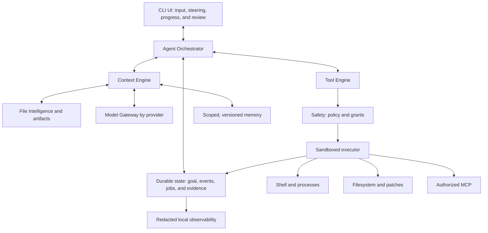

**DeepSeek Code — Harness, context, and developer experience**

Technical research performed on **October 10, 2026**, addressed to Marcelo. English translation of the original report; headings follow the requested structure. The subject is observable whole-system capability, without accessing private model reasoning. Statements about the checkout and unchanged product code describe the research snapshot, not subsequent implementation work; see [the implementation audit](implementation-audit-2026-10-11.md) for later changes.

## How to interpret this report

**FACT** describes an observation from code/documentation or a study result. **EVIDENCE** identifies the source and observation scope. **HYPOTHESIS** expresses an explanation not yet established. **RECOMMENDATION** proposes a DeepSeek Code decision; it does not imply a measured improvement.

Severity: **S0** cosmetic; **S1** minor friction; **S2** noticeable degradation; **S3** substantial degradation; **S4** can derail the entire task; **S5** security or data loss. Evidence: **A** relevant reproducible experiment with explicit scope; **B** multiple independent reports/sources; **C** architectural inference or code inspection; **D** hypothesis requiring a test. An A-level mechanical experiment does not make an LLM-quality improvement claim A-level evidence.

Idea classifications: **BEST PRACTICE** addresses a known requirement/invariant; **INTERESTING IDEA** has a plausible mechanism requiring local evaluation; **QUESTIONABLE** relies on a fragile assumption; **LEGACY DECISION** belongs to an earlier version/product; **WORKAROUND** bypasses a limitation; **ANTI-PATTERN** violates a necessary contract.

The work combines documentary research, open implementation reading, issues/PRs/discussions, and checkout inspection. Reports are investigation signals: issue counts do not measure incidence, popularity, or relative quality. Result comparisons are treated as harness evidence only when models, tasks, and conditions are comparable. Sources are summarized; proposed engineering is identified separately.

**Verified local baseline:** `@hermenics/deepseek-code`, version **0.12.0**, commit `84d8509274e030b78f5880adf5da9bdb6207be82`. The briefing mentions 0.11.0; the inspected checkout takes precedence for recommendations. Names v0.1/v0.5 denote conceptual maturity stages, not a proposal to roll release numbering backward. The observed package is scoped; installation guidance must name the published package rather than assume unscoped `deepseek-code` exists. [package.json](/home/marcelo/deepseek-code/package.json:2).

The deliverable is research and a reference specification. An A/B benchmark was designed with a manifest; no LLM benchmark ran during this research. Nine deterministic experiments used real helpers and temporary fixtures. Product code, tests, and eval fixtures were unchanged at the research stage.

# 1. Executive Summary

The central hypothesis is **supported, with limits**: tools, observations, navigation, and context management can substantially change outcomes for the same LLM. This does not erase model capability differences or establish a universal percentage of intelligence attributable to a harness. Comparable ablations and reproducible mechanical failures provide the most useful evidence; cross-product rankings with different models/configurations do not. Quantitative comparisons and their denominators are in section 19.

The principal recommended investment is a **state and evidence contract**: every result states where it was produced, which version it read, whether it completed, what error occurred, what was omitted, and how to recover the rest. Every change identifies before/after versions; every verification identifies the patch it validated. Every authorization has a scope. Every summary preserves requirements and references recoverable evidence.

DeepSeek Code already has important components: paginated reads, unique patches preserving CRLF, atomic writes, micro-compaction, structured summaries, LSP, memory, sessions, tasks, checkpoints, risk rules, and bubblewrap for contextual shell execution. The potential advantage comes from **making these components agree on identity, scope, and version**, rather than adding another agent, indexer, or enormous prompt.

Immediate inspection-derived priorities: distinguish empty from nonexistent files in rollback; preserve recoverable evidence after truncation/compaction; cap reads by bytes/tokens as well as lines; verify read versions before mutation; load hierarchical instructions for the target file; clarify host/sandbox paths; preserve completion and cancellation as separate states; and evaluate permissions/resume through tests exercising those flows. These are research recommendations, not fixes applied during the research stage.

A pleasant interface can expose actions clearly: show state and brief milestones, keep complete logs accessible, provide predictable interruption, and finish with changes/tests/limitations. Autonomy should depend on effects and authorized scope, backed by real isolation. Asking for every read disrupts flow; executing arbitrary content with production credentials undermines safety.

There is insufficient evidence for a universal ideal tool count, token window, cheap summarization model, percentage improvement from LSP, or guaranteed thirty-second understanding of a million-line repository. This report proposes mechanisms and experiments to establish those boundaries in the product.

# 2. The AI Coding CLI Landscape

Compare **mechanisms and contracts**, not brand impressions. Local CLIs, editors, cloud services, and desktop applications observe different environments. Editor autocomplete is not the same workload as autonomous issue resolution; a reproducible remote environment does not measure every shell difficulty on a laptop.

## 2.1 Open cores and proprietary tooling

| Tool | Inspected code | Useful mechanism | Risk or boundary | Classification |
|---|---|---|---|---|
| Codex CLI | Rust: compaction, execution buffers, apply-patch, MCP truncation | Reconstructed context state, persistent execution, partial patch deltas | Nested caps can hide data; process pruning; MCP previews lose structure | BEST PRACTICE for metadata; QUESTIONABLE for fallback without recoverable semantics |
| Claude Code | Public README/changelog, official docs, issues with logs | Compaction, isolated subagent context, disk outputs, permissions plus sandbox | Main harness absent from the inspected tree; failure/resume signals may disagree | INTERESTING IDEA; evaluate observable facts without pretending to access proprietary code |
| Gemini CLI | TypeScript: compression, context processors, shell, edit | Reverse-budget allocation for tool responses; summary followed by review; controlled fuzzy matching | Loop guards do not preserve state; summarizers can lose information | BEST PRACTICE for caps; INTERESTING IDEA for review; QUESTIONABLE for indiscriminate fuzzy matching |
| Aider | Python: repo map, edit blocks, history, base coder | Ranked structural map; small text edits; bounded reflection | Ranking can miss rare dependencies; file fallback can broaden the target; recursive summaries | INTERESTING IDEA for navigation; WORKAROUND for edit tolerance |
| OpenCode | TypeScript/Effect: v2 architecture, compaction, shell/edit plugins | Retained recent window; bounded reduction retries; locked, unique edits | Native provider features require provenance; plugins can break formats | BEST PRACTICE for states; QUESTIONABLE for cosmetic-only validation |

These cells summarize section 18 inspection, not overall quality rankings. Evidence does not establish which of these five achieves the highest DeepSeek success rate; that requires identical model, task, snapshot, tools, and budget. The comparable property here is **contract engineering**: what information a tool returns, what survives compression, and how the runner recognizes completion, blocking, or an unproductive attempt.

## 2.2 Editors, extensions, cloud, and desktop

The following rows summarize detailed, cited evidence in section 18. They are not executed product tests.

| Tool/surface | Decision worth studying | Main boundary | Classification |
|---|---|---|---|
| Cursor | Separate sandbox, approval, and automatic review; readable policies | A classifier does not contain processes; terminal completion may be ambiguous | BEST PRACTICE for separation; QUESTIONABLE for trust without enforcement |
| Windsurf / Devin Desktop | Plans/worktrees and category policies in the current flow | Cascade and migration documentation give inconsistent lifecycle information | INTERESTING IDEA; LEGACY DECISION for older policies |
| Cline | Category approvals, terminal event parser, clipboard timeout | Model-generated risk flags and awaiting-approval UI need an enforced lower boundary | INTERESTING IDEA; QUESTIONABLE for a flag as the sole gate |
| Roo Code | Published installer-approval and symlink regressions | A historical advisory does not prove another release vulnerable; repository archived | BEST PRACTICE for configuration-migration lessons; LEGACY DECISION for current adoption |
| Continue | Static/dynamic policies and headless execution | Documentation/code discrepancies and Bash-enabled modes must not be called read-only based on their names | QUESTIONABLE until the effective executor is traced |
| Copilot CLI | Platform-specific cancel/queue/rollback and sandbox descriptions | Contradictory rewind docs; identical approval does not have identical host coverage | INTERESTING IDEA; require contract tests |
| Copilot coding/cloud agent | Remote environments, firewall, and CI execution gates | The firewall does not cover every route; CI convenience has authorization costs | BEST PRACTICE for explicit scope, without equating it to a local sandbox |
| Amazon Q Developer CLI / Kiro CLI | Product migration, deny/ask/allow policies, paste/session IDs | Attribute current defaults/fixes to the correct product/version | INTERESTING IDEA; LEGACY DECISION for older Q versions |

SWE-agent, Agentless, and Terminus 2 are interface/scaffold and evaluation references, not universal winners for everyday UX. Their results/conditions appear in sections 13/19. No evidence here establishes a current model as best in a particular product without controlled testing.

## 2.3 Listening to users without turning opinion into causation

**EVIDENCE/C.** A Hacker News thread collects conflicting reports about compaction and transcript recovery: some people report loss; others say it works in their workflows. The DOM example author also authored the GitHub request discussed in section 18; this post is not independent confirmation of the same incident. [Compaction discussion](https://news.ycombinator.com/item?id=47096210).

**EVIDENCE/C; cause D.** In another discussion, an author describes threshold-based summarization, while participants discuss loops and lost access to older outputs. These are experience/design reports, not controlled ablations or universal thresholds. The lesson to test is continuity through recoverable references. [Building a coding agent in Swift](https://news.ycombinator.com/item?id=47515605).

Community sources provide triggers, environments, and counterexamples for fixtures. Prioritize logs, versions, reproductions, and maintainer responses. A popular thread without a denominator does not measure incidence; cross-promotion is not an independent study. Interviews/videos were not used as technical support because decisive mechanisms were established through code/docs/papers and verifiable written reports.

# 3. Why The Same Model Performs Differently Across Agents

## 3.1 Working causal model

An agent produces actions from **model + instructions + observations + capabilities + executable state**. Each iteration, the harness chooses the observation distribution, available tools, and representation of earlier effects in the next input. A small change can remove a necessary premise, introduce a false premise, or prevent the correct action. A model can choose rationally among options its environment represented incorrectly.

For example, a build fails because of a missing dependency in the middle of a log. The harness returns the beginning/end but omits the cause. The LLM keeps modifying application code; the apparent debugging failure begins with observability. Alternatively, compiler diagnostics describe v1, a patch has produced v2, and the agent believes the same errors remain. Apparently foolish repetition can arise from missing version identity.

This does not prove every failure environmental. Even with correct observations, working tools, adequate tests, and sufficient time, a model can choose wrong abstractions, misunderstand concurrency, omit a requirement, or invent an API. Eliminate discriminating environmental explanations before attributing the remaining cause to the model.

## 3.2 Separating the eleven requested failure classes

| Class | Discriminating signal | Evidence to collect | Engineering response |
|---|---|---|---|
| Intrinsic model limitation | Failure persists with complete observations and a simple interface | Controlled replay and a human reference | Replace/escalate the model, decompose, expand verification |
| Harness/agent | An action/result disappears or changes meaning in the loop | Call traces and actually transmitted items | Event and transition contracts |
| Context | A necessary premise is missing, stale, or contradictory | Context manifest, versions, compaction diff | Requirement/provenance retention and re-reading |
| Tools | A correct API returns ambiguity or an uncategorized error | Arguments, schema, status, tool tests | Small schemas, recoverable errors, structured output |
| Terminal | Progress/ANSI/CR/width transforms observations | Bytes and normalized streams | Incremental parser and default noninteractive execution |
| Filesystem | A read/edit targets the wrong checkout/path | Realpath, repo, worktree, inode/hash | Workspace identity and executor validation |
| UX | An interruption/denial/choice is not incorporated | Input events and turn state | Explicit steering, cancel, and queue semantics |
| Architecture | Subsystems retain conflicting state | Correlation by task/session/version | Authoritative state and projections |
| Security | Untrusted data gains authority | Provenance and granted capabilities | Trust separation and sandboxing |
| Performance | Savings change evidence/model/scope | Quality/latency/cost ablations | Pareto optimization, not tokens alone |
| Implementation detail | A Unicode/CRLF/exit-status boundary breaks the task | Minimal reproducible fixture | Contract test and shared correction |

## 3.3 Mechanical evidence from the inspected checkout

Experiments ran with Bun **1.3.13** in a temporary directory, using the actual named modules. The accompanying script accepts the checkout path. PASS_EXECUTED means the mechanical assertion was confirmed, not that undesirable behavior is acceptable or an LLM-quality metric improved.

| ID | Executed observation | Interpretation and scope |
|---|---|---|
| L1 | A 4,019-character output with a middle cause becomes 1,104 characters under a nominal 1,000 limit; the cause disappears and the notice remains | Head/tail improves on head-only for some logs but still loses middle causes; the notice exceeds the content allowance |
| L2 | A single-line file containing 1,000,000 characters returns 1,000,087 | A 500-line limit alone does not bound volume; no OOM measurement or model call |
| L3 | Loader returns only AGENTS.md from the supplied cwd, without combining ancestors | Confirms that function's contract; initialization uses the workspace, not each target |
| L4 | keepLastN=1 removes an older read marked as an active constraint and retains a recent irrelevant read | Micro-compaction ranks by recency/type, not semantic importance; LLM decisions were not measured |
| L5 | An export in one /bin/sh is absent in the next subprocess | Platform experiment consistent with isolated commands; not a bug if isolation is the stated contract |
| L6 | Patch accepts an LF snippet in a CRLF file and refuses duplicate matches without writing | Two existing robust behaviors to preserve |
| L7 | A unique-substring patch is accepted after a premise on another line changes | Protects the target fragment but lacks a whole-file version precondition; not proof of a data-loss race |
| L8 | Final stdout→stderr concatenation changes before,middle,after to before,after,middle | Representation loses original order; separate streams also do not establish perfect causal ordering |
| L9 | A UTF-16 cut splits an emoji surrogate pair | Incremental decoding and valid-boundary cuts are needed; no LLM-quality gain is promised |

Local sources: [shell and truncation](/home/marcelo/deepseek-code/src/tools/Shell/Shell.ts:295), [ReadFile](/home/marcelo/deepseek-code/src/tools/ReadFile/ReadFile.ts:46), [instructions](/home/marcelo/deepseek-code/src/agent/steering.ts:43), [micro-compaction](/home/marcelo/deepseek-code/src/services/compact/microCompact.ts:72), [patch](/home/marcelo/deepseek-code/src/tools/PatchFile/PatchFile.ts:77). Complete results: local-experiments.json.

**Additional integrity finding, C/PASS_DERIVED:** createFileCheckpoint saves empty content for both an empty file and any read failure; rollbackLast/rollbackAll delete the target when its backup is empty. Thus the format cannot distinguish an existing empty file from a nonexistent file. Rollback also does not compare the post-patch hash before restoring. This warrants **S5/P0**: record existed, treat only ENOENT as absence, preserve other errors, and verify ownership/version before undo. No rollback was executed against the user's real history. [fileCheckpoint.ts](/home/marcelo/deepseek-code/src/agent/fileCheckpoint.ts:70).

# 4. Death by a Thousand Cuts

There are **64 distinct details**. Why it seems small identifies the temptation to ignore each one; how it harms describes a mechanism, not a measured percentage loss. Severity is potential and task-dependent. C denotes engineering inference; quantitative LLM impact remains D unless supported by a specific section 19 study. L marks mechanics reproduced during this research (section 3.3), not an intelligence ablation. The tests below are proposed contracts/experiments except for the executed L cases.

| ID / detail | Why it seems small | How it harms the model/agent | Severity / evidence | Correction | Test |
|---|---|---|---|---|---|
| C01 — Original objective removed | The latest message seems sufficient | Completes a subtask and declares the larger task done | S4/C | Retain the objective, criteria, and scope changes | A long session with ten subtasks; check every final requirement |
| C02 — Critical premise appears only in the middle | Everything is technically in the prompt | Information competes with distractions; retrieval can fail | S3/C; ablations §19 | Recover the relevant passage near the decision without copying the entire history | Vary the position of the same premise at a controlled length |
| C03 — Duplicate rule | Repetition seems reinforcing | Consumes budget and can favor an obsolete rule | S2/C | Deduplicate by origin/version; retain explicit priority | Inject repeated versions and inspect conflict resolution |
| C04 — Conflicting rules without scope | They are just two texts | Applies a frontend rule to the backend | S4/C | Instructions bound to root, target, and precedence | Different rules in two packages; edit both |
| C05 — Summary becomes fact | It seems convenient memory | An old hypothesis gains authority and guides the wrong patch | S4/C | Retain observed/hypothesis status and references | Compact a refuted hypothesis; check that it remains refuted |
| C06 — Reads removed by recency | It was read-only | An active constraint disappears while a recent useless read remains | S4/A mechanics L4; impact D | Pin requirements and retain recoverable references | An old decisive constraint among many recent irrelevant reads |
| C07 — Duplicate schemas after refresh | Reloading is normal | Two tool versions remain available simultaneously | S3/C | Versioned registry and atomic replacement | Change an MCP schema during a session; inspect transmitted tools |
| C08 — Summary lacks process IDs | IDs seem operational details | Restarts a live job or waits for a dead job | S4/C | Preserve handles and revalidate liveness | Compact with a background build; resume without duplication |
| C09 — Tokens estimated as chars/4 | It is a cheap approximation | Unicode/JSON/code exceeds the window, forcing late cuts | S4/C | Provider-aware counting with calibrated margins | Multilingual and dense strings; compare actual usage |
| C10 — Instructions discovered only at cwd | The root is the project | Misses target-package or ancestor rules | S4/A mechanics L3 | Hierarchical discovery for the target path | Root/subpackage/worktree with three rules |
| C11 — Generic tool names | The description will explain | Vague semantics lead to the wrong operation | S2/C | Action names and descriptions of effects/boundaries | Two definitions of the same tool; equivalent blinded tasks |
| C12 — Implicit optional parameters | Defaults save text | cwd or mode differs from model assumptions | S3/C | Explicit defaults in schemas and results | Omit the parameter and inspect reported effective scope |
| C13 — Entire catalog always included | Discovery seems expensive | More schemas compete for context | S2/D | Small core and deterministic discovery | Vary catalog size with a fixed task; measure selection/cost |
| C14 — Schema differs from executor | It is just documentation | A schema-valid call is rejected by implementation | S4/C | One source of truth and input validation | Generate schema cases, execute, compare contracts |
| C15 — Error text without status | A human understands Error | The agent confuses failure with a normal result | S4/C | Envelope with error.kind/status/retryable | Fail the tool; the model must not claim completion |
| C16 — Missing output means success | Nothing was printed | A live process or broken channel becomes a pass | S4/C | Separate running/completed/unknown states | A pending silent command and a completed silent command |
| C17 — Head-only build output | The first bytes seem useful | Final diagnostics/verdict disappear | S4/C | Error-based selection and tail with an artifact | Final error after thousands of progress lines |
| C18 — Head/tail discards the middle | It seems to solve truncation | Middle causes disappear; retries lack evidence | S4/A mechanics L1 | Preserve causes/context and a recoverable log | Move the error to the beginning, middle, and end |
| C19 — Unbounded single-line JSON | It counts as one line | A result can contain millions of characters; final request insertion was not measured | S4/A mechanics L2; impact D | Cumulative byte/token/line limits | Minified 1MB file and batched reads |
| C20 — Truncation notice without recovery | Knowing it was cut seems enough | The agent must repeat an expensive/dangerous command | S3/C | Artifact ID, omitted ranges, search/read | Find the cause in the original log without reexecution |
| C21 — Per-tool budget without batch budget | Each output is small | Ten simultaneous outputs exceed the combined allowance | S4/C | Aggregate per-turn budget and group identity | Twenty batched reads; check the ceiling and recovery |
| C22 — Raw ANSI returned | It is just color | Terminal controls pollute or alter observations/rendering | S2/C | Incremental normalization and sanitized UI | Split SGR/OSC across chunks without losing text |
| C23 — CR treated as newline | Both move the cursor | Repeated progress consumes thousands of tokens | S2/C | Coalesce updates while preserving stable lines | Spinner/progress bar with carriage returns; compare final capture |
| C24 — ANSI stripped per chunk | Regex works on examples | Split sequences survive or remove legitimate text | S3/C | A parser retaining state across chunks | Split each sequence at every possible boundary |
| C25 — Arbitrary UTF-16/byte cuts | A limit is just a number | Broken emoji/UTF-8 makes passages or paths unreadable | S2/A mechanics L9 | Incremental decoding and valid Unicode boundaries | CJK, emoji, combining accents at the cut boundary |
| C26 — Unexpected PTY width | Width seems visual | Wrapping breaks URLs, stack traces, and parsers | S3/C | Default pipes and declared PTY width | Same command at 40/80/160 columns |
| C27 — stdout followed by stderr | Each buffer is complete | The log's causal narrative is reversed | S3/A mechanics L8 | Events with channel/sequence; do not invent causal order | Alternating writes; inspect observed collector order |
| C28 — Buffering without visible state | The process is working | The agent assumes a hang and kills useful work | S3/C | Handle/liveness and a heartbeat without invented progress | A buffered process, silent but alive |
| C29 — TTY enabled for every command | It seems extra compatibility | Commands prompt for input or animate | S3/C | PTY only when interaction is necessary | Installation/tests in pipes and PTY with timeout |
| C30 — export/cd assumes persistence | The shell is a terminal | The next command uses an old environment/directory | S4/A mechanics L5 | Explicit isolation contract; cwd/env per call | cd/source/export followed by another execution |
| C31 — Untranslated host=/mnt namespace | Both point to the project | Diagnostic paths become nonexistent files for file tools | S4/C; local code | Bidirectional translation in the executor | /mnt stack trace and host read, including symlinks |
| C32 — Wrong branch/repository | File names match | Fixes a checkout different from the tested one | S4/C | Repo/worktree identity in every result | Two clones/branches; tests must reference the edited one |
| C33 — Ignore rules confused with sandboxing | Do not read .env seems protective | Shell/runtime reads and transmits through another route | S5/C | Isolation and egress controls; ignore only for navigation | Defensive boundary test using synthetic secrets |
| C34 — Wrong PATH binary | Its name matches | Version/venv/SDK differs from the project | S4/C | Executable provenance and relevant versions | Two SDKs/venvs with the same controlled task |
| C35 — Lost venv activation | Running source seems sufficient | Installs packages or tests in the wrong environment | S4/C | Absolute venv executable per job | Two Python environments with incompatible dependencies |
| C36 — Environment scrubbing removes a requirement | Removing variables seems purely protective | The build loses a required public variable | S3/C | Categorized allowlist and opaque secret references | Build requires a non-secret variable; model key is absent |
| C37 — Implicit cloud region/profile | The user already configured it | Operates in the wrong account/cluster | S5/C | Identity and destination before plan/apply | Two fake accounts; plan bound to the destination |
| C38 — Login shell loads local code | It helps find tools | Startup files modify aliases/cwd or execute side effects | S4/C | Predictable execution and controlled detection | A startup fixture alters a command; disclose/forbid according to mode |
| C39 — Substring matching misses a stale file | The target still matches | Adjacent assumptions changed after the read | S4/A mechanics L7 | Hash/base version and reading the affected unit | Same target with a changed neighboring type/contract |
| C40 — Ambiguous replacement accepted | The first match seems enough | Edits another same-named handler | S4/C | Require uniqueness and sufficient context | Two identical blocks with different callers |
| C41 — Silent newline/CRLF normalization | Code still compiles | Whole-file diffs/formatter churn obscure verification | S2/C; L6 tests existing protection | Preserve EOL and disclose transformations | CRLF, missing final newline, mixed EOL |
| C42 — Whole-file rewrite for convenience | One output seems simpler | Removes comments, exports, and user work | S4/C | Minimal patches, preview, and base version | Small change in a file with external edits |
| C43 — Rename using grep alone | Text replacement seems a refactor | Touches strings/overloads and misses semantic references | S4/C | LSP/AST when available; verified fallback | Same name in distinct scopes and dynamic reflection |
| C44 — Tests validated an earlier patch | Green is green | Claims v2 success using v1 results | S4/C | Bind results to input digests | Edit after green; success must invalidate |
| C45 — Empty tests exit zero | The command passed | No tests becomes correctness evidence | S4/C | Explicit count, scope, and expectations | An unmatched filter must not verify the task |
| C46 — Retry without a new hypothesis | Trying again is cheap | Repeats an invalid patch and consumes budget | S3/C | Categorized errors, progress, circuit breaker | Same deterministic failure in three calls |
| C47 — Retry duplicates a side effect | HTTP seems transient | Creates two operations after an ambiguous timeout | S5/C | Idempotency or state queries | Lost response after a fake external commit |
| C48 — Kill only the parent | Kill seems final | A child keeps a lock/port and contaminates the next attempt | S4/C | Process group/tree termination and reaping | Fixture with a child; cancellation frees its resource |
| C49 — Budget expires without partial state | It seems operational only | Completed work disappears and is repeated next session | S3/C | Durable checkpoint and inconclusive result | Timeout between edit/test; resume revalidates |
| C50 — Resume restores conversation only | The chat is complete | Files/branch/jobs changed; assumptions are stale | S4/C | Revalidate workspace and tools | Close, change branch/file, resume |
| C51 — Empty checkpoint means nonexistent | It is an economical representation | Undo deletes an existing empty file | S5/C; derived from code | An existed field and distinct read errors | Empty file→edit→undo must leave it existing |
| C52 — Undo does not check human edits | The backup seems authoritative | Restore overwrites later user work | S5/C | Compare current version with agent post-patch version | User edits after the agent; undo must report conflict |
| C53 — New messages automatically cancel everything | It simplifies control | A status question kills a useful build/transaction | S3/C | Distinguish steering, queue, and cancel | Ask for status during a job; it must remain alive |
| C54 — Cancel only the model | UI streaming stopped | A pending tool keeps writing after stopped | S5/C | Executor abort and pre-commit protection | Cancel between staging and fixture rename |
| C55 — Permission errors become model refusals | One message seems enough | The agent changes strategy without understanding the boundary | S3/C | Reason/policy/destination and available alternatives | Deny network; perform an independent local read |
| C56 — Ask continue for an obvious dependency | It seems polite | Fragments execution, creates waits, loses context | S2/D | Consent by objective/effect without ritual | Task authorizes fix plus test; count unnecessary prompts |
| C57 — Package lifecycle runs outside containment | Installation is routine | Third-party content executes with credentials | S5/C | Preview lockfiles/scripts and isolate execution | Harmless fixture package writes a marker outside scope |
| C58 — Remote content becomes privileged instructions | Markdown sounds normative | Data changes the objective or broadens authority | S5/C | Provenance and executor permissions | Synthetic document requests an unrelated action; tool blocks it |
| C59 — Redaction only in the UI | The user cannot see the secret | A key already entered a request/cache/trace | S5/C | Redact before model requests and all persistence | Synthetic canary; inspect controlled local sinks |
| C60 — Prefix grants without effect checks | npm/test seems safe | Project scripts can access networks/production | S5/C | Effective capabilities, sandboxing, script identity | Change a script after a grant; approval must invalidate |
| C61 — Path-only cache keys | A name seems sufficient identity | A v1 result is reused for v2 | S4/C | Keys based on hashes and relevant environment/configuration | Edit without renaming; cache must not return v1 |
| C62 — Cheap model summarizes critical facts | A summary is just compression | Reverses requirements/denials and contaminates the stronger model | S4/D | Validated summary contract and fallback | Summaries with negations, paths, and an unresolved error |
| C63 — Usage ignores subagents/retries | Only the final message exists | Optimization appears cheaper than it is | S3/C | Count every attempt and delegation | Failed run plus subagent; reconcile provider totals |
| C64 — Success telemetry uses the final response | The model said it finished | The metric rewards false completion | S4/C | External checker and human acceptance/regression review | Model finishes without a patch; completion must be false |

The first inexpensive remedies need no embeddings: identity, status, aggregate limits, recoverable artifacts, uniqueness, and versioning. A detail can be S1 in a trivial task and S4 in a long monorepo session. Do not use severity as a universal cross-product ranking.

# 5. Intelligence Multipliers

There are **36 proposed improvements**. Multiplier is a product metaphor, not a measured numerical factor. BEST PRACTICE identifies reliability invariants; incremental DeepSeek Code success gains require section 19 controlled evaluation. Each item is small enough for its own ablation.

| ID | Improvement and mechanism | Evidence/classification | Useful metric |
|---|---|---|---|
| M01 | Context manifest records origin, version, scope, and inclusion reason | C/BEST PRACTICE | Correct-evidence diagnostics and stale-observation rate |
| M02 | Pinned objective/acceptance criteria survive compaction | C/BEST PRACTICE | Final requirements actually satisfied |
| M03 | Keep contradictions as contradictions without silently erasing earlier versions | C/BEST PRACTICE | Use of a previously refuted hypothesis |
| M04 | Reads return content hashes and exact ranges | C/BEST PRACTICE | Stale-base writes and useful re-reads |
| M05 | Patches require a base version or confirm the fragment and affected dependencies | C/BEST PRACTICE | Incorrect patches accepted; conflicts recovered |
| M06 | Shell results separate exit code, signal, timeout, and state | C/BEST PRACTICE | False success after abnormal termination |
| M07 | Complete logs remain recoverable under a small observation budget | C/BEST PRACTICE | Diagnosis per token without reexecution |
| M08 | Error extraction preserves nearby context/causal chains rather than only matching ERROR | D/INTERESTING IDEA | Root-cause recall versus noise |
| M09 | Incremental terminal normalization coalesces animations | C/BEST PRACTICE | Redundant bytes and text corruption |
| M10 | Every execution identifies cwd/worktree/host paths | C/BEST PRACTICE | Wrong-repository actions |
| M11 | Minimal probes identify the task's package manager, lockfile, and runtime | C/BEST PRACTICE | Environment failures and bootstrap time |
| M12 | Target-path instructions with explicit priority | C/BEST PRACTICE | Compliance in nested packages |
| M13 | Fast lexical search before broad reading | C/BEST PRACTICE; ablation §19 | Irrelevant files read per solved task |
| M14 | Search results grouped by file/symbol with continuation | C/BEST PRACTICE | Calls needed to locate the correct implementation |
| M15 | LSP disambiguates definitions/references when text is insufficient | D/INTERESTING IDEA | Caller recall and correct refactors |
| M16 | Diagnostics identify document versions and workspace identity | C/BEST PRACTICE | Fixes based on obsolete errors |
| M17 | AST returns a syntax unit with a range, not the entire tree | D/INTERESTING IDEA | Tokens needed to understand a function and context coverage |
| M18 | An existing package graph guides affected tests | C/BEST PRACTICE | Dependent regressions and total time |
| M19 | Tool schemas describe limits and failure recovery | C/BEST PRACTICE | Valid first calls and useful retries |
| M20 | Incremental discovery with a versioned tool catalog | D/INTERESTING IDEA | Tool selection, schema cost, miss rate |
| M21 | Verification records patch digests and actual coverage | C/BEST PRACTICE | Valid green results for final state |
| M22 | Retries require a transient error class or an explicit new strategy | C/BEST PRACTICE | Repeated errors without progress |
| M23 | Async jobs return queryable, cancelable handles | C/BEST PRACTICE | Duplicate/orphan jobs and correct completion |
| M24 | Resume reentry checks branch, dirty files, and jobs | C/BEST PRACTICE | Recovery after external changes |
| M25 | Undo restores only changes identified as agent-owned | C/BEST PRACTICE | Preserved human edits |
| M26 | Sandbox supports fluid local work with network/secrets separated | C/BEST PRACTICE | Unnecessary prompts and boundary violations |
| M27 | Grants bind destination, relevant content/configuration, and duration | C/BEST PRACTICE | Approval reuse for different effects |
| M28 | Steering becomes an event with objective revision | C/BEST PRACTICE | User corrections incorporated without restart |
| M29 | Parallel reads have quotas; writes have ownership | C/BEST PRACTICE | Stale merges, waiting, tokens per success |
| M30 | Subagents receive short contracts and return evidence/locations | D/INTERESTING IDEA | Cost and correctness versus one agent |
| M31 | Routing retains a strong arbiter and verified facts | D/INTERESTING IDEA | Net cost gains without inferior quality |
| M32 | Stable prompt caching without freezing mutable observations | C/BEST PRACTICE | Cache hits, latency, stale answers |
| M33 | Project memory has provenance/validity and a forgetting option | C/BEST PRACTICE | Correct preferences and obsolete memory applied |
| M34 | Completion criteria use checkers/artifacts rather than self-assessment | C/BEST PRACTICE | Actual completion rate |
| M35 | Local traces show context/transformations without secrets or chain of thought | C/BEST PRACTICE | Time needed to explain a failure |
| M36 | Same-LLM A/B with identical fixtures tests improvements against placebo | C method/BEST PRACTICE; evaluation unexecuted | Paired deltas, confidence intervals, category regressions |

# 6. Context Engineering

**Scope and status.** These notes were produced on October 10, 2026 for the DeepSeek Code report. FACT denotes local code observations; EVIDENCE denotes published results; HYPOTHESIS denotes mechanisms to test; RECOMMENDATION denotes proposed engineering. Grade A means strong empirical evidence within the evaluated design; B, convergent reports or an observational study; C, architecture, documentation, or a case study; D, an unmeasured hypothesis. A corporate before/after publication remains a corporate report when its protocol/audit data are unavailable.

**EVIDENCE A.** Lost in the Middle, published in TACL in 2024, varies evidence position in document-question-answering and key–value retrieval tasks. Accuracy can decline when relevant information appears in the middle. This establishes position sensitivity in those tasks/models, not a universal token limit for 2026 models. [Lost in the Middle](https://aclanthology.org/2024.tacl-1.9/).

**EVIDENCE A.** RULER v2, dated April 11, 2024, evaluates ten models on thirteen synthetic tasks, including retrieval, chaining, and aggregation. Good simple-retrieval performance does not guarantee good results on more complex operations as context grows. Do not confuse this version with later repository results using a larger cohort. [RULER v2](https://arxiv.org/html/2404.06654v2).

**EVIDENCE A.** NoLiMa, in the inspected ICML 2025 version, reduces literal overlap between a question and the needed information. Among twelve models advertising at least 128k windows, ten fall to half or less of short-context performance at 32k. The observed effect combines semantic-association retrieval difficulty with length. Finding an exact error string and relating a policy to behavior are different abilities. [NoLiMa](https://arxiv.org/html/2502.05167v2).

**EVIDENCE B.** The corporate Context Rot report of July 14, 2025 examines eighteen models, including GPT-4.1, Claude 4, Gemini 2.5, and Qwen3 families, with varied tasks/distractors. Window utilization is not uniform. Its authors warn that not all eighteen models participate in every experiment because of window/budget limits. Context rot describes experimental behavior, not every long conversation or a universal degradation function. [Context Rot](https://www.trychroma.com/research/context-rot).

**RECOMMENDATION.** Separate three often-conflated questions: does information fit in the request, is it accessible to the model, and does it help the next decision? Fitting is a protocol/budget property. Accessibility requires preserving content, references, and position. Usefulness requires a task connection. A 200k-token file can contain many necessary contracts; a 5k output can repeat hundreds of useless warnings. The harness should supply sufficient evidence for a correct decision while retaining recovery paths for the rest.

Context for fixing a function should include the motivating contract, current fragment, relevant callers, directory restrictions, reproduced result, and evidence that could invalidate the current hypothesis. It need not contain the whole repository. Cross-package defects require a larger sufficient set. Blind context reduction merely substitutes omission for distraction.

**RECOMMENDATION.** Use progressive loading with verifiable identifiers. The first layer gives path, size, language, symbols, and a short description. The second supplies the needed fragment with lines/revision. The third expands surroundings, callers, or tests. References must still identify the correct state after edits; line numbers alone age. Content hashes, Git revisions, and file generations detect stale observations without resending all bytes every turn.

**EVIDENCE C.** The corporate Effective Context Engineering guidance of September 29, 2025 recommends iterative curation of instructions, schemas, history, and data through lightweight references and just-in-time recovery. It offers a useful architectural pattern, not an optimal prompt size automatically transferable to DeepSeek Code. [Effective Context Engineering](https://www.anthropic.com/engineering/effective-context-engineering-for-ai-agents).

Summarization recommendations need a contract for what must survive. An operational summary retains objectives, decisions, restrictions, executed results, pending work, and artifact references. Repetitive logs can be discarded; denied authorization or a process finishing without writing cannot become redundant details. Reporting unknown is preferable to reconstructing a nonexistent result.

**EVIDENCE B.** On November 24, 2025, Anthropic reports dynamic tool discovery reducing definition tokens in an example and improving internal MCP evaluations: Opus 4 from 49% to 74%, Opus 4.5 from 79.5% to 88.1%. The article acknowledges an additional search call. These figures are not promises for every catalog; names, schemas, tasks, and search coverage matter. [Advanced Tool Use](https://www.anthropic.com/engineering/advanced-tool-use).

**HYPOTHESIS D.** A large DeepSeek Code catalog could hurt selection through semantic overlap or schema costs even below the maximum window. Test keeping a small essential core always visible while discovering specialized tools as needed. Negative outcomes include missing the correct tool or spending more on the extra turn than discovery saves. No consulted source establishes a universal magic tool count.

Truncation must disclose loss, omitted bytes/lines, recovery locations, and applied limits. Head/tail supports quick diagnosis but does not necessarily preserve middle errors, lines between blocks, or temporal order. A summary plus a persisted complete output is preferable to an incomplete representation presented as complete. The system must confirm persistence before exposing its reference.

# 7. Tool Engineering

## 7.1 Tools are part of the cognitive interface

**RECOMMENDATION/C, BEST PRACTICE:** design tools as observable operations: search, read, edit, execute, inspect_job, cancel_job. The catalog should describe effects, required authority, mutated state, and observation limits. A do-anything tool weakens guarantees; ten nearly identical tools increase ambiguity. Specialized tools are justified when they express guarantees generic shell cannot, such as unique versioned patches.

Names should identify verbs and objects. Small schemas, genuinely required fields, and explicit defaults prevent the LLM from guessing state. Descriptions need not teach a whole language; state when to use the tool, important errors, and recovery. Risk-changing properties—external destinations, destructive modes, cwd, replace-all—must be visible and executor-validated. A tool calling unrestricted Bash does not satisfy a read-only label.

**How many tools are too many?** This research establishes no universal number. Count, schema size, overlap, model, and task matter. Dozens can work; a few poorly specified tools can fail. Treat any ceiling as a hypothesis. Measure correct selection, incomplete discovery, and schema costs at 8/32/128/512 tools on identical tasks, without adding tools artificially favorable to one arm.

Lazy loading needs a stable lightweight catalog, names/provenance, deterministic search, and a schema matching the executed version. Retaining tools needed by an active task avoids prefix churn and surprise authorization. Hierarchical routing reduces context but adds a selection step that can discard the correct tool; record discovery misses. MCP is an integration transport/contract, not an automatic relevance, trust, or isolation mechanism (§14 and §22).

## 7.2 Results: useful representations depend on the task

| Representation | Useful for | Limit and handling |
|---|---|---|
| Raw text | Short code, readable stderr, README fragments | Bound bytes/tokens; identify origin/range |
| Valid JSON | Job state, API results, typed diagnostics | Never cut midway and present it as valid JSON; provide a separate preview |
| Minified JSON | Transport and persistence | Saves whitespace but hurts human scanning; does not guarantee token savings |
| Indented JSON | Debugging small structures | Tolerable overhead; avoid repeating schemas in every response |
| Table | Comparable file/test summaries | Preserve original types/IDs; disclose cell truncation |
| LLM summary | Long heterogeneous narratives | Lossy; retain originals, state outside summaries, and evidence references |
| Deterministic extraction | Recognized build/test/diagnostic formats | Do not select only ERROR; retain causal warnings and fallback |

An execution producing 30,000 lines should write a **bounded recoverable local artifact** and return state, verdict, counts, diagnostics, samples, and a log reference. Re-reading the relevant range beats repeating installation/deployment merely to recover stdout. Disk is finite too: use session quotas, backpressure/rotation, and an explicit failed-evidence retention policy.

Format adapters help when they reduce loss rather than reimplement every CLI. Start with JSON/JUnit/SARIF and stable project patterns, keeping a line-based fallback. Every adapter must disclose what it extracted and what it did not interpret.

| Ecosystem | Priority result | Trap to cover |
|---|---|---|
| npm/pip/install | Exit, package/lock diff, executed scripts, relevant advisory | Progress/informational text consumes space; lifecycle scripts have side effects |
| Cargo | Structured diagnostics when available, plus target package | Warnings are not failures; build cache depends on flags/target |
| pytest | Primary failure, assertion, fixture traceback, summary, test count | Collection errors differ from failing tests; empty filters are not green |
| Maven/Gradle | Failed module/task, first cause, summary | Root errors can precede cascading module failures |
| Terraform | Diff/plan, workspace identity, controlled plan file | Output can contain sensitive data; apply depends on the approved plan |
| Docker/Kubernetes | Context/namespace/resource IDs and terminal state | Logs are not state; watch is persistent streaming |
| AWS CLI | Account/region identity, request IDs, relevant fields | Paginated/truncated responses do not prove a complete inventory |

Adapter classification: **INTERESTING IDEA/D** for incremental quality gains; state, secret, and pagination contracts are **BEST PRACTICE/C**. Validate each used version. No log heuristic should reclassify a nonzero exit as success.

# 8. Terminal & Shell Engineering

## 8.1 Separate human terminals, processes, and LLM observations

A terminal is a control/rendering protocol. Capturing bytes does not capture exactly what a human saw; removing colors does not interpret carriage returns/cursor movement. Retain protected raw capture and a derived text view disclosing transformations. The UI must stop untrusted output from manipulating titles, clipboard, links, or renderers. Model logs need not include spinners/repaints.

At the research snapshot, local shell execution concatenates stdout and stderr after completion, limiting output to 50,000 characters; execa buffers exist before that cut. Therefore a prompt cap is not automatically a RAM/capture cap. truncateShellOutput retains 60% head and 40% tail with a notice. This protects final verdicts, but L1/L8/L9 show limitations. [Shell.ts](/home/marcelo/deepseek-code/src/tools/Shell/Shell.ts:269), [constants](/home/marcelo/deepseek-code/src/constants/tools.ts:2).

Node documentation distinguishes buffer limits in **bytes** and warns about multibyte text and process termination on overflow. This supports separating capture from observation budgets; it does not describe the product's execa/Bun defaults. Do not transplant another API's default value. [Node child_process](https://nodejs.org/api/child_process.html#maxbuffer-and-unicode).

**RECOMMENDATION/C:** incremental streams carrying sequence, monotonicTime, channel, and chunk; stateful UTF-8 decoding; ANSI parsing; coalescing only recognized animations; retaining persistent lines. Sequence reflects collector arrival, not physical causality across streams. stderr alone does not imply failure. A nonzero exit can be normal operation semantics, such as grep finding no match; define this per operation rather than suppress failures generically.

## 8.2 Pipes and PTYs have different contracts

Pipes are the default for builds/tests/inventory: less animation, stable output, separate stdout/stderr. PTYs serve programs requiring terminal features, screen control, or TTY detection; some REPLs/prompts also work through pipes. PTYs may mix streams, change wrapping with width, require stdin lifecycle management, and alter application behavior. Report tty, rows/columns, shell, and stdin mode.

Carriage return visually replaces a line; backspace and CSI can move cursors. Sequences split across chunks require stateful parsing. Unicode bytes, code units, code points, and display widths differ; CJK, emoji, and composed graphemes need specific tests. Identify encoding or assume UTF-8 with visible errors; never silently replace bytes in code to be edited.

Do not force CI=true indiscriminately: it can change build branches, warnings-as-errors, and network behavior. Prefer officially supported noninteractive flags, NO_COLOR where compatible, and recorded environment changes. Do not change experimental semantics just to clean output visually.

## 8.3 Recommended shell-state model

| Model | Benefit | Risk | Recommended use |
|---|---|---|---|
| Isolated subprocess | Reproducibility; explicit cwd/env | cd/export/source do not persist | Default for tests/builds/finite operations |
| Persistent shell | Retains shell state and avoids repeated bootstrap | Aliases, traps, exports, cwd contaminate tasks | Opt-in inspectable interactive sessions |
| Persistent job/process | Retains a necessary server/REPL | Stale handles, stdin, orphan trees | Explicit job types with lifecycle controls |
| Container/remote executor | Predictable environment and external boundary | Different path namespaces, network, filesystem, credentials | User-selected environment with identity in every event |

The minimum solution is not a universal persistent shell. Isolated commands with **explicit environment overlays/cwd** address most false assumptions. Selecting venv/bin/python is more predictable than expecting source to persist. For Java/Node, identify the executable/version actually used rather than listing the entire PATH. Do not print secret variables to investigate environments.

Canonicalize cwd, identify repositories/worktrees, and translate namespaces in the executor. At the contextual Linux research snapshot, workspace mounts at /mnt and the environment block explains it. Make translation a tool contract because diagnostic paths return to the file engine. [Environment](/home/marcelo/deepseek-code/src/agent/environment.ts:58), [sandbox mount](/home/marcelo/deepseek-code/src/tools/Shell/Shell.ts:120).

Total timeout, inactivity timeout, cancellation, and voluntary completion differ. Cancellation should close stdin where appropriate, signal the process group/tree, wait a grace period, escalate, and drain output. cancel_requested is not cancelled until executor confirmation. Never promise automatic rollback of cloud actions/external transactions. Do not kill a healthy silent server using a build-oriented inactivity rule.

# 9. Filesystem & Repository Intelligence

## 9.1 First 30 seconds in an unfamiliar repository

**RECOMMENDATION/D:** thirty seconds is a discovery budget, not a promise of complete understanding. Tasks continue even if optional indexing is unfinished. Probes need bounds and minimal-information fallback.

| Stage / illustrative budget | Action | Usable information |
|---|---|---|
| 0–3s | cwd/realpath, Git root/worktree, status including untracked files, branch | Identity and protected preexisting work |
| 3–7s | Approved root/path instructions, README, small manifests | Rules, repository purpose, likely toolchain |
| 7–12s | Lockfiles, workspaces, scripts/test configuration | Project commands; never choose another package manager out of habit |
| 12–20s | Extract task terms; lexical search plus names/symbols | 3–10 candidates with reasons/contextual fragments |
| 20–30s | Read the definition, relevant callers, nearby tests | Initial hypothesis, dependencies, validation check |

These are proposed allocations, not measured times. Avoid recursive million-line trees. Do not run hooks/builds merely to inspect an untrusted repository. Git status and README are insufficient: package scripts can differ from CI, lockfiles can be obsolete, cwd can sit inside a nested repository. Inspect task-relevant information and verify manifests against actual execution.

## 9.2 Layered search with explicit limits

| Method | When to choose it | What it does not establish |
|---|---|---|
| grep | Available fallback; simple file/stream | Reference semantics or repository coverage |
| ripgrep | Known identifier/error/string, globs/ranges | Ignore/hidden/binary rules can exclude results; zero matches do not prove global absence |
| Partial read | A target/relevant unit is already known | Imports, callers, or rules outside the fragment |
| Whole file | A short file whose entire structure matters | More reading does not make every passage relevant |
| Tree-sitter/CST | Function/class/import boundaries and syntax queries | Type resolution, dynamic dispatch, runtime code |
| Compiler AST | Known-language refactors and typed transformations | Configuration/build graphs and dynamic effects |
| LSP | Definitions/references/hover/diagnostics/rename | Every dynamic reference or runtime tests |
| Embeddings/vector | Conceptual descriptions without identifiers; weak lexical fallback | Current-version evidence or a substitute for exact reading |
| Import/package graph | Navigation and intermodule impact | Actual call semantics or generated configurations |
| Symbol/code graph | Repeated investigations justifying indexing cost | Completeness in dynamic languages or multiple repositories |

**FACT:** Tree-sitter builds **concrete syntax trees**, supports incremental parsing, and seeks useful results despite syntax errors. Calling every result an AST without distinguishing syntax loss/preservation is imprecise. **RECOMMENDATION:** start with lexical search/reading, use CST for ranges and LSP for disambiguation, and add semantic indexing only after measuring miss rates. [Tree-sitter](https://tree-sitter.github.io/tree-sitter/).

**FACT:** The official VS Code guide separates language services into server/client components, including validation and editing features. The potential advantage is semantic facts unavailable to regex. **HYPOTHESIS/D:** agent-success improvements depend on server quality, cold start, configuration, and task; no universal percentage was established. [Language Server Extension Guide](https://code.visualstudio.com/api/language-extensions/language-server-extension-guide).

**Local baseline:** the inspected LSP exposes definition/references/hover/document_symbols/workspace_symbols, opening a short-lived connection per request and closing it afterward. The inspected enumeration does not expose rename/diagnostics. This avoids complex persistent state with possible repeated cold-start costs. Recommend persistence only when profiling establishes meaningful cost and document versions are tracked. [lsp.ts](/home/marcelo/deepseek-code/src/lsp.ts:7), [runLspRequest](/home/marcelo/deepseek-code/src/lsp.ts:149).

## 9.3 Monorepos: use the graph already available

| System | Discovery | Guiding execution | Official source |
|---|---|---|---|
| pnpm workspaces | pnpm-workspace.yaml plus manifests/lockfile | Package/dependency/dependent selectors; check empty selection | [Filtering](https://pnpm.io/filtering) |
| Nx | Project configuration and graph | JSON project-graph export; affected tests require the correct base | [Explore graph](https://nx.dev/docs/features/explore-graph) |
| Turborepo | turbo.json plus package graph | cwd/filter scoping and task dependencies; cwd changes scope | [Running tasks](https://turborepo.dev/docs/crafting-your-repository/running-tasks) |
| Bazel | WORKSPACE/MODULE/BUILD and targets | Query deps/rdeps/somepath; distinguish queries from actual configuration | [Query guide](https://bazel.build/query/guide) |
| Cargo workspaces | [workspace], members/default-members | -p/workspace; root cwd selects differently from package cwd | [Cargo workspaces](https://doc.rust-lang.org/cargo/reference/workspaces.html) |
| Maven multi-module | Aggregator POM and modules | Reactor orders dependencies; include dependents when needed | [Multiple modules](https://maven.apache.org/guides/mini/guide-multiple-modules.html) |
| Gradle | settings.gradle(.kts) and project paths | Qualified tasks preserving build dependencies | [Multi-project builds](https://docs.gradle.org/current/userguide/multi_project_builds.html) |

Documentary facts do not prove these commands available in a particular installation. **RECOMMENDATION/C:** adapters return package IDs, edges, scripts, and selected scope; the LLM receives a relevant neighborhood, not the entire graph. For generated code, edit the source and regenerate through the expected path. Generated/vendor files follow project rules, not an absolute prohibition on touching output.

Multiple repositories need a workspaceSet with separate roots, branches, and grants. Frontend/backend/infra can be three repositories, packages, or directories without Git. Never infer identity from directory names. Version shared API contracts; frontend tests do not validate the backend. Branches/checkpoints/rollback are not global three-repository transactions. Git does not snapshot databases, ignored files, or external effects.

At one million lines, indexes should be **incremental and local**, with quotas and content/configuration identity. Prioritize manifests, task-mentioned files, symbols, and callers; lexical search remains available during optional indexing. Repository semantics cannot fit in a single embedding. Invalidate edited/generated sources and resolution configuration; watchers are hints, not the sole freshness guarantee.

# 10. Editing & Patching

## 10.1 Robustness depends on contracts, not tool names

| Strategy | Benefit | Risk | Decision |
|---|---|---|---|
| Exact search/replace | Small and simple; no complex diff grammar | Ambiguity, stale surroundings | Default for local changes with uniqueness/version checks |
| Line-addressed edit | Few tokens, nearby preview | External edits shift line numbers | Require expected text and base version |
| Unified diff/apply_patch | Natural multiline/multifile changes | Context fuzz, partial application, whitespace | Model-calibrated grammar and partial deltas |
| Whole-file rewrite | File creation or necessary total transformation | Content loss, enormous diffs | Reserve for creation or deliberate transformations |
| AST/structured edit | Rename/config/refactor with formal intent | Parser, formatting, compilation, syntax extensions | Reuse an existing engine; validate semantics and preview |

**RECOMMENDATION/C:** no universally superior tool. Minimum contracts require an explicit target, create/update/delete operation, base version, uniqueness, preserved EOL/encoding, per-file atomic writing, previews, and reported effects. Multifile transactions are separate: an atomic rename for one file does not make a whole patch atomic. Record partial changes exactly and inspect/re-read before retrying.

The local patch implementation already rejects multiple occurrences, preserves CRLF, and uses replacement callbacks to prevent special interpretation of $ in new text. Preserve these protections rather than replacing them with generalized fuzzy matching. L6 checked them. Line editing validates every edit before writing and applies edits bottom-up; preserve that contract. [PatchFile](/home/marcelo/deepseek-code/src/tools/PatchFile/PatchFile.ts:83), [EditFile](/home/marcelo/deepseek-code/src/tools/EditFile/EditFile.ts:92).

**Additional caution C:** atomicWriteFile acquires a write lease, but callers read earlier. This makes publication atomic and coordinates writers at that moment; alone it does not prove no lost update between read/commit or protection from an external editor. Add hash compare-and-swap inside the critical section. No data-loss race was claimed as reproduced. [pathSafety](/home/marcelo/deepseek-code/src/tools/shared/pathSafety.ts:173).

Patch error handling: zero matches → re-read the current range and compare EOL/whitespace; multiple matches → expand context, never automatically choose the first; changed file → obtain a new base hash and diagnose changes; write error → partial/unknown result with actual inspection. More tolerant retries are appropriate only for cosmetic differences while the target remains unambiguous.

## 10.2 Git and rollback

**In the recommended design**, record tracked/untracked and staged/unstaged state plus the user's baseline before editing. Checkpoints store minimal bytes/metadata for agent-owned changes, existed, mode, and before/after hashes; automatic commits are not the only strategy. Undo verifies that current content still matches the agent's post-patch state, preserves human edits, and reports conflicts otherwise. A permission-denied read must never become a nonexistent-file assumption. These fields/guarantees are proposals, not descriptions of the checkpoint at the research snapshot.

Automatic branches/worktrees help with authorized extensive changes but are unnecessary for every small edit. A local commit can belong to an explicitly requested workflow; push, PR/publication, and deployment have different external effects and objective/destination consent. Checkpoints cannot guarantee rollback of scripts, migrations, databases, or cloud actions. Avoid git reset --hard as the default rewind implementation.

In the checkout, checkpoint.ts handles conversation, fileCheckpoint.ts handles backups, session.ts handles sessions, and orchestration snapshots handle tasks. These are four persistence types with different semantics, not automatic proof of exact resume. Coordinate IDs and invalidate evidence without merging everything into a giant class. [checkpoint](/home/marcelo/deepseek-code/src/agent/checkpoint.ts:15), [file checkpoint](/home/marcelo/deepseek-code/src/agent/fileCheckpoint.ts:7), [session](/home/marcelo/deepseek-code/src/agent/session.ts:1).

# 11. Verification & Recovery

## 11.1 Evidence-driven loops

Recommended flow: identify acceptance criteria and trigger → obtain a baseline when useful → change the smallest coherent unit → run relevant verification → classify results → fix the discriminated cause → repeat affected checks and relevant regressions → confirm final state. Planning does not require running the entire suite after each line; saving calls never permits claiming unexecuted verification.

A test result contains command, scope, inputDigest, status, exitCode, diagnostics, testCount, and duration. PASS_EXECUTED, FAIL_EXECUTED, PASS_DERIVED, PREDICTED, and UNVERIFIED are distinct classes. A proposed test is not a passed test. Green from an unmatched filter does not establish correctness. Edits affecting inputs invalidate prior green results; restoring a file does not make timestamps alone sufficient to recover validity.

Loops help when the environment provides discriminating signals: a compiler identifies an incompatible type, a test reproduces a race, an assertion establishes output. They harm when the agent changes hypotheses without evidence, repeats deterministic errors, relaxes tests to pass, or recompiles everything without incorporating diagnostics. A no-progress detector can compare normalized error plus scope/inputDigest and new effects, not merely response wording or a fixed turn count.

## 11.2 Recovery by failure class

| Failure | Useful next operation | Retry allowed? |
|---|---|---|
| Rate limit/transport before action | Honor Retry-After; budgeted jittered backoff | Yes for idempotent inference without duplicate effects |
| Interrupted stream after a tool side effect | Reconcile call ID, execution, state | Never automatically reexecute the tool |
| Stale/ambiguous patch | Read the new range or specify the destination | Only after changing the premise/call |
| Test/compiler failure | Extract cause, locate caller, discriminating hypothesis | Rerun after relevant changes |
| Missing dependency/runtime | Inspect manifest/lockfile and executable | Installation requires authorized scope/sandbox |
| Policy-blocked network | Explain the reason; continue available local work | Do not retry outside the grant |
| Silent process | Query handle/tree/state; progressive output | Never restart solely because observation expired |
| Timeout/exit signal | Preserve partial output and inconclusive state | Depends on cost, idempotency, diagnosis |
| External action with a lost response | Query existence/transaction/idempotency key | Never blindly retry a mutation |

Limits enable safe stopping; they are not arbitrary definitions of objective failure. On budget exhaustion, deliver verifiable partial state, job handles, and the next check, not a completion claim. Recovery must preserve the user's objective rather than select a different solution because it is easier to test.

Local code distinguishes execa statuses, uses cancelSignal, and retries transport failures with backoff. Measure success, background, cancellation, and failure paths separately. Textual Error results need statuses interpreted consistently by orchestration and UI. [Shell failure](/home/marcelo/deepseek-code/src/tools/Shell/Shell.ts:242), [Agent retry](/home/marcelo/deepseek-code/src/agent/agent.ts:2071).

# 12. Memory

**RECOMMENDATION.** Distinguish session working memory, durable operational state, and project knowledge. Working memory helps choose the next step. Operational state records executions, patches, approvals, and pending work. Project knowledge contains reusable conventions/decisions. Compacting all three into one unversioned, ungrounded text can turn a temporary build observation into a project rule while losing a permanent restriction.

**EVIDENCE A.** The inspected LongMemEval version has five hundred questions covering extraction, cross-session reasoning, temporal reasoning, updates, and abstention. It separates indexing, retrieval, and reading; measuring only retrieval of an old sentence misses correctness after updates. Its principal cohort includes GPT-4o and Llama 3.1, not every vendor's current models. [LongMemEval](https://arxiv.org/html/2410.10813v2).

**RECOMMENDATION.** Project memory must identify origin, applicable project/directory, establishment time, supersession, and removal. User preferences, repository instructions, and retrieved webpages have different authority. A text-storage tool must never turn an instruction found in a document into user authorization.

Updates should replace/invalidate earlier knowledge rather than accumulate incompatible facts. Test example: development port 3000 is later changed by the user/configuration to 4100. Resume must not recommend 3000 merely because it was mentioned more often. Another example: an old decision applies only to a legacy package; retrieval must not spread it throughout the monorepo.

**EVIDENCE A, preliminary.** Lost in Compaction, a July 31, 2026 preprint, evaluates session constraints inserted into histories for three scenarios. Evaluated compactors preserve an average 17% of constraints in the reported aggregate; a specialized extractor exceeds 90%. These belong to the CompInt protocol, not DeepSeek Code. Six main configurations use 100k contexts; GPT-5.4-mini uses 220k and fewer attempts. The paper states this comparison does not isolate model capability from size/cohort. Text retention and later compliance are distinct metrics. [Lost in Compaction](https://arxiv.org/html/2608.11242v1).

**RECOMMENDATION.** Store active constraints in structured state separate from free-form summaries. This can be small: no test edits, files owned by others, pending approval, financial limits, and the latest user decision. Automatic extraction is a candidate mechanism, but an application already knowing an authorization request should not depend on a generated summary to retain the response. The rule can remain in application state.

Keep session checkpoints containing task, next step, files/hashes, executed tests, and each subprocess state. A checkpoint indexes evidence; it does not validate every assertion. A test-pass claim must reference the completed execution, exit code, and evaluated file versions. If files changed later, the result remains historical and does not validate current files.

**EVIDENCE C.** Compaction as Epistemic Failure, dated July 11, 2026, documents one Claude Code/Windows occurrence: a summary treated partial stdout from a process terminated with code 143 as confirmed output. The paper itself limits external validity to one instance/configuration. Its useful contribution is a counterexample to equating printed output with completed, persisted work. [Compaction as Epistemic Failure](https://arxiv.org/html/2607.13071v1).

**HYPOTHESIS D.** Short memory with provenance/invalidation may outperform reinjecting full history in repeated project tasks. It can fail by extracting the wrong rule or failing to retrieve the right one. Measure stored-memory precision, retrieval recall, expired-content usage, compliance, and abstention. High retrieval recall is insufficient when false content is promoted confidently.

**FACT.** Local eval disables memory in scripts/eval/run.ts:83–86. This reduces learning across attempts but means its current score does not measure memory quality. Reenabling it without isolation would contaminate A with knowledge from B or previous rounds. Memory arms must start with identical seeds within each pair; attempt writes stay within that pair or the case-defined sequence.

**RECOMMENDATION.** Prefer metadata/minimal content over durable full transcripts. Logs can record denied authorization without preserving an entire private conversation. Use synthetic canaries, fictional secrets, and local endpoints instead of sensitive data/credentials in tests. Memory quality includes export, removal, scope, and corruption recovery. Do not collect/request private reasoning; actions, evidence, and brief rationales suffice for auditing.

## 12.1 Four scopes, four contracts

**RECOMMENDATION/C**, not a description of newly implemented features:

| Scope | Stored information | Validity/authority | Risk and protection |
|---|---|---|---|
| Session Memory | Current objective, decisions, requirements, pending work, references | Session; new requests supersede earlier decisions | Summaries omit constraints; operational ledger with evidence links |
| Repository Memory | Conventions, architecture decisions, approved commands/contracts | Repository/directory/revision with provenance | Old rules spread; hashes/scopes and invalidation after changes |
| User Memory | Preferences explicitly useful for work | User, review, and product-appropriate opt-in | Sensitive/surprising references; minimal collection, editing/removal |
| Global Memory | Generic patterns without proprietary content | Opt-in; below current state in authority | Transfer across clients/repositories; no code/secrets by default |

Global memory should retain revisable heuristics rather than silently extract project details. User memory does not authorize deployment or credential access. Export/import/deletion need explicit contracts. Old logs/backups have retention too, so memory deletion cannot promise total removal without checking those stores.

# 13. Agent Architecture

**EVIDENCE A/C.** ReAct interleaves decisions/actions with environmental feedback; experiments cover specific knowledge/interaction tasks. It supports using tool results to adapt a trajectory instead of blindly following an initial plan. It does not establish that larger task lists, planner personas, or exposing internal reasoning improve code correctness. [ReAct](https://arxiv.org/html/2210.03629v3).

**RECOMMENDATION.** A minimum plan identifies an observable objective, dependencies, the first discriminating test, and a stopping condition. Update it when evidence contradicts the hypothesis, actual scope grows, or permission is denied. Trivial tasks need no ritual. More recorded steps are not intelligence metrics; a small shared fix can resolve multiple symptoms better than a large subtask tree.

Useful adaptation has a verifiable trigger. A test shows the parser correct: inspect the unit supplied by its caller. A generated file becomes wrong again after regeneration: fix the generator. A tool reports truncation: recover the relevant range. A subprocess dies: recover state before another mutation. Generic retry instructions do not distinguish these paths.

**EVIDENCE A.** Agentless v1, from July 2024, uses localization/repair phases without the same free-form interactions as other agents. Its 27.33% result on three hundred SWE-bench Lite tasks uses GPT-4o and candidate selection. The paper also presents single-generation results and ablations. Comparing this to GPT-4 Turbo SWE-agent as causal proof of simplicity would confound model, sampling, and selection. [Agentless](https://arxiv.org/html/2407.01489v1).

**RECOMMENDATION.** Keep a principal agent owning final decisions; use subagents when sufficient independent work exists. Exploring two modules, researching different APIs, and reviewing a patch can run in parallel. Distinct agent names do not make simultaneous edits to the same function on a shared filesystem independent. Delegation must specify deliverables, files, dependencies, and budgets.

Subagent context should contain its contract and necessary evidence rather than an automatic copy of the entire session. Return observed facts, hypotheses, changes, verification, and open questions separately. The principal needs usable results and references to check decisive points. Reviewer opinions do not change code by authority; they need failing cases, violated conditions, or concrete changes.

**EVIDENCE B.** On June 13, 2025, Anthropic reports a 90.2% gain on an internal research evaluation from an Opus 4 leader plus Sonnet 4 subagents versus solo Opus 4. It also reports approximately fifteen times chat consumption and notes that many coding tasks offer less parallelism. This does not isolate parallelism, mixed models, and compute budget, nor predict software gains. [Multi-Agent Research System](https://www.anthropic.com/engineering/multi-agent-research-system).

**HYPOTHESIS D.** A transferable benefit is distributing evidence acquisition across smaller contexts and integrating results when acquisition dominates work. Coordination costs include duplication, re-reading, conflicts, integration, repeated tests, and idle time. Quality can fall if a subagent hides a decisive caveat in a summary or the principal accepts ungrounded results.

Initial delegation policies can use simple reversible signals: independent investigations, nonoverlapping files, and a clear output contract. A CSS color change does not require a new neural router or a team. Increase complexity only after evaluation demonstrates limits.

**EVIDENCE A, outside coding agents.** RouteLLM trains preference-based routers to select stronger or cheaper models, evaluating answer-task quality/cost. It establishes that routing problem's feasibility, not predicting which model will recover a looping coding session. [RouteLLM](https://arxiv.org/html/2406.18665v3).

**RECOMMENDATION.** Separate fixed-model harness experiments from routed-product experiments. Switching models invalidates attribution in the former. In the latter, log/count every model, router call, fallback, and retry. Measure final correctness, unnecessary escalations, and cheaper-model errors occurring before escalation. Switching models after failure can be reasonable, but authentication, schema, or timeout errors must not be mislabeled reasoning deficiencies.

# 14. Security

### Factual evidence and consequences

**FACT/C.** Prompt injection includes instructions embedded in consulted material such as pages/files. OWASP distinguishes this indirect route from legitimate user requests and notes that RAG/fine-tuning do not eliminate it. Retrieved content needs provenance without automatically gaining authority to use tools. This does not establish one delimiter technique as a universal defense. [OWASP LLM01](https://genai.owasp.org/llmrisk/llm01-prompt-injection/)

**FACT/C.** Cursor separates approval, sandboxing, and model evaluation: automatic review can inspect scripts before judging them, but its documentation explicitly says the classifier is not a security boundary. Better interpretation reduces poor decisions; executor restrictions limit consequences when interpretation fails. Combining them is **BEST PRACTICE**; equating probabilistic classification with isolation is an **ANTI-PATTERN**. [Cursor run modes](https://cursor.com/docs/agent/security/run-modes)

**EVIDENCE/A, maintainer-published incident.** Roo advisory GHSA-c292-qxq4-4p2v documents automatic npm-install approval enabling lifecycle scripts, fixed in 3.26.0. The fix also removed old defaults during upgrades. Command names do not describe every program they execute; fixing only fresh installs leaves persisted configurations exposed. This is historical evidence of a concrete failure class, not a claim about every current release of other products. [Lifecycle-script advisory](https://github.com/RooCodeInc/Roo-Code/security/advisories/GHSA-c292-qxq4-4p2v)

**FACT/C.** Roo's approval file combines subcommand parsing and suspicious-expansion detection with string-prefix/rule-length decisions. This exceeds first-token matching but is not complete shell semantics. An enhancement request identifies redirection as an effect hidden by a read-command prefix. The report and an independent comment support restricting redirection; we did not reproduce it. [commands.ts](https://github.com/RooCodeInc/Roo-Code/blob/main/src/core/auto-approval/commands.ts), [issue 11095](https://github.com/RooCodeInc/Roo-Code/issues/11095)

**EVIDENCE/A.** Another Roo advisory documents ignored-file access through symlinks, corrected through validation before/after resolution. Exclusion lists select/protect within tools consulting them; they are not sandboxes controlling shell, subprocesses, and MCP. This architectural conclusion follows from those differing routes as well as the incident. [Symlink advisory](https://github.com/RooCodeInc/Roo-Code/security/advisories/GHSA-p76r-7mc3-qh7c)

**FACT/C.** Copilot documents local sandboxing disabled by default, OS process containment, and built-in file tools running inside the CLI outside that containment with application policy checks. It also distinguishes a Windows network proxy depending on client cooperation from Linux/macOS restrictions on direct connections. Enabled sandboxing must identify covered executors/resources; it is not a VM around the entire application. [Copilot sandboxes](https://docs.github.com/en/copilot/concepts/security-governance-and-network-settings/about-cloud-and-local-sandboxes)

**FACT/C.** Copilot cloud-agent firewall coverage applies to agent-started Bash processes; documentation excludes direct MCP-server execution and setup steps. A network boundary can behave exactly as documented while another route remains open. Token permissions, network access, and file access are separate dimensions to review together. [Firewall limitations](https://docs.github.com/en/copilot/how-tos/copilot-on-github/customize-copilot/customize-the-firewall)

### DeepSeek Code recommendations

**RECOMMENDATION/C — BEST PRACTICE.** Preserve input type/origin: user, trusted configuration, project file, page, command result, or MCP output. Instructions in README files, comments, screenshots, or tool descriptions cannot grant capabilities. A model can explain additional access needs; harness policy decides availability. Delimiters aid interpretation, but executors must preserve trust distinctions even if the model ignores them.

**RECOMMENDATION/C — BEST PRACTICE.** Separate secret-exposure prevention from data-egress prevention. Redacted logs/context reduce accidental leaks but cannot stop subprocesses reading permitted files and transmitting them. Default to child environments without credentials, grant only needed service access, and enforce egress at execution. Domain allowlists do not legitimize every upload: permitted services can receive unnecessary parameters/files/content. Approval should show destination/data class, not only friendly tool names.

**RECOMMENDATION/C — BEST PRACTICE.** Prefer typed reads, edits, and known-process operations. For shell, analyze composition, redirection, substitution, interpreters, and options invoking other programs; an isolated regex cannot provide this contract. Parsing failures need explicit decisions, never silent approval. Include script content, Git hooks, dependency installation, and lifecycle scripts alongside visible commands. A prior grant to run a script does not validate changed content automatically.

**RECOMMENDATION/D — INTERESTING IDEA.** Keep a small execution broker with research, local-edit, and network-task profiles. It can enforce canonical paths, minimal environments, and child identities. Disclose when/why execution runs outside isolation. If required controls are unsupported, fail clearly or offer an explicit narrow exception. Silently continuing with reduced protection is an **ANTI-PATTERN**. Validate this architecture on Marcelo's actual Linux host, not only in a diagram.

### MCP: identity, network, catalog changes, and consent

**FACT/C.** The inspected MCP 2025-11-25 specification requires resource parameters in relevant flows and validation that tokens were issued for the receiving server; it prohibits forwarding received tokens as automatically valid upstream API credentials. It also requires PKCE and support verification. HTTP transport authorization does not make returned text trustworthy. [MCP authorization](https://modelcontextprotocol.io/specification/2025-11-25/basic/authorization)

**FACT/C.** Official guidance covers per-client consent, token passthrough, OAuth-discovery SSRF, and why session IDs are insufficient authentication. Validate metadata/endpoint destinations, redirects, and network resolution beyond the initially typed URL. Tool specifications treat annotations as untrusted unless supplied by a trusted server and allow catalog changes; they do not mandate particular description-pinning strategies. [MCP security best practices](https://modelcontextprotocol.io/docs/2025-11-25/tutorials/security/security_best_practices), [MCP tools](https://modelcontextprotocol.io/specification/2025-11-25/server/tools)

**RECOMMENDATION/C — BEST PRACTICE.** Successful authentication does not authorize unrestricted tool use. Bind consent to server, user, scope, and action; store tokens outside history and avoid sending them to models. STDIO servers execute locally and need binary/argument/environment/filesystem controls. Remote servers need connection/data controls because local sandboxes cannot contain remote machines.

**RECOMMENDATION/D — INTERESTING IDEA.** Record approved-catalog versions/fingerprints; recheck names, schemas, and descriptions before grant reuse. This reduces exposure to approved tools changing behavior, but does not prove safety: implementations can change while schemas remain identical. Treat readOnlyHint-like flags as auxiliary information combined with real scope/local policy. Revalidate every OAuth-discovery hop and block inappropriate internal destinations at the network layer; textual IP blacklists alone are insufficient.

### Security cost and perceived latency

**RECOMMENDATION/C — BEST PRACTICE.** Reduce interruptions through good scoping. Session-wide workspace-read grants are cheap to check and cover many calls. Network exceptions, out-of-project writes, or credentials require narrower decisions. Group independent requests while retaining each call/parameter identity. Caching deterministic decisions can reduce latency; caching mutable-script judgments without invalidation can change risk.

**HYPOTHESIS/D.** Frequent uninformative requests may encourage mechanical approval. Section 18 CI discussions illustrate practical pressure to remove gates, not measured confirmation fatigue. Compare active time, approval waiting, reversed decisions, and completion under identical policies. No benchmark here establishes an acceptable overhead percentage. Expose protection costs/scope so common paths can improve without hiding exceptions.

# 15. Permissions & Autonomy

### What the sources establish

**FACT/C.** Cline auto-approval documentation assigns command requires_approval flags to the model rather than publishing a fixed allowlist; YOLO expands approvals, including mode transitions. A July 2026 report disputes dangerous commands emitted with false flags. Documentation confirms that architecture, but the report was not reproduced and does not establish all-version behavior. The design is **QUESTIONABLE** if flags can lower executor-imposed requirements. [Cline auto-approve](https://github.com/cline/cline/blob/main/docs/features/auto-approve.mdx), [issue 12020](https://github.com/cline/cline/issues/12020)

**FACT/C.** Inspected Continue defaults permit Bash/wildcards in the headless branch; plan mode excludes explicit writing tools but permits Bash and MCP tools with comments questioning read-only behavior. The inspected dynamic check limits static policy only when returning disabled. This creates an auditable discrepancy with headless documentation describing ask-tool exclusion. Alone it does not establish a released vulnerability: full execution and caller tracing were missing. [Defaults](https://github.com/continuedev/continue/blob/main/extensions/cli/src/permissions/defaultPolicies.ts), [checker](https://github.com/continuedev/continue/blob/main/extensions/cli/src/permissions/permissionChecker.ts), [headless](https://docs.continue.dev/cli/headless-mode)

**FACT/C.** Kiro documents deny above ask/allow across layers, global/workspace policies outside repository content, and compound-subcommand parsing. Devin Local offers category allow/ask/deny, organizational policy, and editable command approval. Copilot distinguishes catalog removal from execution denial and supports differently scoped persisted grants. These mechanisms are useful, but names/defaults are not equivalents without comparing scope. [Kiro permissions](https://kiro.dev/docs/permissions/), [Devin Local](https://docs.devin.ai/desktop/devin-local), [Copilot tool permissions](https://docs.github.com/en/copilot/how-tos/copilot-cli/use-copilot-cli/allowing-tools)

### Separate recommendations

**RECOMMENDATION/C — BEST PRACTICE.** Models may make requests more conservative but never relax harness prohibitions. Resolve policy before execution through direct calls, subprocesses, delegated tasks, hooks, and MCP. Plan mode must actually remove mutation capabilities or restrict executors. Hiding Write while retaining unrestricted writable shell is an **ANTI-PATTERN**. Mode names must match effective operations; mode changes need explicit state transitions.

**RECOMMENDATION/D — INTERESTING IDEA.** Model grants using resource, operation, destination, duration, and origin. Offer once/session/persistent approval when scope is understandable. Show effective policy and the deciding rule, including inherited denial. Explain revocation effects on new/pending calls and running processes. Saved directory approval must not leak into another workspace through state reuse; subagents cannot inherit more access than their parent task received.

**RECOMMENDATION/C — BEST PRACTICE.** Pending requests need stable IDs, immutable parameters, status, and turn association. Tool approval does not automatically authorize every subsequent call in a response. Model/mode/session changes must preserve or explicitly cancel waits. Late clicks cannot confirm changed parameters. Auditable decisions are allow/ask/deny; execution states are queued/awaiting_approval/running/cancelling/finished. Mixing these axes encourages stale footers and ambiguous spinners.

**EVIDENCE/C.** Open Cline PR 13848 describes a session parked in awaiting_approval not being treated as active execution during mode changes, leaving a stale generic UI action. The proposal/author-reported tests are useful regression contracts, not a shipped fix or tests executed in this research. [PR 13848](https://github.com/cline/cline/pull/13848)

**RECOMMENDATION/C — BEST PRACTICE.** Unattended execution must declare policy before starting and fail with actionable causes when capabilities are missing. Absence of a human is not consent. Support approved bounded jobs, intermediate persistence, and resume without repeated completed effects. Advance through authorized steps and stop at real dependencies. Reasking for granted reads harms flow; silently broadening access harms control.

**RECOMMENDATION/D — INTERESTING IDEA.** Separate action budgets from rights budgets: attempt/time/cost/concurrency limits do not replace authorization. At a limit, persist evidence and the next dependency with continuation available. Batches should show expected effects per call and permit partial rejection, avoiding an approve-all button whose scope grows as streaming adds tools. High autonomy can remain fast inside narrow sandboxes while preserving traceability.

## 15.1 Proposed autonomy levels

Levels communicate capabilities; **effects and authorization decide individual calls**. Reads can expose secrets; tests can execute arbitrary code. Higher levels are not unlimited transitive permission.

| Level | Capability | When it proceeds without another question | Authorization dependency |
|---|---|---|---|
| L0 | Answer/propose | Conversational request | No implied external effect |
| L1 | Read/search | Workspace/sources within granted access | Secrets, external directories, data transmission |
| L2 | Edit | Authorized implementation within task scope | Broader scope or undoing human work |
| L3 | Run checks | Necessary verification inside an authorized executor | Required network/credentials/effects outside the grant |
| L4 | Install dependencies | Necessary dependencies covered by registry/script/lock grants | Lifecycle scripts, new registry, global changes, added privileges |
| L5 | External operations | Concrete destination/effects explicitly authorized | Publishing/transmitting/creating resources outside granted scope |
| L6 | Deploy | Authorized account/environment/effects and prepared verifiable output | Ambiguous destination, new impact, destructive apply beyond grant |

Allow once covers immutable action parameters. Allow session covers defined scope until session end/revocation. Patterns need parsing/effect restrictions; an npm prefix is too broad. Project trust facilitates known commands within boundaries; dependencies are not automatically benign. Sandboxing reduces reach and enables flow but does not replace external-effect authorization.

Do not reask for authorized reads/edits/checks or necessary next task steps. Ask when essential requirements, destination, or applicable grants are missing; prepare diffs/plans/evidence first where possible. Durable denial requires adaptation, not reworded equivalent questions.

## 15.2 Effect-based risk: defensive examples

| Operation/class | Potential risk | Proposed decision | Verification |
|---|---|---|---|
| Workspace inventory without secrets | S1–S2 | Session read grant | Canonical paths, bounds, no transmission |
| Project build/test | S2–S5 depending on scripts | Confined executor, minimal environment, coherent grants | Scripts/egress/artifacts; never trust the test name alone |
| File removal or Git reset | S5 if valid work is affected | Target/ownership/preview and specific destructive-action authorization | Tracked/untracked state and recoverability |
| Database DROP or destructive migration | S5 | Identify environment, plan, explicit approval | Actual system-appropriate backup/restore and partial application |
| Infrastructure destroy or cluster deletion | S5 | Bounded account/namespace/resources/effects | Before/after remote state and reconciliation |
| Credentialed publication/deployment | S4–S5 | Prepare concrete results and use destination grants | Identity, health, request IDs |

**RECOMMENDATION/C:** classify scope/reversibility/sensitivity rather than use universal string blacklists. Regex is auxiliary; enforcement/policy must cover composition, scripts, and indirect calls. Section 14 documents sources/advisories; no destructive operations were run during this research.

## 15.3 Package installation without blind approval

Installing application dependencies, updating lockfiles, and changing global runtimes differ. npm install, pip install, cargo add, apt install, and brew install do not share one effects profile. Infer the manager from manifests/lockfiles and the existing environment; do not install fixed runtime versions or global tools when the project already has a working solution.

Use approved registries/destinations, appropriate versions/locks, and isolation. Lifecycle/build hooks and plugins execute code; disabling flags change behavior and must be recorded. Scriptless installation can require a later controlled step. System privileges, new registries, network access, and unauthorized effects are specific dependencies; they do not make every following read require new approval.

# 16. Performance & Cost

**RECOMMENDATION.** Measure cost per completed task under its full contract alongside success rate. Token/call/attempt costs alone favor cheap systems that fail. More tokens per attempt can yield a lower cost per solved task when more tasks succeed; the reverse is also possible. Measure on the same task set.

Record time to first useful action, first valid patch, tests, total completion, tool waits, approval waits, and integration. A quick promise to investigate is not fast progress. CLI p50/p95 distinguish common use from slow tails; averages conceal loops/queues.

**DERIVATION.** For independent searches taking t1 and t2, ideal parallel time is max(t1,t2) rather than t1+t2. Actual performance includes startup, coordination, provider limits, and integration overhead. Starting a dependent operation before its prerequisite result does not shorten a valid path. This supports testing parallel reads while treating same-state parallel mutations as a different problem.

**RECOMMENDATION.** Distinguish requested/received tokens, cache, and billing. Applying identical pricing to both arms compares usage without confusing price changes with context savings. Actual bills depend on provider, model, time, retries, and caching. Never publish current prices from historical tables or equate normalized cost with actual spending.

**FACT.** Local eval records model, mode, effort, budget, host, commit, dirty state, patch hash, and tool count in run.ts:285–314, adding delegated usage to fixed-model cost. compare.ts:54–63 normalizes to a code-defined model/date. This compares usage; it is not a current quote or accurate valuation of mixed-model teams with different prices.

The execution timer stops before external evaluation in run.ts:263 and :290–292. Thus durationMs describes the agent phase, not the complete checked-experiment experience. Future time-to-verified-solution measurements should record verifier duration separately. Tests can run inside the loop and in the final grader; these are not independent progress events to sum.

**HYPOTHESIS D.** Stable instruction/schema prefixes can favor caching, while reordering, timestamps, and summaries change requests. A cachedTokens field does not demonstrate optimized caching. Compare hit rates, latency, and actual cost in semantically identical cold/warm runs. API-compatible gateways do not necessarily share official-provider cache behavior.

Budgets must include leaders, subagents, verifiers, discovery, and retries. A supervisor seeing only leader statistics live can enforce financial limits later than aggregate spending. This is an architectural inspection question, not evidence of observed financial loss.

**RECOMMENDATION.** Promote optimizations only when correctness/safety contracts remain intact. Remove redundant checks, not the only test of changed behavior. Reduce context while retaining decisive evidence. Saving approval requests never authorizes denied actions.

## 16.1 Caches by state type

| Cache | Proposed key/freshness | Risk | Policy |
|---|---|---|---|
| Prompt prefix | Model/endpoint/configuration and provider-specific stable prefix | Changing semantics for cache hits | Cold/warm A/B; do not assume compatible-gateway features |
| File/range | Canonical workspace/path and content version/range | mtime/rename/external edits | Hash/revalidation; mtime assists but is not absolute proof |
| Symbol/AST/graph | Content and parser/configuration/dependency versions | Generated edges lag sources | Incremental invalidation and edge provenance |
| Diagnostics/test results | Inputs/toolchain/lock/configuration and evaluated version | Reusing old-code passes | Historical until the full key is verified |
| Read-only tool results | Arguments and relevant data/scope/environment | A read command can access remote state or cause effects | Cache only with a known contract/TTL |
| Grants | Resource/effect/script hash/policy/session | Changed scripts or revoked authorization | Invalidation and durable deny |
| Cloud response | Account/region/object/time | Remote state changes | Never justify apply solely with an expired snapshot |

**RECOMMENDATION/C.** Streaming lowers time to useful information, but announcing success before draining/persisting creates false state. Independent speculative reads can be canceled; external speculative writes must not precede decisions/grants. Fewer tool calls help when removing redundancy, not when removing the only discriminating observation.

# 17. AI CLI UX

### Inspected evidence

**FACT/C.** Cline CLI's README describes explicit authentication and immediate headless errors without credentials instead of unexpectedly opening a browser. Kiro supports session-ID resume, directory-bound session lists, editable paste chips, and timers paused during approvals. These distinguish startup, long input, and waiting. They are documented behaviors, not comparative onboarding measurements. [Cline CLI](https://github.com/cline/cline/blob/main/apps/cli/README.md), [Kiro terminal UI](https://kiro.dev/docs/cli/terminal-ui/)

**FACT/C.** Cline's OSC 633 parser retains state across chunks, emits command-start/end events, preserves split markers, and bounds unterminated markers to avoid unbounded accumulation. This is concrete incremental terminal-protocol handling. The file alone does not validate the entire terminal pipeline or prove Cline cannot hang. [osc633Parser.ts](https://github.com/cline/cline/blob/main/apps/vscode/src/hosts/vscode/terminal/osc633Parser.ts)

**EVIDENCE/B, convergent reports.** Cursor reports from different periods describe output finishing while the agent waits. In the April 2026 thread, support identifies a detection-failure class and suggests the legacy-terminal workaround without establishing every environment's cause. A Windsurf report attributes a similar symptom to zsh prompt markers/hooks. This does not prove one shared cause, but motivates separating output arrival from harness receipt of process exit. [Cursor 159147](https://forum.cursor.com/t/cursor-hangs-executing-a-snippet-agent-is-waiting-for-a-command/159147), [Cursor 59969](https://forum.cursor.com/t/cursor-agent-mode-when-running-terminal-commands-often-hangs-up-the-terminal-requiring-a-click-to-pop-it-out-in-order-to-continue-commands/59969), [Windsurf report](https://www.reddit.com/r/windsurf/comments/1pbku9w/solved_cascade_terminal_commands_hang_fix_provided/)

**FACT/C.** Cline's clipboard utility passes text to helpers through stdin, supports timeout/cancellation, and avoids automatically using the remote machine's clipboard over SSH. This distinguishes copying to the agent host from copying to the user. Do not attribute OSC 52 implementation to this file: it guides local fallback, while OSC 52 belongs to another layer. [clipboard.ts](https://github.com/cline/cline/blob/main/apps/cli/src/tui/utils/clipboard.ts)

**FACT/C.** Copilot documents distinctions among Ctrl+C, Esc, permission rejection, and rollback, including local-versus-remote interruption queues. In-progress writes may finish to preserve integrity. Computer-use documentation acknowledges timing/window-state/wrong-control failures and says removing persistent authorization does not revoke access already granted to active sessions. A visible stopping/revocation contract is needed. Rollback documentation also conflicts on preserving manual edits versus restoring the whole workspace; no preservation guarantee is assumed here. [Cancel and roll back](https://docs.github.com/en/copilot/concepts/agents/copilot-cli/cancel-and-roll-back), [Computer use](https://docs.github.com/en/copilot/concepts/agents/computer-use)

### Terminal, session, and desktop recommendations

**RECOMMENDATION/C — BEST PRACTICE.** At first use, check provider, available credentials, executor, and workspace before expensive tasks. Explain missing configuration and retain drafts. Interactive authentication must be an understandable choice; headless runs need structured recoverable errors. Never silently replace an unavailable requested model. Resume must permit explicit selection because fallback can change capability, cost, and quality.

**RECOMMENDATION/D — INTERESTING IDEA.** Persist session IDs, workspace, model, effective policy, active jobs, interruption points, and conversation. Reconcile processes/files on resume: old jobs may have finished while UI was closed and Marcelo may have edited files. A scoped difference/revalidation avoids repeated effects and globally blocked resume. Generated summaries must not replace authoritative records.

**RECOMMENDATION/C — BEST PRACTICE.** Separate source text, editable buffers, and visual representation. Terminal wrapping must not become clipboard newlines; visual indentation must not alter heredocs/Python/YAML. Large paste must be atomic, editable, and clearly marked; Enter during paste must not submit multiple messages. Offer external editors and multiline shortcuts independent of terminal special keys. Explicit selection defines copied content; disclose destination/failure without capturing Ctrl+C when cancellation is intended.

**RECOMMENDATION/D — INTERESTING IDEA.** Test Unicode, combining characters, widths, tabs, CRLF, and long sources through paste/edit/send/select/copy round trips. Record clipboard-helper selection and resolve its executable predictably; PATH can explain failures. Compare bytes or explicitly normalized text, not attractive screenshots concealing content changes.

**RECOMMENDATION/C — BEST PRACTICE.** Distinguish awaiting approval, process started, receiving output, process exited, and awaiting terminal marker. Integration-wait limits can offer verification/recovery without declaring success before exit. Present persistent servers as active jobs with their own logs/control instead of occupying one turn forever. Separate active-work and waiting timers to distinguish model latency from authorization blocking.

**RECOMMENDATION/C — BEST PRACTICE.** Stop interrupts generation, blocks new calls, and requests task-resource shutdown. Then reconcile results and report completed, still-active, and irreversible effects. Terminating processes requires child/group identity, not broad name matching that can hit the CLI itself. Closing panels, hiding spinners, or discarding stream errors cannot establish stopped execution. Conversation rewind, file rollback, and execution interruption need separate names/effects.

**RECOMMENDATION/D — INTERESTING IDEA, desktop untested.** Bind graphical actions to a target, window, and recent observation. Reobserve after navigation/focus/modal changes; prefer accessibility trees or structured selectors where available. Before pasting/confirming sensitive actions, verify the active control and corresponding account/document. Verify visible changes afterward; never blindly repeat late-result actions. These derive from documented risks, not verified DeepSeek Code features or protection against stale screenshots.

**RECOMMENDATION/D — INTERESTING IDEA.** Desktop grants need narrower scope than any-window access: name application, workflow, and session. Revocation must block the next action and disclose whether initiated work can finish. Prefer APIs/MCP/CLI when they provide the same effect with structured results. Screenshot automation adds focus/timing/geometry dependencies; do not introduce it merely to unify appearance without making failure conditions understandable.

## 17.1 Daily interaction contract

The following are **RECOMMENDATION/C or D**, not an inventory of implemented DeepSeek Code features. Concrete values/shortcuts must respect the current TUI and target terminal.

| Interaction | Proposed behavior | Boundary/test |
|---|---|---|
| Slash commands and shortcuts | Discoverable palette, short commands, contextual help | Literal slash/terminal conflicts; never execute autocomplete |
| Multiline and history | Editable buffer, external editor, draft/request history | Enter versus paste; avoid accidental secret persistence |
| Autocomplete/fuzzy/@filename | Workspace suggestions, precise paths, explicit expansion | Duplicate/ignored files, spaces in paths, scope preview |
| Drag-and-drop/image paste | Attachments with identity/type/size; text-path fallback | MIME/extension, actual multimodal provider support, retained drafts on errors |
| Clipboard | Copy selection/source text to a declared destination | Wrapping, SSH/local, absent helpers, timeout |
| Shell escape | Input distinguished from model requests; policy-bound execution | Explicit grant/state/environment and correlated results |
| Background/notifications | Jobs have IDs/logs/lifecycle; notify completion/action needs | Coalesce notices; terminal closure follows the contract |
| Session restore/branch/search | Workspace/session IDs; branching retains origin/scope | Conversation branches do not isolate filesystems; worktrees are separate |
| Undo/rewind/checkpoint | Separate effects and restoration previews | Detect human edits/empty/untracked files; no global reset |
| Model switching/thinking level | Actual capabilities, explicit choice, cost/context effects | Do not transfer opaque state or promise unsupported effort |
| Token/cost display | Distinguish observed usage and estimated/actual cost | Include workers/retries/cache without exposing private reasoning |

Trust does not require showing every token/command. Reproduced, located, changed, and verified milestones should be evidence-backed execution events. Stateless spinners are animation only. Reasoning summaries are short decision rationales independent of private reasoning. Accessible details provide control without dumping 30k lines into the main flow.

## 17.2 First use and zero configuration

Ideal flow, **unexecuted design**: install the published package/entrypoint → login or configure provider/credentials when needed → open workspace → execute task. The checkout identifies a scoped package; do not assume the briefing's generic installation command matches the public registry.

First run detects shell/OS, Git root/worktree, manager/lockfile, executor/sandbox, and available settings. Briefly show workspace X, model Y, policy Z. Missing credentials need actionable choices and a preserved prompt. If multiple choices exist without a preference, ask only for the required selection. Never infer keys, cloud accounts, production destinations, or permanent repository trust.

After login, validate connectivity/capabilities using the smallest appropriate operation, record errors, and offer correction. Connection tests do not establish access to every tool or the maximum context window. Headless first run returns structured errors without unexpected browser opening. Accept input before million-line indexing; load catalogs/search on demand.

## 17.3 Resume and interruption

Offer recent sessions **for the same workspace**, summarizing objective, latest results, and jobs. New tasks should not automatically receive entire old sessions. Resolve IDs, persistence schemas, actual repo/worktree, external changes, credentials/model, and process identity. Persistence exists; exact continuation requires this additional reconciliation.

Requirement corrections update objective revision and cancel incompatible actions not yet started. Status messages receive brief answers while work continues. Explicit cancellation blocks new actions, requests shutdown, drains/reconciles, and reports completed/pending effects. Already-started atomic commits may finish to preserve integrity; deleting conversation cannot reverse external effects.

Desktop uploads/file pickers/clipboard identify document, version, and destination; screenshots/focus are temporary observations. OS and task permissions are distinct. Reobserve after modal/focus/navigation changes and prefer APIs/accessibility where available. Notifications must not expose code/secrets on lock screens. These transfer to CLI identity, freshness, and lifecycle without requiring a new GUI.

# 18. Competitor Analysis

The mechanisms below are attributed to the inspected snapshot/documentation and report status. Selected issues do not estimate incidence. An open PR or closed issue does not establish a released fix; main/HEAD does not pin a release. No competitor was installed or run in this research.

## Codex CLI

### Code and architectural decisions

**FACT/C.** `codex-rs/core/src/compact.rs` contains `build_compaction_replacement_history`, `assemble_compaction_history`, and `build_compacted_history_with_limit`. It reconstructs the prefix/context separately from reduced history, has pre/post-compaction hooks, and preserves user messages under a separate budget. Text retention uses a 20,000-token limit; partially retained sources receive incompleteness metadata. Thus, the community claim that everything is summarized identically does not accurately describe this snapshot. **BEST PRACTICE:** distinguish host-controlled state from the conversation summary. **HYPOTHESIS/D:** these safeguards may still fail to preserve an important decision expressed only in free text; reading code does not measure semantic retention. [Compaction code](https://github.com/openai/codex/blob/HEAD/codex-rs/core/src/compact.rs).

**FACT/C.** `codex-rs/utils/output-truncation/src/lib.rs` budgets bytes or tokens. `truncate_mcp_tool_result` serializes the result and, when it exceeds the limit, replaces its content with a text preview, preserving `is_error` but removing `structured_content` and metadata. The algorithm reduces the preview again when JSON escaping pushes the envelope over the limit. **BEST PRACTICE:** measure the final envelope, not just its body. **QUESTIONABLE:** a text preview of JSON is not a usable partial object with the same contract; the model may lose relevant fields or media. **RECOMMENDATION:** return a recoverable reference and explicit metadata without presenting that text as an intact structured response. [Truncation](https://github.com/openai/codex/blob/HEAD/codex-rs/utils/output-truncation/src/lib.rs).

**FACT/C.** `HeadTailBuffer` divides the budget between the beginning and end, discarding the middle. `process_manager.rs::process_id_to_prune_from_meta` protects the eight most recent processes, prioritizes unprotected completed processes, then older candidates. Pruning can terminate a live process; interaction locks prevent removal during stdin/terminal publication. **BEST PRACTICE:** handle concurrency between collection, stdin, and termination. **QUESTIONABLE:** access recency does not represent process importance; a quiet server may be essential. **RECOMMENDATION:** DeepSeek should distinguish persistent servers, finite tasks, and interactive sessions before applying quotas, and always expose termination by pruning as an event distinct from successful completion. [Buffer](https://github.com/openai/codex/blob/HEAD/codex-rs/core/src/unified_exec/head_tail_buffer.rs), [process manager](https://github.com/openai/codex/blob/HEAD/codex-rs/core/src/unified_exec/process_manager.rs).

**FACT/C.** `apply-patch/src/lib.rs::apply_hunks_to_files` writes hunks sequentially and accumulates `AppliedPatchDelta`; failure can occur after earlier changes. A delta can be marked inexact when a write error does not establish absence of effects. `seek_sequence.rs` tries exact matching, then whitespace normalization, returning the first position found. **BEST PRACTICE:** report partial effects honestly. **WORKAROUND:** text tolerance reduces patch rejection, but the first occurrence does not guarantee intent in repeated blocks. **RECOMMENDATION:** output should identify files already changed, the rejected fragment, and the need to reread; there should be no implicit promise of a global transaction. [Patch](https://github.com/openai/codex/blob/HEAD/codex-rs/apply-patch/src/lib.rs), [matching](https://github.com/openai/codex/blob/HEAD/codex-rs/apply-patch/src/seek_sequence.rs).

### Public failures, causal confidence, and lessons

**Limited EVIDENCE/B — #25792.** The author reports lost continuity after compaction and a change in stated progress from 97% to 42%; comments dispute treating narrative percentages as reliable accounting. Reports also mention rules and repeated work, but this example does not demonstrate that the algorithm treats all context classes identically. **Cause:** semantic loss is plausible; the percentage alone does not prove it. **RECOMMENDATION:** keep acceptance criteria and completed operations in a structured ledger, and calculate progress from actual criteria when a denominator exists. [Issue #25792](https://github.com/openai/codex/issues/25792).

**EVIDENCE/C supported by external reproduction — #28736.** The report identifies `SessionStart(source=compact)` hooks deferred until the next turn instead of firing at the compaction boundary. It includes a testcase name, base commit, and function flow. The issue was closed as completed on July 20, 2026; it should not be presented as a necessarily current defect. **Cause:** turn boundaries and compaction boundaries were treated differently. **RECOMMENDATION:** test that two compactions in the same turn produce immediate, unique reinjections without pending context spilling into the next turn. [Issue #28736](https://github.com/openai/codex/issues/28736).

**EVIDENCE/C for mechanism; D for causal billing impact — #40897.** The author supplies telemetry and a rollout of parallel reads with large individual budgets and truncation in the outer exec. New reads compensated for incomplete results and expanded repeated history. Quota figures are the user's observation, not proof of a billing formula. **Probable cause:** composition of individual limits without a coherent aggregate budget. **RECOMMENDATION:** apply caps before inserting results into history, measure the aggregate envelope, and offer range queries against the preserved artifact. [Issue #40897](https://github.com/openai/codex/issues/40897).

### What to transfer and measure

OpenAI documentation recommends output truncation under a budget, retaining the beginning/end, and shows persistent execution with `exec_command`/`write_stdin`; this is training-distribution guidance for that ecosystem, not proof that 10k tokens or the same patch grammar is ideal for DeepSeek. The compaction API describes an opaque result to pass forward intact. Adapt only the principle of preserving contracts and state without assuming Chat Completions or another provider accepts the same item. [Codex guide](https://developers.openai.com/cookbook/examples/gpt-5/codex_prompting_guide), [Compaction API](https://developers.openai.com/api/docs/guides/compaction).

The documentation distinguishes approval from isolation: `never` can coexist with a read-only sandbox, and `on-request` allows what falls within the configured boundary. Documented Linux isolation uses `bwrap` + `seccomp`; policies depend on the environment. **RECOMMENDATION:** DeepSeek must make explicit whether running without prompts removes only approval prompts or also OS barriers. [Agent approvals & security](https://learn.chatgpt.com/docs/agent-approvals-security).

## Claude Code

### Inspection limits and public facts

**FACT:** the public `anthropics/claude-code` tree read in this inquiry includes README, CHANGELOG, plugins, examples, and mods; the main context/execution harness was not located. This analysis therefore invents no internal function names and does not call the entire product open source. The README points to official documentation. This observability difference is part of the comparison: a changelog and a report are different sources from an available implementation. [README](https://github.com/anthropics/claude-code/blob/HEAD/README.md).

**Documented FACT.** Documentation describes cleaning old outputs before summarization; persistent rules in `CLAUDE.md`, compaction focus commands, separate subagent context, and MCP tool definitions loaded on demand. It also states that auto-compaction stops after a few attempts when context immediately overflows again. **BEST PRACTICE:** contain thrashing and prevent extensive subagent investigation from occupying the main context. **HYPOTHESIS/D:** a subagent summary may omit an important counterexample; isolated context does not automatically make conclusions reliable. [How Claude Code works](https://code.claude.com/docs/en/how-claude-code-works).

**Documented FACT.** Best practices recommend executable checks and context management, including partial summaries and task separation. This supports the view that the maximum window is not an occupancy target: the product treats context as a resource that affects performance. **RECOMMENDATION:** DeepSeek instrumentation should show which classes consume space and preserve test evidence instead of relying solely on the UI percentage. [Best practices](https://code.claude.com/docs/en/best-practices).

**Documented FACT.** Permissions recognize shell operators and analyze subcommands; wrappers have specific rules, unparseable commands require approval, and sandboxing provides OS enforcement for shell/children. Nominal authorization of a command does not semantically cover what an arbitrary script executes. **BEST PRACTICE:** separate command analysis from execution boundaries. **QUESTIONABLE:** promising complete safety through a text denylist alone. For DeepSeek, an authorized script with broad access remains a broad capability. [Permissions](https://code.claude.com/docs/en/permissions).

### Fixes that reveal where the harness breaks

**Official EVIDENCE, historical scope.** The CHANGELOG records: v2.1.89 limits compaction thrashing; v2.1.217 fixes truncated MCP results whose full version remained in memory; v2.1.214 fixes stream-json draining at exit for slow consumers; v2.1.288 fixes lost files/context on resume; v2.1.293 fixes confusion between actions before/after compaction. **C:** these records demonstrate lifecycle engineering concerns, not current frequency. **RECOMMENDATION:** test transmitted content, RAM retention, durable transcripts, and displayed state separately; fixing one does not guarantee the others. [CHANGELOG](https://github.com/anthropics/claude-code/blob/HEAD/CHANGELOG.md).

**EVIDENCE/B, announced fix — #18211.** Several users report manual/automatic compaction failing with long conversations. A contributor announces an MCP/compaction interaction fix in v2.1.11; the issue is closed. Comments about claude.ai do not establish precisely the same bug in the CLI. **Cause:** interaction between MCP representation and compaction according to the official response; internals were not audited. **RECOMMENDATION:** a fixture with tool_use/tool_result pairs and large MCP schemas, covering manual and mid-turn compaction. [Issue #18211](https://github.com/anthropics/claude-code/issues/18211).

**EVIDENCE/C, single report — #26771, request; cause D.** The author reports user-supplied markup reduced to a mere mention after summarization despite an on-disk transcript, and proposes indexed references for retrieval. This is a feature request with an example, not a demonstration that all input is lost. **INTERESTING IDEA:** message/artifact indexes for targeted retrieval. **RECOMMENDATION:** preserve the location, hash, and type of the original payload and expose range reads; an archived file without a path the agent can find is not operational memory. [Issue #26771](https://github.com/anthropics/claude-code/issues/26771).

**EVIDENCE/B, mechanism not yet audited — #79175 and #16306.** The first reports background stdin without EOF, contrasts foreground behavior, and describes an indefinite task; it was closed as a duplicate, not a verified fix. A later comment reports running state after the child exited: the same appearance with a different cause. The second supplies a Linux sandbox reproduction involving `/dev/stdin`, correct output, and a frozen UI. **HYPOTHESES:** stuck stdin, pipe draining, and completion accounting are distinct paths. **RECOMMENDATION:** `waiting-input`, `running`, `exited`, `cancelled`, and `timeout` states and detection of exited processes; empty stdout does not prove processing. [#79175](https://github.com/anthropics/claude-code/issues/79175), [#16306](https://github.com/anthropics/claude-code/issues/16306).

### Critical assessment

Recoverable output, context boundaries, and recognition of lack of progress are worth adopting. This research provides no basis for copying secret prompt strings, assumed bundler internals, or current model lists. A capable UI can keep showing running because of a lifecycle bug even when the model reasons well; this hypothesis can be checked through process trees and events, rather than debates about model IQ.

## Gemini CLI

### Code that manages context and results

**FACT/C.** `ChatCompressionService.compress` uses a default threshold of 0.5, a reverse budget for function responses, and summarization followed by a second review call. Excess outputs are archived with placeholders; after an earlier failure, automatic processing may use truncation alone. Inflated summaries are rejected; the inspected version protects three recent turns and lists retrieval tools exempt from collapse. **BEST PRACTICE:** measure reduction before replacing history. **INTERESTING IDEA:** summary review. **QUESTIONABLE:** reviewing the same history with the same model does not faithfully validate every fact and costs another inference; requiring enumerated constraints and preserved IDs is more auditable. [Compression](https://github.com/google-gemini/gemini-cli/blob/HEAD/packages/core/src/context/chatCompressionService.ts).

**FACT/C.** `createNodeTruncationProcessor` calculates savings before accepting a new representation and records `replacesId`/`turnId`; `createToolMaskingProcessor` uses a text threshold to mask values. **BEST PRACTICE:** record which node a derivative replaces while keeping its origin accessible. **RECOMMENDATION:** DeepSeek should distinguish tool-returned content from pipeline-created previews; that distinction must survive in the transcript. [Node processor](https://github.com/google-gemini/gemini-cli/blob/HEAD/packages/core/src/context/processors/nodeTruncationProcessor.ts), [Tool masking](https://github.com/google-gemini/gemini-cli/blob/HEAD/packages/core/src/context/processors/toolMaskingProcessor.ts).

**FACT/C.** `shell.ts::trimLiveOutputBuffer` keeps a live buffer of up to 100,000 UTF-16 units and avoids starting on a low surrogate. The LLM result uses an untrusted-text wrapper. This distinguishes visual updates from output delivered to the model. `summarizer.ts` contains optional LLM summarization and an output limit; fallback retains text on problems. **RECOMMENDATION:** do not treat incomplete UI display as evidence of prompt truncation or assume a shell summary faithfully records execution. Code must also preserve exit status outside text that may be summarized. [Shell](https://github.com/google-gemini/gemini-cli/blob/HEAD/packages/core/src/tools/shell.ts), [Summarizer](https://github.com/google-gemini/gemini-cli/blob/HEAD/packages/core/src/utils/summarizer.ts).

**FACT/C.** `edit.ts` tries exact, flexible, regex, and fuzzy matching; fuzzy matching weights whitespace differences, skips very short searches, and limits estimated comparison cost. `ReplacementResult` retains strategy and ranges. **WORKAROUND:** tolerant recovery can avoid another turn for cosmetic differences. **QUESTIONABLE:** similarity does not prove that the correct block was selected. **RECOMMENDATION:** require a unique target and reveal the strategy; ambiguity should require more context instead of automatically increasing tolerance. Tests with nearly identical blocks matter more than patch application alone. [Edit](https://github.com/google-gemini/gemini-cli/blob/HEAD/packages/core/src/tools/edit.ts).

### Issues and proposals that illuminate failures

**EVIDENCE/C for external diagnosis — #27738.** Gemini CLI 0.42.0 in headless/ACP mode receives approximately 24 MB of single-line JSON output, then exceeds the input limit and repeats the failure because the response remains in history. The author shows the persisted file. **Probable cause:** this execution path archives output without sufficiently limiting what reaches the model. **RECOMMENDATION:** cap bytes/tokens before appending history, including single-line output, and allow removal/retrieval of the contaminating item without repeating the command. Do not claim the current snapshot still has this bug. [Issue #27738](https://github.com/google-gemini/gemini-cli/issues/27738).

**Official/historical EVIDENCE — discussion #8297.** A September 2025 preview announcement describes configurable truncation that favors final lines. **INTERESTING IDEA:** log endings may contain the verdict. **QUESTIONABLE:** line counts do not limit minified JSON byte size or guarantee retention of an error in the middle. The announced feature and later report do not establish universal absence of truncation; they show the need to distinguish version/channel/mode and the actual contract used. [Discussion #8297](https://github.com/google-gemini/gemini-cli/discussions/8297).

**EVIDENCE/C; proposal distinguished from merge — #23907/#23946.** A compression-loop investigation issue and PR describe `tryCompressChat` firing at each `processTurn` in the same chain. The proposal adds a per-turn flag and failure when the summary remains above the threshold. The PR was open on the inspected page, so it is not a deployed fix. **WORKAROUND:** a flag prevents repetition. **HYPOTHESIS/D:** forbidding every second compaction in a turn could also constrain legitimately long tasks. **RECOMMENDATION:** an attempt budget, proof of reduction, and the ability to compact again after new work, instead of an absolute per-turn lock. [Issue #23907](https://github.com/google-gemini/gemini-cli/issues/23907), [PR #23946](https://github.com/google-gemini/gemini-cli/pull/23946).

## Aider

### Repo map: useful navigation, incomplete evidence

**FACT/C.** `repomap.py::get_ranked_tags` combines definitions/references and graph ranking; `get_tags` reuses cache when mtime is unchanged. `get_ranked_tags_map` searches for a tag count that fits the budget with size tolerance; token counts may be estimated by sampling. **INTERESTING IDEA:** a compact structural view focused on mentioned symbols without reading every file. **QUESTIONABLE:** centrality is not the same as needing modification; rarely called interfaces, configuration, and tests may be excluded. An mtime cache may miss replacement that preserves timestamps. This is an invalidation hypothesis, not a bug reproduced here. **RECOMMENDATION:** use the map to guide search, never to certify caller coverage; invalidate after known edits and record what remains unexamined. [Repo map](https://github.com/Aider-AI/aider/blob/HEAD/aider/repomap.py).

### Matching, reflection, and history

**FACT/C.** `EditBlockCoder.apply_edits` applies blocks, records failures/successes, and instructs against resending successful edits. If the path fails and SEARCH is nonempty, it tries other files in the chat. `perfect_replace` finds the first occurrence; edit-distance fuzzy matching remains after a `return` and is unreachable in that path. **BEST PRACTICE:** distinguish partial effects from total failure. **QUESTIONABLE:** fallback to another file turns matching text into an authorized destination. **RECOMMENDATION:** DeepSeek should reject destination changes without explicit evidence and ambiguous SEARCH blocks; do not copy a fuzzy function that appears available but is inactive. [Edit block coder](https://github.com/Aider-AI/aider/blob/HEAD/aider/coders/editblock_coder.py).

**FACT/C.** `ChatSummary.summarize_real` retains a budgeted tail, selects an old portion that fits the summarizer, and may recurse; `summarize_all` tries alternate models. `base_coder.py` limits reflections to three and preserves original history when summarization during a coder switch fails. **BEST PRACTICE:** conservative fallback and explicit limits. **LEGACY DECISION:** a prefixed text summary is portable across providers but loses types/provenance. **RECOMMENDATION:** a partial summary of the beginning should not appear to cover the entire old range; its receipt must list omitted ranges and retained content. [History](https://github.com/Aider-AI/aider/blob/HEAD/aider/history.py), [Base coder](https://github.com/Aider-AI/aider/blob/HEAD/aider/coders/base_coder.py).

**Documented FACT.** The edit-errors guide suggests reducing files/context, checking sizes/limits, and trying architect mode. Absolute context thresholds in that guide are historical general advice, not a universal performance curve measured for DeepSeek. **RECOMMENDATION:** test understanding of the change separately from the ability to emit a valid edit; architect/editor introduces an intermediate contract and transmission cost, not a guarantee. [Edit-errors guide](https://github.com/Aider-AI/aider/blob/HEAD/aider/website/docs/troubleshooting/edit-errors.md).

### Two public cases

**EVIDENCE/C with a guard in current code — #2258.** Aider 0.62.0 in architect mode could append new-file content to an existing file. The issue is closed/fixed. The inspected code explicitly mentions this number and prevents fallback when SEARCH is empty. **Cause:** cross-file recovery confused creation with appending. **BEST PRACTICE:** type create/update/delete operations before recovery logic; empty has semantics beyond missing data. [Issue #2258](https://github.com/Aider-AI/aider/issues/2258).

**Limited EVIDENCE/B — #3651.** A user on Aider 0.77.1, with Azure GPT-4o-mini as architect and editor, reports correct understanding but incompatible SEARCH/REPLACE; similar comments exist. **Cause:** format/model and search-content compatibility is plausible but was not separated by a controlled experiment. **RECOMMENDATION:** track edit rejection, repairs, and wrong-file rates by model+grammar combination; do not attribute every rejection to planning intelligence. [Issue #3651](https://github.com/Aider-AI/aider/issues/3651).

## OpenCode

### Analysis must distinguish v1 from v2

**Documented FACT.** The v2 compaction document says it preserves approximately 15,000 recent tokens alongside the summary and reserves a configurable margin, defaulting to 10%. It accepts native compaction when supported and states that compression is lossy. It also distinguishes v1: pruning/tail-turn does not automatically describe v2. **RECOMMENDATION:** community references to `packages/opencode/src/session/prompt.ts` are historical for this inquiry; use the new `packages/core` files for analysis of the present snapshot. [Compaction v2](https://github.com/anomalyco/opencode/blob/HEAD/services/www/src/docs/content/compaction.mdx).

**FACT/C.** `SessionCompaction` has summary and native routes. `deliver` reduces its target through 0.7/0.5/0.35 steps when the provider rejects size, then fails when steps are exhausted. `summarize` gives invalid formatting only one additional opportunity. Format validation accepts the presence of at least one expected heading. Native compaction requires stable endpoint/provenance; flattened fallback removes/limits information and drops old exchanges when necessary. **BEST PRACTICE:** explicit limits and error states. **QUESTIONABLE:** an existing heading verifies neither completeness nor truth; textual fallback may lose facts before the summarizer sees them. **RECOMMENDATION:** distinguish syntax validation, budgeting, and fidelity; record reductions and discarded items. [Compaction implementation](https://github.com/anomalyco/opencode/blob/HEAD/packages/core/src/session/compaction.ts).

**FACT/C.** `shell.ts::prepare` resolves directories, analyzes commands, authorizes external resources, and checks workdir immediately before spawning. `notifyWhenDone` publishes a synthetic task result. Input distinguishes foreground/background; background has no default timeout and its instruction discourages polling. **BEST PRACTICE:** event-driven notification and validation after approval. **QUESTIONABLE:** no timeout is useful for a server but risky for a script waiting indefinitely for stdin. **RECOMMENDATION:** separate maximum duration from inactivity policy and job type without killing a dev server for being quiet. [Shell plugin](https://github.com/anomalyco/opencode/blob/HEAD/packages/core/src/tool/plugin/shell.ts).

**FACT/C.** The edit plugin requires unique matching by default, distinguishes replaceAll, normalizes line endings, and edits under `fileMutation.withLock`. It exposes a diff for authorization and result metadata. **BEST PRACTICE:** locking, uniqueness, and objective zero/multiple-match errors. **HYPOTHESIS/D:** an internal lock does not stop an external editor changing the file; this inspection did not audit the full FileMutation implementation. **RECOMMENDATION:** compare hash/version at write commit when external concurrency exists and report conflict instead of silently overwriting. [Edit plugin](https://github.com/anomalyco/opencode/blob/HEAD/packages/core/src/tool/plugin/edit.ts).

### Public cases and current status

**Limited EVIDENCE/B — #27924.** The report describes `overflow → compact → overflow` in the v1 runner without an attempt budget, with another user's comment and a combination of large fixed context/provider limits. A comment offers reproductions but includes self-authored text and cap hypotheses; these are not official facts. **Probable historical cause:** compaction did not change what kept the request over the limit. **RECOMMENDATION:** instrument variable-context reduction and fixed-prefix size; recompacting history cannot fix a system prompt that exceeds the window alone. Do not extrapolate from v1 to v2, which has new guards. [Issue #27924](https://github.com/anomalyco/opencode/issues/27924).

**External EVIDENCE/C — #6474.** Version 1.0.218 on Ubuntu reports failure after switching models, with provider validation of an empty message. The issue is closed; the page does not establish a specific fix in v2 code. **Cause:** history transformation between model contracts is plausible, not proven by the error alone. **RECOMMENDATION:** provider-switch tests should validate roles, empty messages, tool pairs, reasoning, and media before requests; history accepted by A is not automatically accepted by B. [Issue #6474](https://github.com/anomalyco/opencode/issues/6474).

## Cursor

**FACT/C.** Cursor combines approval, policies, and isolation but saves agent edits immediately; auto-reload can execute the result before later review. Documentation also describes workspace trust disabled by default and restricted-mode limitations for AI features. Reviewing a diff after writing is a recovery capability, not prior approval of execution triggered by that write. [Agent security](https://cursor.com/docs/agent/security)

**EVIDENCE/B.** Threads 59969 and 159147 document the agent waiting for commands users say have already finished, at different times. In the second, support associates one class of cases with shell integration and suggests the legacy terminal; the user initially reports that the workaround did not fix their environment. This supports the symptom's existence and partially diagnosed support cases, without establishing incidence or a universal cause. [Thread 59969](https://forum.cursor.com/t/cursor-agent-mode-when-running-terminal-commands-often-hangs-up-the-terminal-requiring-a-click-to-pop-it-out-in-order-to-continue-commands/59969), [Thread 159147](https://forum.cursor.com/t/cursor-hangs-executing-a-snippet-agent-is-waiting-for-a-command/159147)

**HYPOTHESIS/D.** In some cases, waiting appears to depend on the integration's completion event rather than still-active computation. **RECOMMENDATION/C.** Separate output progress from exit confirmation, protect paths that trigger automatic execution, and record the layer responsible for waiting. Explicitly scoped sandboxing is **BEST PRACTICE**; the legacy terminal is a **WORKAROUND**; using auto-review as final security authority is **QUESTIONABLE**, although useful for triage.

## Windsurf, now under Devin Desktop documentation

**FACT/C.** The FAQ states that Windsurf was renamed Devin Desktop on June 2, 2026. Inspected old pages redirect to docs.devin.ai. The same FAQ promises Cascade availability until July, while the published Cascade page still presents it: the consulted sources have a lifecycle inconsistency. This does not justify inferring that every current installation has lost Cascade. [FAQ](https://docs.devin.ai/desktop/devin-desktop-faq), [Cascade](https://docs.devin.ai/desktop/cascade/cascade)

**FACT/C.** In Cascade documentation, denylisting means requesting approval, not an absolute block, and the four execution levels are replaced by Devin Local policy. The latter offers worktrees, a persisted plan, and restricted mode that disables agents and hooks. **LEGACY** should identify the old policy, avoiding comparison of its Turbo mode with the current policy as though they were the same product. [Terminal](https://docs.devin.ai/desktop/terminal), [Devin Local](https://docs.devin.ai/desktop/devin-local)

**EVIDENCE/C, individual report.** A user reports completed output while Cascade keeps waiting; they associate failure with prompt hooks and OSC 633 markers and present a workaround said to fix their environment. The inspected material contains no vendor confirmation. **HYPOTHESIS/D.** Shell integration may explain this case, while backend latency or other pending state remain hypotheses in different environments. **RECOMMENDATION/C.** Diagnosis by layer, a plan as a reviewable artifact, and worktree isolation are transferable; the prompt adjustment is a **WORKAROUND**, not a general solution. [Report](https://www.reddit.com/r/windsurf/comments/1pbku9w/solved_cascade_terminal_commands_hang_fix_provided/)

## Cline

**FACT/C.** Category-based approval and notifications are useful workflow ideas; command risk delegated to a model-produced flag needs an independent lower-level policy. Terminal-parser and clipboard code provides concrete examples of incremental robustness and timeout handling, without establishing overall product performance. [Auto-approve](https://github.com/cline/cline/blob/main/docs/features/auto-approve.mdx), [Parser](https://github.com/cline/cline/blob/main/apps/vscode/src/hosts/vscode/terminal/osc633Parser.ts), [Clipboard](https://github.com/cline/cline/blob/main/apps/cli/src/tui/utils/clipboard.ts)

**EVIDENCE/C, closed report without a fix verified here.** Issue 14065 describes commands that never start and apparently invisible approval in a September 2026 extension. The author performed probes and proposes a mechanism; this research did not run those tests or confirm the internal cause. Open PR 13848 provides a narrower state explanation for a stale footer after a mode change while awaiting approval. These are different problems that may look like the same spinner to a user. [Issue 14065](https://github.com/cline/cline/issues/14065), [PR 13848](https://github.com/cline/cline/pull/13848)

**HYPOTHESIS/D.** Unrendered pending approval and incomplete session reconstruction explain some reports better than model slowness. **RECOMMENDATION/C.** Persist requests with IDs and valid transitions, test actual awaiting_approval shapes instead of impossible states, and expose why execution is waiting. An incremental parser is **BEST PRACTICE**; broad approval through a model flag is **QUESTIONABLE**; a PR test report does not replace checking merge and release status.

## Roo Code

**FACT/C.** The official repository shows archival on May 15, 2026. It is a useful **LEGACY** reference for mechanisms and incidents, not an indication of an actively developed competitor. Its advisories provide stronger evidence for lifecycle scripts and symlinks than generic security-failure reports. [Security and archival](https://github.com/RooCodeInc/Roo-Code/security), [Lifecycle](https://github.com/RooCodeInc/Roo-Code/security/advisories/GHSA-c292-qxq4-4p2v), [Symlinks](https://github.com/RooCodeInc/Roo-Code/security/advisories/GHSA-p76r-7mc3-qh7c)

**EVIDENCE/C, individual reports not reproduced here.** Issue 11210 reports parallel native calls receiving approval only for the first, attributing this to presentation flow. Issue 12357 reports that the X button failed to stop a Python task. Neither alone establishes its suggested cause or frequency. The inspected cancellation utility recognizes expected errors in specific teardown contexts; it does not by itself demonstrate termination of the entire process tree. [11210](https://github.com/RooCodeInc/Roo-Code/issues/11210), [12357](https://github.com/RooCodeInc/Roo-Code/issues/12357), [cancellation.ts](https://github.com/RooCodeInc/Roo-Code/blob/main/apps/cli/src/commands/cli/cancellation.ts)

**HYPOTHESIS/D.** Associating approval with presentation advancement instead of the call may make concurrency dangerous; closing only the UI can leave work active. **RECOMMENDATION/C.** Independent gates for each call and cancellation with resource confirmation. A fix that migrates old defaults is **BEST PRACTICE**; treating a prefix as semantic proof of safety is an **ANTI-PATTERN**; avoiding blanket suppression of EPIPE outside its context is a useful defense.

## Continue

**FACT/C.** Inspection revealed permissive defaults in headless and plan modes and policy precedence that requires joint auditing with executors. Hiding Edit alone does not establish safe planning, nor do these files alone establish a proven vulnerability. Documentation and the inspected snapshot must be reconciled by version and execution. [Defaults](https://github.com/continuedev/continue/blob/main/extensions/cli/src/permissions/defaultPolicies.ts), [Precedence](https://github.com/continuedev/continue/blob/main/extensions/cli/src/permissions/precedenceResolver.ts), [Headless](https://docs.continue.dev/cli/headless-mode)

**EVIDENCE/C.** Issue 13335, from October 2026, reports command submission on WSL without stdout or exit capture. A comment describes a difference between IDE and CLI paths, but the corresponding execution file could not be inspected because of API limits; that explanation must remain attributed to the commenter. **EVIDENCE/C.** Issue 13265 reports identical Delete/Backspace behavior and no End support; its author explicitly inspected code without runtime reproduction. [WSL 13335](https://github.com/continuedev/continue/issues/13335), [Keyboard 13265](https://github.com/continuedev/continue/issues/13265)

**HYPOTHESIS/D.** A channel that only injects terminal text without structured completion events does not satisfy an executable-tool contract. **RECOMMENDATION/C.** Declare the adapter's actual capability, including output and exit capture, and test keyboard behavior by editing semantics. A uniform IDE/CLI contract is **BEST PRACTICE**; plan mode with unrestricted shell is **QUESTIONABLE**; fallback without capture must be presented as a **WORKAROUND**, not fully observed execution.

## GitHub Copilot CLI

**FACT/C.** There is a useful distinction between an allowed catalog and execution authorization, with denials taking precedence over saved approvals. Persistent tool permissions are location-bound; permanent URL authorization may be global. Reset returns to the flag-defined baseline, so it does not mean removing every initial capability. Exposing this distinction prevents reset from promising more than it does. [Allowing tools](https://docs.github.com/en/copilot/how-tos/copilot-cli/use-copilot-cli/allowing-tools)

**EVIDENCE/C, historical.** Closed issue 1594 complains about multiline input in common terminals in February 2026; it does not prove current absence. In closed issue 2143, copying only one character on Windows was associated in comments with an alternative clip.exe preceding the system helper in PATH; another user corroborated the presence of two executables. This is an environmental diagnosis, not a proven Ctrl+C failure. Open issue 3033 reports execution of a broad process-termination command that reaches the CLI itself, with an unhelpful error. [Multiline](https://github.com/github/copilot-cli/issues/1594), [Clipboard](https://github.com/github/copilot-cli/issues/2143), [Processes](https://github.com/github/copilot-cli/issues/3033)

**HYPOTHESIS/D.** Resolving the wrong helper explains one clipboard case; locating processes by name can target the agent itself. **RECOMMENDATION/C.** Use source text, helper diagnostics, and process ownership. The documented cancellation/rollback contract is **BEST PRACTICE**; global name-based cancellation is an **ANTI-PATTERN**. The sandbox page is particularly useful for explicitly describing coverage differences instead of promising uniform isolation across platforms.

## GitHub Copilot coding agent / cloud agent

**FACT/C.** The cloud agent has its own branch and PR-completion limits; documentation says it cannot approve or merge its PR. This should not be generalized to every Copilot product or local app session. Its controls include review and workflows; the March 13, 2026 changelog confirms an administrative option to run Actions without human approval while retaining approval as the default. [Risk mitigations](https://docs.github.com/en/copilot/concepts/security-governance-and-network-settings/risks-and-mitigations), [Workflow changelog](https://github.blog/changelog/2026-03-13-optionally-skip-approval-for-copilot-coding-agent-actions-workflows/)

**EVIDENCE/C.** Discussion 162826 documents repeated CI approval friction and later the official setting that resolves part of that workflow. Older answers claiming it was never possible became obsolete. Discussion 180953 records trouble with private submodules and blocked downloads, with workarounds and divergent results; it does not establish universal lack of current submodule support. [CI 162826](https://github.com/orgs/community/discussions/162826), [Submodules 180953](https://github.com/orgs/community/discussions/180953)

**HYPOTHESIS/D.** An agent can be authorized to edit the main repository yet lack credentials or network access for another dependency; task approval does not replace those accesses. **RECOMMENDATION/C.** Dependency preflight and CI without secrets in an isolated environment reduce interruptions. Giving the agent a broader personal token merely to remove the gate is **QUESTIONABLE**. Protecting workflow files alone is insufficient when a workflow runs mutable project scripts and code. A trust gate between validation and publication is **BEST PRACTICE**, provided its cost is clear.

## Amazon Q Developer CLI and Kiro CLI

**FACT/B.** AWS explicitly states that Amazon Q Developer CLI became Kiro CLI. The migration guide preserves q and q chat and access to the old client, but directs new features/fixes to Kiro; it copies configuration and prioritizes .kiro when both directories exist. Thus Q CLI is **LEGACY** in this comparison, not a separate current implementation. [AWS Q CLI](https://docs.aws.amazon.com/amazonq/latest/qdeveloper-ug/command-line.html), [Current migration guide](https://kiro.dev/docs/upgrade-guides/migrating-from-q/)

**FACT/C.** Current Kiro permission documentation describes compound-command analysis and explicit precedence; this prevents repeating old prefix-trust descriptions as though they characterized the entire current runtime. The TUI separates generations and offers multiline input, long paste, and expandable tool summaries. Do not extrapolate those capabilities to version 2.4.1 in an older report. [Permissions](https://kiro.dev/docs/permissions/), [Terminal UI](https://kiro.dev/docs/cli/terminal-ui/)

**EVIDENCE/C, individual report.** Issue 8814 was closed as not planned; it describes copying rendered text changing wrapping/indentation and breaking pasted code. The author's text is evidence of the problem in their environment, not our test or a guarantee that the current TUI retains the defect. **HYPOTHESIS/D.** Reconstructing content from visual lines is a plausible mechanism for this class. **RECOMMENDATION/C.** Copy original source text and keep paste as a structured buffer. Text integrity is **BEST PRACTICE**; silent behavior changes during migration are an **ANTI-PATTERN**; clear documentation by generation is essential. [Issue 8814](https://github.com/kirodotdev/Kiro/issues/8814)

# 19. Benchmarking

**EVIDENCE A.** SWE-agent v3, dated November 11, 2024, provides an important fixed-model comparison: GPT-4 Turbo gpt-4-1106-preview, SWE-bench Lite, 300 tasks. Shell-only with a demonstration resolves 11%, versus 18% for SWE-agent, a seven-percentage-point difference. Without a demonstration, Shell-only resolves 7.33%; attributing the entire delta from that arm to the interface alone would confound treatments. Ablations show 18% with a 100-line window versus 12.7% with the full file, and 18% with five recent observations versus 15% with full history. These results belong to that cohort/configuration, not a guaranteed effect for current DeepSeek. [SWE-agent](https://arxiv.org/html/2405.15793v3).

**EVIDENCE A/C.** SWE-bench Verified launched on August 13, 2024 with 500 reviewed tasks, using checks for resolution and preservation of existing behavior. GPT-4o's increase from 16% on the original set to 33.2% on Verified involves a dataset change and should not be presented as a harness improvement. [Introducing SWE-bench Verified](https://openai.com/index/introducing-swe-bench-verified/).

**EVIDENCE B.** On February 23, 2026, OpenAI reported discontinuing Verified reporting and recommended Pro because of contamination and residual problems. Its audit found material problems in 59.4% of 138 tasks selected because o3 did not consistently solve them in 64 attempts. That selection does not justify extrapolating 59.4% to all 500 tasks or every benchmark. The relevant conclusion is that high or low scores require auditing the instrument. [Why SWE-bench Verified no longer measures frontier coding capabilities](https://openai.com/index/why-we-no-longer-evaluate-swe-bench-verified/).

**EVIDENCE A, historical cohort.** SWE-bench Pro v1, dated September 21, 2025, contains 1,865 problems from 41 repositories, with public, held-out, and commercial partitions; 731 problems are public in that version. It uses human-augmented specifications, reviewed environments/tests, and a common scaffold. Its initial result below 25% is historical, not an October 2026 ranking. Licensing and restricted access reduce exposure opportunities; they do not prove absence of contamination in the public subset. [SWE-bench Pro](https://arxiv.org/html/2509.16941v1).

**EVIDENCE A/C.** Terminal-Bench v1, dated January 17, 2026, describes 89 Terminal-Bench 2.0 tasks with environments, instructions, tests, and reference solutions. Terminus 2 is the simple terminal agent; Harbor coordinates evaluation infrastructure. The inspected paper contains a relevant inconsistency: the results-table caption mentions 74 tasks and the difficulty table sums to 74, while the text announces 89. Do not treat its figures as equivalent to a current run of all 89 without reconciling version and cohort. [Terminal-Bench](https://arxiv.org/html/2601.11868v1), [Harbor](https://docs.harborframework.com/).

**UNKNOWN.** ShellBench alone does not identify an unambiguous agent benchmark. Research found namesakes, including POSIX-shell comparisons and agent evaluation. Official repository inspection via github_fetch/github_read encountered HTTP 403 rate limiting. This was not bypassed with cloning, raw GitHub, or a browser. Before using a score, require canonical URL, commit, dataset, grader, and measurement unit. Do not rename Terminal-Bench as ShellBench or invent methodology to fill the name.

**EVIDENCE A/C.** BFCL V4, described on July 17, 2025, adds search, memory, and format sensitivity to tool tests. It uses AST or state-transition checks and a weighted combination of categories, not simply the percentage of all calls. An overall BFCL result is not an issue-resolution rate. Native function calling, prompted formatting, and version changes must be recorded. [BFCL V4](https://gorilla.cs.berkeley.edu/blogs/15_bfcl_v4_web_search.html).

**EVIDENCE A.** Tau-bench distinguishes pass@k, the chance of at least one success across attempts, from pass^k, the chance that all succeed. These values evaluate tasks with APIs, policies, and a simulated user. The distinction is useful for a CLI: obtaining a patch after ten attempts differs from consistently solving it in one. The simulated-user model and action count also belong to the protocol. [Tau-bench v1](https://arxiv.org/html/2406.12045v1).

**EVIDENCE B.** Engineering Pitfalls, a March 21, 2026 preprint, analyzes over 3,800 reports closed by December 12, 2025 across three tools. Invocation, execution, configuration, and integrations concentrate reported problems. Issue-tracker frequency is evidence of failure classes, not a per-user rate or proof that one product is worse. Reporting, closure, and user volume introduce selection effects. [Engineering Pitfalls](https://arxiv.org/html/2603.20847v1).

**EVIDENCE C.** Anthropic's January 9, 2026 eval guidance recommends isolated environments, deterministic graders where appropriate, and human calibration of judgments. This is engineering guidance; its examples do not replace local measurement. [Demystifying Evals](https://www.anthropic.com/engineering/demystifying-evals-for-ai-agents).

**FACT.** The project already has 23 fixtures under scripts/eval/tasks. The runner copies each repository into a temporary directory, initializes git, and runs the actual source-code Agent class, not an external binary. After the agent, it runs visible tests and only then copies hidden checks. It requires visible+hidden success, time limits, and a budget. Tasks cover navigation, callers, generators, CRLF, parsing, caches, and browsers. This study ran no paid model attempts.

This foundation allows testing changes without inventing another platform. Its six comparison tests ran and passed, with 26 assertions. This verifies comparator behavior covered by those tests; it validates neither agent intelligence nor every statistical/privacy assumption. Existing hidden checks are real, with paths and assertions in the manifest. New cases are specifications; their checkers were not implemented or run.

**RECOMMENDATION.** Preregister one comparison per change. Arm A is the baseline commit/configuration. Arm B changes only the chosen characteristic. Fix the versioned model, provider/endpoint, effort, sampling, untreated schemas, task prompt, permissions, limits, images, dependencies, hardware, and grader version. If the provider cannot pin a snapshot or seed, declare that limitation; sharing a commercial name does not make two requests identical.

Randomize A/B order within each task×repetition block; interleave blocks instead of running all A on Monday and all B on Friday. Record task, scheduler, grader, and bootstrap seeds separately from the provider seed. Temperature zero does not prove determinism. Reset git, processes, caches, and memory between arms except for the state explicitly under study.

The proposed exploratory minimum is five repetitions per task, not a power analysis. The primary outcome is the proportion of tasks completed with all checks; each task has equal weight. Estimate per-task delta and a clustered interval; for actual seed/scenario pairs, preserve pairing in resampling. With few tasks, intervals will be wide. More repetitions reduce sampling noise but do not replace task diversity.

**FACT and limitation.** compare.ts:125–143 groups by task and resamples A/B runs independently; it does not use seed-pair identity. Its promotion rule at :164 requires at least +10pp, a 90% interval above zero, and cost per success up to 1.2×. This is a code policy, not a universal threshold. Overlap between separate Wilson intervals, cited in the :219 message, is not a correct test of no difference. The delta interval and predefined protocol are the appropriate objects.

Do not rotate the suite based on treatment scores. The below-30% checker-suspect classification in compare.ts:169–172 is an audit signal, not proof. A genuinely difficult task remains valid. After confirming a specification/checker defect, fix a separate version, reevaluate both arms, and publish the change. Never relax the target because the agent failed.

Keep the grader outside the workspace, except checks inserted only at completion. Maintain a reference solution and a deliberately incorrect implementation to verify that the checker accepts a valid solution and rejects typical failures. When patch quality is uncertain, use blinded adjudication: hide arm/model identity, provide the diff, contract, and results, use two reviewers, and record disagreements. Judgment should not favor one author's style.

**RECOMMENDATION.** Publish success, regressions, p50/p95 time, total cost and cost per success, leader/delegate/cache tokens, calls, schema errors, retries, loops, context loss, conflicts, stale-state use, permission violations, and false test claims. A single composite score may hide increased accuracy alongside unauthorized actions. Extra successes do not compensate for security failures.

**FACT and privacy.** run.ts:298–303 saves raw messages for every failure and for every attempt with --transcripts. The proposal uses metadata and observable events, with secret removal and review before export, without capturing or publishing private reasoning. Synthetic canaries measure leakage. Reduced-collection claims must be implemented and verified before real data is used.

## 19.1 What a score does not measure

This table summarizes the reach of studies cited in the section without transferring metrics between cohorts.

| Benchmark/family | What it measures | What it does not establish |
|---|---|---|
| SWE-bench/Lite | Issue resolution in repositories with defined checks/environments | Daily terminal UX, human permissions, months of memory, safe deployment |
| SWE-bench Verified | Reviewed subset; resolution and preservation through checks | Absence of contamination or equivalence to the original set |
| SWE-bench Pro | Broader reviewed tasks/environments and a comparable scaffold | Current rankings outside the inspected version/cohort; unrestricted access to every partition |
| Terminal-Bench | Task execution in terminal environments with a grader | User TUI experience, actual host/TTY, or another version's results |
| ShellBench | Canonical identity not established | Any safely attributable score or methodology |
| BFCL | Tool/format/state use in defined categories | Repository patch correctness and complete engineering success |
| Tau-bench | Execution with APIs/policies, a simulated user, and repeatability | Human user experience or software quality in general |
| LongMemEval/CompInt | Retrieval/update/retention under defined protocols | DeepSeek patch, grant, or resume correctness without evaluated integration |
| Current local suite | 23 real tasks with visible/hidden checks and budgets | Permission fatigue, enabled memory, a new long session, or unexecuted models |

## 19.2 Delivered benchmark design

The [A/B manifest](harness-benchmark-2026-10-10.json) contains **38 cases: 23 existing and 15 proposed**. Classes cover repository navigation, debugging, output truncation, context management, patching, long sessions, stale state, tool failure recovery, simulated permission state/UX, and monorepos. Do not call the fifteen proposed cases implemented tests.

Arms and models are design parameters; no paid calls were made. Routing stays in a separate experiment to preserve a fixed model. The manifest specifies controlled factors, randomization, seeds/repetitions, metrics, outcomes, privacy, grader auditing, and runner limitations. Later use requires implementing new checkers, instrumenting gaps, and freezing versions before execution.

Delivered deterministic executions: [nine-experiment script](local-experiments.ts), [observed results](local-experiments.json), and six existing comparator tests. Repeat locally from the root with `bun run docs/research/local-experiments.ts`; comparator checks: `bun test tests/eval-compare.test.ts`. The script uses temporary fixtures and imports current code; future changes can alter results and must record a new commit.

This design does not demonstrate that DeepSeek already outperforms another CLI. It makes that question testable without confounding model, dataset, budget, permissions, or success rules.

# 20. Proposed DeepSeek Code Architecture

## 20.1 Evolving the existing foundation

**RECOMMENDATION/C:** avoid a serial UI→Agent→Context→Tools→Files→Shell→Memory→Safety→Model chain. Security, state, and observability must surround all execution; memory is not a stage after shell. The recommended architecture is an orchestrator with authoritative state, projections for UI/model, and controlled executors. Start by adjusting existing contracts without creating ten frameworks.



The diagram is a specification, not a representation of a deployed change. Names describe logical responsibilities that may remain in current modules. `src/orchestration/types.ts` already has task/result envelopes, artifacts, metrics, and errors. `src/kernel/store/store.ts` already uses SQLite/Bun with WAL, timeout, and transactions. `Tool.execute` still returns a string in the inspected contract. The minimal opportunity is to adapt results to the existing envelope while preserving compatibility before creating another bus or database. [Orchestration types](/home/marcelo/deepseek-code/src/orchestration/types.ts:45), [Store](/home/marcelo/deepseek-code/src/kernel/store/store.ts:13), [Tool](/home/marcelo/deepseek-code/src/tools/types.ts:8).

## 20.2 Invariants and contracts

**Authoritative state:** session/task/workspace IDs, revisioned goal, criteria, grants, jobs, changes, and evidence. Conversation observes this state; it is not the sole basis for deciding whether deployment already happened. Transcripts, file backups, and conversation checkpoints have distinct lifecycles; link them through IDs without requiring wholesale migration to a new platform.

**Proposed result envelope:** tool/call/version identity; terminal or running state; workspace/cwd/environment fingerprint; exit/signal/timeout; effects and partial effects; artifacts with hash/size; preview and truncation policy; omitted ranges and retrieval method; provenance/trust; metrics. Empty fields mean known absence or explicit unknown, not implicit success. Do not ask the LLM to generate exit codes.

**Lease and freshness:** reads identify versions; commits confirm preconditions inside the critical section; tests identify the evaluated version; watchers invalidate only affected projections. Locks protect cooperating agents; users/external editors also require content checks. Resource ownership must cover files, branches, generated outputs, package locks, and processes that write results.

**Provider gateway:** negotiate actual catalogs/capabilities: endpoints, tool-schema grammar, media, input/output limits, streaming, compaction, and usage. Do not infer functionality from commercial names or carry opaque provider-A state into provider B. Switching invalidates endpoint-dependent state and validates pending-tool history. Formatting and instructions should be calibrated by model without splitting the entire product logic.

## 20.3 Five ideal workflows

| Task | Observe | Plan | Act | Verify | Adapt | Finish |
|---|---|---|---|---|---|---|
| A — Fix this bug | Trigger/log, repository, relevant code, and callers | Hypothesis and discriminating test; short plan | Patch the correct shared code | Reproduce the trigger and relevant regression | Change investigation when errors contradict the hypothesis | Brief cause, diff/files, checks actually run |
| B — Implement authentication | Framework, flows, storage, and product requirement | Identity/provider/session, threat boundary, and tests; ask only when an essential decision is missing | Use existing authentication or an approved library; keep secrets out of the client | Login/logout/expiry/access denied, route security, and integration | Adjust requirements from evidence; do not invent business policies | New behavior, required integration/environment, and limits |
| C — Find why it is slow | Workload and actual profile/baseline | Competing bottlenecks and discriminating measurements | Instrument minimally; reproduce and fix when in scope | Same load/environment, before/after metrics | Separate cache, warm-up, and noise effects | Causal evidence or remaining hypothesis, measurement, and limits |
| D — Migrate Express to Fastify | Endpoints, middleware, streaming, errors, and dependents | Contract-based plan; incompatibility inventory | Migrate an isolated unit, handlers, and callers | API equivalence, types, relevant integration/performance | Fix divergence without weakening contracts | Migrated routes, regressions, authorized differences |
| E — Deploy to AWS | Account/region/stack/CI, configuration, and remote state with grants | Produce plan/diff, concrete risks, and recovery before apply | Execute only authorized destinations/effects; request missing authorization | Actual status, health, and applicable rollback | Reconcile partial apply; do not blindly repeat creation | Resources/destination/request IDs, health, identified cost estimate |

OBSERVE→PLAN→ACT→VERIFY→ADAPT need not become six messages. A simple bug needs a one-sentence plan; migration/deployment has real dependencies. Clearly authorized external actions should not request the same approval again; a changed destination, scope, or effect requires reassessment. Task B may need identity requirements clarified while independent investigation continues; agents should not guess product security merely to avoid a question.

## 20.4 Observability without mandatory transcripts

**Proposed design/C:** each event has task/session/call IDs, a monotonic timestamp, workspace version, type, and status. Code/log content lives in optional artifacts with local retention; ordinary events keep counts, hashes, and categories. Content hashes can reveal cross-project correlation, so they are not anonymization. Export requires sensitive-data removal/review and never depends on private reasoning.

| Event | Useful fields | Question answered |
|---|---|---|
| Model request/response | Provider/model/configuration version, input/output/cache tokens, duration, error kind | Did quality, provider, or budget change? |
| Context assembled/compacted | Included/omitted items, versions, estimate versus usage, reasons, references | Was the necessary premise available? |
| Tool started/finished | Schema version, redacted arguments, cwd/environment fingerprint, status/exit, duration | Was the call invalid or did execution fail? |
| File read/edited | Path scope, range, bytes, base/post hash, omitted ranges | Was the correct version read/changed? |
| Patch rejected | Zero/ambiguous/stale/encoding/write failure | Did matching or a precondition fail? |
| Test/diagnostic | Command/grader version, patch hash, outcome, runtime | Does this result verify the current patch? |
| Retry/recovery | Reason, attempt, strategy/evidence change | Was there progress or blind repetition? |
| Grant/deny/revoke | Scope/effect/resource, authority, expiration | Why was permission requested/lost/used? |
| Model switch/worker | Old/new configuration, contract, aggregate usage | Did a gain attributed to the harness change model or budget? |
| Cancel/resume | Request, barrier, reconciled jobs, partial effect | Did it actually stop and resume without duplicating effects? |

Aggregate metrics: task completion/first-pass success, human corrections, patch reverts, regressions, retries/loops, patch/test failures, productive/waiting/total time, tokens/cost per success, and interruptions by reason. Acceptance rate needs an explicit denominator: accepting a suggestion does not prove absence of regression. User interruption may mean new direction, impatience, or an error; it is not automatically product failure. Separate security metrics from average outcomes.

# 21. DeepSeek Context Engine

## 21.1 Information units and budgeting

**RECOMMENDATION/C:** use items with `id`, type, source/trust, scope, contentVersion, validity, references, size, and inclusion reason. Classes: host instructions; user request; active requirements; recent evidence; file/symbol; tool result; summary; memory; tool catalog. Importance does not authorize violating instruction hierarchy. Tool text is data even when it contains imperatives.

Calculate the budget as **actual input limit − protocol/tool overhead − calibrated margin**; also subtract output reserve when input/output share the window. When limits are independent, respect each separately. Reserve cannot be an arbitrary universal percentage. Provider usage and a compatible tokenizer calibrate estimates, particularly for CJK, JSON, and code.

| Experimental length | Proposed policy, subject to the model |
|---|---|
| 10k | Measure selection/duplication before summarizing; even short context can be wrong |
| 50k | Monitor overlap, old constraints, and useful-evidence proportion |
| 100k | Compare focused retrieval with broad history, preserving the contract |
| 200k+ | Only when accepted by the endpoint; measure cost, retention, and decisions after compaction |
| Advertised maximum | Treat as a protocol ceiling; reserve room for tool-result growth and output |

These lengths are **experimental points**, not measured degradation thresholds for 2026 models. Do not compact because of an unmeasured assumption that 100k is bad, or fill the window merely because the provider supports more.

## 21.2 Minimal algorithm without a new neural router

Design pseudocode, **not implemented**:

```text
assemble(task, workspaceVersion, capabilityVersion):
  pin = policies + current user intent + active acceptance criteria
  retain = unresolved errors + denied grants + live job references
  invalidate known stale file, diagnostic, instruction and cache entries
  candidates = targeted lexical/symbol retrieval + relevant recent evidence
  exclude duplicate and irrelevant candidates, preserving references
  allocate remaining budget by task dependencies and provenance
  if relevant evidence does not fit:
      replace large bodies with recoverable artifact/range references
      compact closed episodes; preserve constraint ledger separately
  validate tool-call/result integrity and provider budget
  record inclusion/exclusion manifest and send context
```

Ranking can start with rules: mentioned path/symbol, current test error, caller, changed file, scoped instruction, and recency. Recency breaks ties; it does not erase requirements. Graph neighborhoods and semantic retrieval enter when lexical search cannot locate the concept. Learned scoring is justified only after miss/hit data; otherwise it creates another model whose failures will be confused with the main LLM.

A sliding window alone loses old dependencies. A summary alone may invent or omit facts. Selective retention alone may select the wrong rule. Semantic retrieval alone may retrieve an old version. A hybrid architecture preserves **exact application-known state** and uses summarization/retrieval for open textual content. Contradiction should create an item to check, not a fictitious synthesis that erases disagreement.

Rereading: after edits, invalidate observations for affected ranges/units and associated diagnostics; before consequential changes, check the base hash; on session resume, revalidate IDs, roots, and jobs. Do not require complete rereads every turn. Historical evidence remains valid as history, although it does not validate current state.

## 21.3 Ideal AGENTS.md / project-instruction system

Deterministic discovery: approved global user instructions → workspace root → directory chain to the **target file**. Root fallback does not cover nested rules. Worktrees have explicit logical/real roots; multiple repositories do not inherit sibling rules. The contract defines where discovery stops, symlink handling, and whether product-specific names supplement or replace `AGENTS.md`.

Precedence: policy/runtime → current user request → approved applicable project instructions → contextual memory. A repository rule does not grant network or secret access, weaken sandboxing, or cancel an explicit request. Newly arrived files from untrusted sources must be identified as data until project trust authorizes them; the name `AGENTS.md` does not automatically promote content to maximum privilege.

Dynamic loading by target, origin/scope/hash lists, and visible conflicts are preferable to concatenating every directory's rules. Stable order benefits auditability and caching. More specific rules refine general ones within scope without violating higher authority. For an unresolvable conflict, identify the concrete rule and request the one necessary decision.

Size: configurable class budgets, warnings before saturation, and skills loaded as references when needed. Never silently truncate a security requirement or user contract. Handle overflow by separating operational content from references; if the authorized core does not fit, state the limitation. No universal maximum size suits every model.

Updates: hash/mtime plus invalidation after known writes; refresh at tool/turn boundaries before the next change. Do not silently generate/rewrite AGENTS.md with session summaries. Propose project-rule changes as a separate diff when requested. The inspected local loader observes cwd only; extending this policy is a P1 evolution with path/conflict tests. [steering.ts](/home/marcelo/deepseek-code/src/agent/steering.ts:43).

# 22. DeepSeek Tool Engine

Responsibility: **discovery → validation → authorization → execution → observation → recording**. Safety decides capability; executors enforce isolation; the engine maintains correlation and recovery. Do not hide these steps in text returned to the model.

Before execution: resolve tool/version and validate schema; canonicalize target/cwd; classify effects/idempotency; obtain an applicable grant; check relevant snapshot/version. After execution: preserve partial effects, output/status, and artifacts; normalize; select a budgeted preview; persist a redacted record before claiming the result is recoverable. This reuses project envelopes/tasks.

Retries: policy depends on error kind and effect. Inference transport timeout before a tool differs from timeout after sending an external mutation. `retryable` is not unrestricted authorization; it is tied to the failure point. Deterministic schema errors require a changed call. Loop guards count attempts, evidence gains, and budget; without progress, change strategy or state the concrete blocker.

Tool-result cache keys include content/configuration/environment and grant scope. Cached reads must prove freshness; arbitrary commands are not cacheable by default. Test results bind lockfile, compiler, configuration, inputs, and isolation. Cloud responses have TTL/context and are never reused to justify mutation without checking live state.

MCP: registration by server/version/identity, collision-free names, lazy discovery, handshake/call timeouts, payload limits, capability consent, and authentication according to the specification. Remote descriptions are not trusted policy sources; grants are local. Catalog updates change hashes and invalidate sensitive authorization. Do not install/activate MCP from repository files without explicit trust.

## 22.1 Discovery and execution contract

The catalog contains name/version, a short description, schema, declared capabilities/effects, and a registered executor. Remote annotations are hints, not authority. Discovery returns candidates, reasons, and schemas; it can search names/descriptions/categories without another LLM. Discovery failure should offer catalog expansion instead of encouraging shell improvisation to bypass an unfound tool.

A call follows **validate → resolve target → authorize → execute → reconcile → persist → expose**. Schema validation does not validate permission; authorization does not prove the target is unchanged. Confirm mutation preconditions near commit within applicable coordination. If the user changes the task before execution, cancel stale queued calls. The same ID cannot be reused for different parameters after approval.

Proposed pseudocode, not executed:

```text
dispatch(call, taskRevision):
  reject unknown tool/version or invalid arguments with actionable error
  target = resolve canonical workspace/resource and intended effects
  require current taskRevision and valid scoped grant
  choose executor with required isolation/capabilities
  execute under timeout/budget/cancellation token
  reconcile partial effect or uncertain completion before any retry
  persist status + artifact + metrics with redaction policy
  return structured result and budgeted recoverable preview
```

## 22.2 Errors and aggregate budgets

| Class | Proposed default action | What to avoid |
|---|---|---|
| Invalid schema/argument | Return field/rule and correct the call | Repeating identical arguments |
| Missing tool/capability | Refresh catalog or use an authorized fallback | Inventing results |
| Conflict/freshness | Reobserve target and current request | Increasing fuzzy matching to force a patch |
| Rate limit/transport before effects | Budget-limited backoff when safe | Unbounded loops or hidden spending |
| Timeout after mutation submission | Reconcile through status/request ID | Blindly rerunning creation/apply |
| Denial/policy | Record and adapt strategy | Rephrasing the same action to evade denial |
| Output persistence failure | Report unavailable result/artifact and known scope | Returning a nonexistent reference |

Batch budgets cover all calls' input/output, collector CPU/memory, and time; per-tool caps alone do not address twenty simultaneous responses. Queue independent execution without promising completion order. Workers share an aggregate budget and inherit only capabilities within the parent grant. An already-running tool may produce partial effects after cancellation; results must record them.

# 23. DeepSeek Shell Engine

Default: an isolated finite job with declared cwd/environment. Interactive jobs and servers are explicit modes. Minimum state: `queued/running/waiting-input/cancel-requested/completed/failed/timed-out/cancelled/unknown`; this can project existing states without necessarily replacing the entire public enumeration.

The executor controls process/descendant identity, stdin, pipes/PTY, capture limits, progressive streaming, timers, and namespaces. Change cwd only through its field or known persistent-session state. Required variables have public categories or secret references; do not inherit everything from the main process. PATH/toolchain probes return executables and versions, never full environment dumps.

Process exit → pipe drain → persistence → result publication are separate events. A dead parent with a child holding its pipe is not normal completion; the collector needs a deadline and diagnosis. Closing a terminal does not imply cancellation of a detached job, but detached jobs require actual persistence and reattachment. On resume, a PID alone is insufficient: verify identity/start time/executor session to avoid PID reuse.

Host/WSL/container/remote: the executor announces OS, shell grammar, and translation map. Bash quoting does not apply to PowerShell, and Windows paths should not be interpreted as Unix flags. Prompt instructions cannot solve everything: normalization/argument vectors and paths belong in code. Check network/filesystem scopes in remote executors as well as local ones.

## 23.1 Capture, observation, and recovery

Pipes/PTY use the same job identity with different collectors. Capture has memory/disk limits and explicit spill policy; preview has separate byte/token/line limits. Preserve decoder/parser state between chunks. Sequence and channel reflect observed arrival order without promising total causality between stdout/stderr.

Preview selection: status + command/cwd + recognized diagnostics + adjacent context + final verdict + omitted range/reference. Pytest/compiler/infrastructure parsers can extract summaries, but textual fallback remains available. Never discard originals merely because parsing recognized zero errors. A 30k-line log need not occupy the prompt; it must be searchable through artifacts and ranges.

Cancellation: block new jobs, send the appropriate signal to the owned process/group, wait a configured grace period, escalate within the executor when necessary, drain under a deadline, and reconcile effects. PID/command name is insufficient ownership. Detached servers need an explicit duration/reattachment contract; keepalive does not make finite tasks perpetually running in the UI.

| Case | Expected design result |
|---|---|
| Silent command exits 0 | Confirmed completion, known empty output |
| Command waits for input | Waiting-input or deadline; explain stdin mode |
| Child holds pipe after parent exits | Parent exit distinct from capture completion, with deadline and diagnosis |
| UI closes with persistent job | Durable, resumable job according to its contract |
| Timeout with partial file | Timed-out + partial effect; artifact not validated as complete |
| Sandbox lacks required capability | Honest error or authorized, visible exception |

## 23.2 Minimal environment and platform differences

Isolation with declared cwd/environment is the default. Shell persistence exists only in an explicitly chosen session; capture relevant cwd/environment changes without recording secrets. Do not present `source`, `export`, and `cd` as persistent across subprocesses when they are not. Virtualenv activation can use explicit executables or recorded environment according to project workflow.

On-demand probes discover executable path/version, manager, and project configuration. AWS account/profile/region, Docker context, and kube context are destination identities: query minimal metadata with authorized access and expose divergence before mutation. Do not dump the full environment into the model. Proxies/remotes/containers have their own fingerprints and translation maps; convert host paths only when the executor defines that conversion.

# 24. DeepSeek File Intelligence Engine

Incremental construction: file/ignore/size/encoding catalog → lexical search → CST/symbol units → configured LSP → package/import graph → optional semantic retrieval. Do not block first run on complete indexing. If LSP fails, explain the unavailable capability and fall back without fabricating types or references.

Each read includes canonical path, workspace/repository, content hash, range/encoding/EOL, and truncation. Aggregate batch budgets combine bytes/tokens/lines; classify binary files before text reads; large minified files use parsing or bounded, recoverable ranges. Generated/vendor classifications are metadata and project instructions, not filters that silently hide the only executed code.

Persistent LSP maintains coherent document versions; diagnostics identify build/generation context. Rename/code actions return workspace edits for preview and controlled application. Compilers/indexers may also execute plugins/configuration; integrating a server does not remove trust boundaries. Each graph edge identifies type and origin: observed package dependencies differ from inferred call edges.

Relevance: resolve mentioned file → symbol/error → direct callers → test → package dependents. Expand neighborhoods when evidence requires it. Across repositories, indexes do not merge same-named symbols; link contracts explicitly. Local hashes/logs may contain proprietary identifiers; retention/export follow preferences and consent.

## 24.1 Incremental navigation algorithm

**Design/C:** queries start with task anchors — mentioned paths/symbols/errors/manifests — rather than complete indexing. Select repository/package before searching for same-named symbols. Lexical search returns path/line/range/version and limit status; zero matches distinguish absence, filtering, and access errors. Expand units/callers/tests when dependencies remain open.

```text
navigate(query, targetScope):
  resolve explicit path/package/symbol anchors
  lexical search in scoped source and relevant configs/tests
  read matching ranges with surrounding contract and version
  if identity/type/reference remains ambiguous:
      query configured LSP or syntax index, preserving provenance
  expand package/import neighbors demanded by the task
  if lexical/symbol search misses the concept:
      try optional semantic retrieval, then verify candidates in source
  return evidence references and unresolved dependencies, not a claim of full understanding
```

## 24.2 Graphs, invalidation, and structured editing

Separate graph edges: manifest dependency, resolved import, symbol reference, test association, and inferred semantic relationship. The last does not have compiler-reference confidence. Resolution depends on aliases/configuration/build flags; store those inputs in index versions. Build sufficient local neighborhoods and expand, without sending a million-line graph to the model.

Watchers mark dirty state; content comparison confirms updates at relevant boundaries. Rename/remove invalidates index identity and path; configuration changes may invalidate many files' resolution. Complete rebuild is a fallback for detected inconsistency, not mandatory after every edit. A symbol cache without document versions can appear faster while returning stale callers.

LSP rename and AST/CST edits are proposals for appropriate transforms, not replacements for every textual patch. Transforms apply to known snapshots/versions, preserve syntax/EOL when required, return diffs, and run checks. Reflection/configuration references still require additional search. Missing types/servers must not become invented types. Comparisons with/without LSP/AST must control model, corpus, budget, and checks and measure refactor success, not reference counts.

# 25. DeepSeek Safety Engine

**RECOMMENDATION/C:** policy considers **effect × destination × sensitivity × reversibility × authorized scope**, and enforcement considers actual capabilities. Safety is more than text telling the model to be careful. Untrusted information may suggest actions; only valid goals/grants allow executors to perform them.

The layer has deterministic hard-limit rules, a parser/classifier for effects, and sandbox enforcement. A classifier may reduce unnecessary prompts; its response cannot expand isolation. Unrecognized commands remain inside the boundary or require a specific decision; absence of a regex match does not make them safe. Project scripts and installers are third-party code.

A secret broker exposes references and the minimum needed to executors; models receive redacted names/schemas/status. Networking has permitted destinations and credential identity. Redaction before requests/persistence complements shell isolation. Even perfect UI redaction does not prevent a process transmitting bytes; egress belongs to the boundary.

Grants have scope, resource, effect, authority source, expiration/session, and binding to relevant configuration. Denials persist as operational facts and cannot disappear in summaries. Approved staging deployment in one account does not authorize production. Trust expands only through user action; remote files, MCP, and memory cannot grant it.

Cross-platform compatibility requires explicit backends: a tested Linux sandbox, a platform with distinct sandboxing, or clearly identified weaker isolation. `cwd` and scrubbed environments are not filesystem sandboxes. The inspected local contextual code already blocks when bubblewrap is unavailable; preserve that honesty instead of hiding fallback. [Shell gate](/home/marcelo/deepseek-code/src/tools/Shell/Shell.ts:259).

Acceptance: authorized local operations flow; actions outside the boundary show reason/destination/effect and the minimum authorization path. Saving two prompts does not compensate for S5. Test grants, path aliases, script changes, commit-time cancellation, and synthetic secrets; no real exfiltration demonstration or dangerous commands against user data are necessary.

## 25.1 Separate policy decisions from enforcement

Decision inputs: typed operation or parsed command, canonical resource, data accessed/sent, destination, executor, current configuration/grants, and task revision. Output: allow/ask/deny, rule/reason, required capabilities, and applicable scope. Executors accept only call-bound decisions and validate boundaries; models cannot authorize themselves.

Read-only filesystems, egress, process/CPU/memory, and credential identity are separate controls. Containers help isolation, but mounts, Docker sockets, and credentials may cross boundaries. Seccomp limits syscall classes; it does not decide whether sending a file to an authorized domain belongs to the task. No single layer solves the entire flow; combine necessary controls with declared coverage.

Authority does not follow discovered text: file/web/MCP data remains data; user/runtime configuration and explicit grants have separate origins. Prompt delimiters and classifiers assist interpretation. Real boundaries do not depend on LLM obedience. A syntactically simple command can execute a changed script; invalidate trust by relevant effect/content/version rather than approving a prefix forever.

## 25.2 Defensive acceptance matrix

| Simulated scenario | Design invariant | Required observation |
|---|---|---|
| Tool output requests an operation outside the grant | Content does not expand authority | Actual policy denies/asks before effects |
| Symlink/path alias changes destination | Authorized path matches executed resource | Canonical scope and precondition checked |
| Lifecycle script changes effects | Installer name alone does not decide | Profile/grant includes indirect execution or requires review |
| Revocation arrives while call is queued | Next execution uses current policy | Call rejected without new effects |
| Worker/hook/MCP seeks greater capability | Child cannot exceed parent grant | Consistent decision records across paths |
| Cloud mutation has uncertain response | Retry does not duplicate effects | Reconciliation and request identity |
| Canary secret in input/output/log | Redaction and egress have separate contracts | Canary absent from inappropriate context/export/destination |

These are tests to implement in synthetic environments. They are neither an executed attack audit nor a declaration that current DeepSeek satisfies the entire matrix. Necessary authorized operations continue to completion; confirmation is the final step only when a concrete decision still needs a grant.

# 26. DeepSeek Code v0.1

**RECOMMENDATION/C — conceptual foundation stage.** The checkout is 0.12.0; v0.1 here defines a reliable product's minimum contract, not a regressive release. Several items already exist and should be preserved. The next work closes proven gaps before expanding the surface.

| Essential capability | Minimum contract | Acceptance |
|---|---|---|
| Provider and credentials | Explicit endpoint/model, useful authentication errors, secrets outside transcripts | Starts the task or identifies exactly which configuration is missing; no silent fallback |
| Workspace identity | Logical/real roots, repository/worktree, cwd, and executor-declared environment | Does not accidentally read/edit a same-named sibling |
| Search, reading, editing, and shell | Small tools, output limits, path safety, unique patches, intact writes | Navigates, changes, and verifies a real task with recoverable content |
| Verification loop | Results include exit/status and evaluated code version | Does not claim a test ran when it only suggested a command |
| Task state | Goal, criteria, grants/denials, jobs, and changed files | Interruption neither loses authorization nor repeats external effects |
| Session and rollback | Separate conversation/backups; distinguish empty/absent/error | Recovery preserves empty files and detects later human edits |
| Executable security | Workspace boundaries and secret protection across authorized paths | README/tool results cannot grant capabilities |
| Readable UX | Intact multiline/paste input, active/waiting state, stop, diff, short results | Users can enter tasks, interrupt, and understand what happened |
| Evaluation | Frozen fixtures, external checks, model/configuration metadata, outcomes | Changes can be compared without changing difficulty or relaxing targets |

Embeddings, desktop, neural routing, and a permanent subagent team are unnecessary for this contract. An agent that reads correctly, applies a small patch, verifies, and resumes safely already delivers the core. The MVP does not finish at printed text: it finishes when it can produce and verify authorized effects.

**Foundation gate:** deterministic regression checks for critical boundaries and invalid-solution grader cases; measured results on representative tasks with a fixed model; no known newly introduced S5 failure. Declare sample size and targets before experimentation. This research invents no minimum product score and does not claim that this gate was reached.

# 27. DeepSeek Code v0.5

**RECOMMENDATION/C — reliability in real sessions.** After closing P0, prioritize continuity, directory-scoped instructions, recoverable output capture, and tool discovery. Expansion should follow observed evaluation/use failures, not a competitor's feature count.

| Evolution | Dependency | Evidence needed for promotion |
|---|---|---|
| Context engine with ledger/invalidation | Correct identity/status/freshness | Better retention and success after long sessions; no lost authorization |
| Hierarchical target-based AGENTS.md | Clear workspace/paths | Correct conventions across root, package, worktree, and multiple repositories |
| Reconciled resume and branching | Versioned jobs/checkpoints | No duplicate jobs or reapplied patches/effects; visible external divergence |
| On-demand LSP/package graph | Lexical search and index freshness | Less wrong navigation/missed callers at comparable cost |
| Selective MCP discovery | Registration, authentication, grants, limits | Correct-tool recall without schema inflation; rejection of untrusted catalogs |
| Background execution/notifications | Process ownership and cancellation | Jobs survive according to contract and can be observed/terminated correctly |
| Focused delegation | Contracts and nonoverlapping files | Gains on independent tasks with declared aggregate cost |
| Selected project memory | Provenance, scope, expiration, removal | Updates/abstains as well as retrieves; no cross-project secret transfer |
| Local observability/redacted export | Execution/evidence IDs | Failures classified without publishing private code or internal reasoning |

Mature features need fallback. If LSP fails to initialize, lexical search continues. Stale indexes are marked and refreshed. If an MCP server fails, the catalog does not pretend the tool executed. If compaction does not reduce requests below the limit, the same transformation must not repeat indefinitely.

**Stage gate:** long-session, recovery, permission-state, monorepo, and human-concurrency cases enter a dedicated suite. Measure human UX outside the headless runner that automatically grants session access. Evaluate composition, such as cancellation during compaction followed by resume, as well as isolated features.

# 28. DeepSeek Code v1.0

**RECOMMENDATION/C — competing on outcomes and trust.** The product becomes competitive when it consistently solves its chosen audience's tasks, respects user data/work, and explains its limits. Superficial command parity with leaders does not establish this.

| Area | Maturity criterion |
|---|---|
| Correctness | Diverse evaluation, regressions/acceptance/first-pass success, patches without unauthorized collateral changes |
| Continuity | Resume after real failures, reconciled state, tested schema migration/data recovery |
| Security | Platform-specific enforcement, consistent policy across mode/UI/headless/worker/hook/MCP, effective revocation |
| Scale | Scoped large repositories/monorepos; incremental indexing without blocking first use |
| Integration | Gateway with verified capabilities, compatible schemas/streams/tool history, explicit model switching |
| Daily UX | Intact input/clipboard, predictable navigation, reliable cancellation, accessible diffs/logs |
| Cost | Aggregate budgets, valid caches, billing distinguished from estimates, preserved quality |
| Distribution | Actual package name/entrypoint, simple login, recoverable errors, transparent updates/migrations |
| Operation | Reproducible diagnostics and redacted opt-in export without compulsory private-code telemetry |

Desktop, semantic indexing, and routing enter only with demand and demonstrated improvements in corresponding cases. Leading in local debugging and session recovery without every visual-automation category is acceptable. Clear scope reduces operational dependencies and enables a verifiable promise.

## 28.1 Features not to build now

These are priority decisions, not permanent prohibitions. All are **RECOMMENDATION/C or HYPOTHESIS/D**, with reasons to reconsider.

| Tempting feature | Why avoid now | When to reconsider |
|---|---|---|
| Embed/index the entire repository on first use | Cost, stale indexes, latency before value | Actual lexical/symbol misses and measured local gains |
| Mandatory agent team for every task | Duplicates context, tokens, integration | Enough independent work and comparable budgets |
| Mandatory cheap model for every summary | A wrong summary contaminates subsequent turns | Evaluated fidelity/cost curves and fallback |
| Mandatory long planning | Overhead and commitment to old hypotheses | Tasks with actual dependencies/risks |
| Giant universal prompt | Irrelevant rules, conflicts, less useful space | No justification for inactive rules; load on demand |
| Hundreds of always-visible tools | Ambiguity and schema cost | Frozen catalogs prove gains; discovery recall is insufficient |
| Default autocommit/autopush/autodeploy | External effects/authorship without a specific request | Concrete authorization with destination/effect and verification |
| Undo meaning reset --hard | May remove human/untracked work | Never adopt that meaning; design ownership-based rollback |
| Invisible persistent shell | Hidden state, contradictory cwd/environment | Explicit interactive jobs and observable state |
| Screenshot automation replacing APIs | Focus/geometry/timing dependencies | Requested cases in applications without structured interfaces |
| Automatic global code/project memory | Contamination, privacy, incorrectly transferred rules | Opt-in, scope/removal, validity evaluations |
| One intelligence score | Hides security, cost, regressions | Keep metric/criteria dashboards even with executive summaries |
| Raw transcript export for debugging | May reveal secrets, code, unnecessary content | Minimal collection and review/redaction before export |
| New database/event bus per engine | Duplicates existing state, expands migration | Demonstrated concrete limitations of current storage |
| Probabilistic classifier as sandbox | Judgment can fail and does not contain processes | Never as the sole boundary; add enforcement |
| Continue prompts after every milestone | Interrupts already authorized tasks | Only actual scope changes or essential dependencies |

# 29. P0/P1/P2/P3 Roadmap

**Proposed priority, not measured ROI.** P0 = integrity/security or instrumentation required for reliable comparison; P1 = primary quality/continuity gap; P2 = optimization after baseline; P3 = optional and demand-dependent. Complexity/cost are qualitative relative to the checkout, without invented deadlines. High impact means the failure class has potential, not an established percentage gain.

| Feature / Improvement | Impact on Model Quality | Impact on UX | Complexity | Cost | Priority |
|---|---|---|---|---|---|
| Checkpoint: existed + distinct ENOENT + rollback guard | Indirect: avoids trust in incorrect restoration | Critical: preserves work | Low–medium | Low | P0 |
| Job-correlated status/exit/timeout/effects | High potential: correct evidence | High: prevents false waiting/completion | Medium | Low–medium | P0 |
| Reading/capture with aggregate byte/token limits | High for huge inputs | High: avoids infeasible requests | Medium | Low | P0 |
| Declared truncation with recoverable artifacts | High for log debugging | High: recovery without reexecution | Medium | Bounded storage/retention | P0 |
| Freshness: read → patch → test → rollback | High for concurrent state | Critical: avoids overwriting human work | Medium | Low–medium | P0 |
| Consistent enforcement/grants across routes | High: limits malicious instructions | Critical with little legitimate friction | Medium–high | Medium | P0 |
| Eval/export privacy and synthetic canaries | Protects the instrument rather than measuring capability | Critical for trust | Medium | Low | P0 |
| Frozen A/B: audited checks, pairs, costs | Enables actual impact measurement | Indirect | Medium | Eval execution | P0 |
| Requirements/denials ledger + compaction references | High potential for long sessions | High: less repetition | Medium | Small token/storage cost | P1 |
| Hierarchical target-file AGENTS.md | High for monorepos | High: follows project rules | Medium | Low | P1 |
| Resume revalidates jobs/files/model/policy | High for continuity | High for daily use | Medium | Low–medium | P1 |
| Cancel/steer/queue with a new-action barrier | High for updated scope | High | Medium | Low | P1 |
| Direct first-use/login/diagnostics | Indirect | High | Low–medium | Low | P1 |
| Clipboard/multiline round trips and source text | Indirect: correct input | High | Medium | Low | P1 |
| Version/evidence metrics and error kinds | High through diagnosis | Medium | Medium | Bounded storage | P1 |
| MCP discovery/on-demand schemas | Catalog-dependent | Medium | Medium | Possible extra call | P1/P2 |
| Persistent LSP, versioned diagnostics, controlled rename | High potential for references/types | Medium | Medium–high | Memory/process | P2 |
| Incremental package/import graph | High for dispersed tasks | Medium | Medium | Indexing | P2 |
| Fingerprint caches and cold/warm evaluation | Preserved quality | Medium: latency/cost | Medium | Conditional savings | P2 |
| Focused workers and aggregate budgets | Independence-dependent | Medium | Medium | May increase tokens | P2 |
| Scoped memory with validity/removal | Conditional | Medium–high | Medium | Retrieval/storage | P2 |
| Learned cross-model routing | Locally unknown | Cost-dependent | High | Eval/operations | P3 |
| Large-scale semantic retrieval/embeddings | Lexical-miss-dependent | Medium | High | Index/storage | P3 |
| Desktop/computer use | New domain, not proven CLI improvement | Demand-dependent | High | Operations/OS | P3 |

## 29.1 Execution sequence and exit criteria

**First: integrity.** Fix checkpoint format and define rollback over later writes; reproduce empty/absent/error cases in isolated directories. Then connect file/process/result identities to existing envelopes. This reaches callers, persistence/migration, and tests; adding unchecked fields is insufficient.

**Second: recoverable observation.** Limit reading/capture, preserve status/artifacts, test minified content and errors in the middle. Models receive references only after data is persisted and retrieval APIs exist. Measure serialized-response caps, including headers/warnings, so nominal limits are real.

**Third: continuity.** Preserve requirements/grants outside free-text summaries, target-based instructions, cancel/steer, and reconciled resume. Test composition: files change while jobs run, users deny actions, sessions compact, terminals close, sessions resume. Short happy paths do not cover this behavior.

**Fourth: measured quality.** Run isolated interventions against frozen fixtures with equal models/configurations, randomized order, and repetitions. Use existing promotion policy when applicable without weakening targets. Improvements with uncertain deltas remain experimental; S5 regressions block promotion even with higher scores.

**Fifth: efficiency and expansion.** Only then promote caches, LSP/graphs, discovery, memory, and delegation in strata where they help. Each expansion must prove scope, freshness, and recovery preservation; do not create privileged routes that bypass the safety engine.

# 30. Top 10 Model-Quality Improvements

Ordered by expected architectural effect and local gaps, **RECOMMENDATION/C with magnitude D**. This is a proposal to validate with the same model, not a ranking of measured gains. S5 rollback protection remains P0 despite not directly improving model capability.

1. **Provide intact, recoverable evidence.** Actual status, artifact logs, and omitted ranges prevent reasoning from mutilated observations. Compare diagnosis with causes at the beginning/middle/end under equal budgets.
2. **Bind observations and changes to the correct version.** Hashes/preconditions/diagnostic generations prevent acting on v1 after v2 exists. Measure stale-state use and human conflicts alongside final success.
3. **Keep requirements, decisions, and authorization as state.** Compaction must not erase criteria, denials, or original goals. Evaluate updates/refutation, not merely literal recall.
4. **Build context from task dependencies.** Relevant code, callers, tests, contracts, and directory rules precede irrelevant material. Preserve access to the remaining corpus to avoid selective omission.
5. **Use verification that identifies the evaluated patch.** Reproduce triggers, run relevant checks, and distinguish predicted from executed. Detect false completion, regression, and invalid graders.
6. **Design tools with explicit effects/errors.** Few required parameters, unambiguous names, schemas matching executors, and error-kind results. Measure valid calls and recovery, not catalog size.
7. **Recover by cause with progress guards.** Invalid schemas need corrected arguments; conflicts need rereads; rate limits need specific policy; uncertain mutation outcomes need reconciliation. Do not repeat blindly or indefinitely.
8. **Apply hierarchical instructions by target file.** Resolve package/root/worktree conventions deterministically. Measure wrong-rule application and preservation of authorized contracts.
9. **Navigate symbols/dependencies when lexical search is insufficient.** LSP/AST/graphs add relationships while preserving versions/fallback. Evaluate discovered callers and correct changes without assuming universal LSP gains.
10. **Delegate only acquisition or independent work with contracts.** Ownership, provenance, and aggregate cost preserve main-agent coherence. Compare single-agent and worker approaches under equivalent budgets on genuinely parallelizable tasks.

# 31. Top 10 UX Improvements

Proposed order for daily preference, **RECOMMENDATION/C**, without claiming a DeepSeek Code user-preference study.

1. **First use without a long wizard.** Detect executor/workspace/provider, resolve necessary login, and retain the prompt. One actionable blocker at a time with clear headless output.
2. **Input/clipboard that preserve text.** Multiline, atomic/editable paste, external editor, and explicit selection; visual wrapping/indentation does not change copied code.
3. **Progress with actual states.** Show useful actions, processes, approval waits, and milestones; details/logs expand when needed. Users distinguish work from blocking.
4. **Predictable interruption.** Stop blocks new actions and reconciles started actions; new messages steer or queue according to context. A color-change request must not become destructive cancellation.
5. **Specific, reusable permissions.** Show effect, destination, and reason with allow once/session/scoped and deny. Do not ask again for authorized actions or make permissions permanent through ambiguity.
6. **Workspace-based resume with reconciliation.** Recent sessions offer state, jobs, and external changes; history pickers do not mix same-named repositories. Closing terminals does not require reconstructing everything.
7. **Diff/rollback with clear ownership.** Show files/hunks, human conflicts, and undo scope. Separate conversation rewind, file backups, and process stopping.
8. **Fast, accessible navigation.** Slash palette, history, fuzzy session/file search, @mentions, and discoverable shortcuts. Completion suggests; it never executes or submits by itself.
9. **Readable model, capability, usage, and cost.** Explicit switching, actual effort/thinking-level support, tokens, and labeled estimates. Normalized prices must not become exact-cost claims.
10. **Short, verifiable completion.** Changes, files, checks actually run, results, and material limits. Next steps only for real dependencies; do not finish completed tasks by asking to continue.

# 32. Top 10 Architectural Mistakes to Avoid

These are **ANTI-PATTERN/C** because they violate invariants; damage magnitude in a particular cohort remains case-dependent.

1. **Conversation text as the sole state source.** Resume, grants, and jobs become vulnerable to summary omission/invention. Keep authoritative operational records.
2. **Discarding evidence without recovery.** Silent truncation/compaction removes premises and makes diagnostic retries blind. References must exist and be readable.
3. **Treating empty files as absent and rollback as a full reset.** This can erase valid work. Persist existence/errors/ownership and check state before undoing.
4. **Writing from stale bases without preconditions.** Agent locks do not detect human editors, and unique substrings do not validate adjacent premises. Check versions inside mutations.
5. **Confusing risk classification with isolation.** Regex or another model can fail and does not constrain subprocesses. Independent enforcement remains mandatory.
6. **Execution routes with different policies.** UI, headless, worker, hook, and MCP must not accidentally offer broader access. Reuse scoped decisions/grants.
7. **Coupling visual terminals to process completion.** Spinners/markers/EOF are neither exit status nor persistence receipts. Separate lifecycles and capture child processes.
8. **Optimizing tokens/latency without measuring complete success.** Cheap summaries/fewer calls may hide necessary work. Measure cost per solution and regressions.
9. **Duplicating stores/engines for each feature.** Divergent projections obscure which data is current. Evolve existing contracts before adding infrastructure.
10. **Benchmarks favoring treatment.** Switching models, relaxing checkers, editing fixtures after failure, or ignoring delegated costs manufactures gains. Freeze criteria and publish limits/intervals.

# 33. Experiments We Should Run

All experiments below are **NOT EXECUTED LLM EXPERIMENTS**. Expected results indicate hypothesis direction, not calibrated predictions, measured gains, or targets to relax. Each comparison fixes model/provider/configuration and preserves the same contract. New scenarios enter only after validating hidden checks with reference solutions and counterexamples. The JSON manifest contains 23 existing cases and 15 newly specified cases, controls, metrics, and runner gaps.

## E01. Recoverable truncation

**HYPOTHESIS:** recoverable references prevent loss of decisive errors. **CONTROL:** currently truncated output. **EXPERIMENT:** identical output/limits with omission notices and confirmed full references. **METRIC:** resolution, region retrieval, false claims of complete output, tokens. **EXPECTED RESULT:** fewer failures attributable to missing content; calls/time may increase.

## E02. Relevant information versus excess

**HYPOTHESIS:** sufficient content reduces distraction without losing dependencies. **CONTROL:** fixed complete corpus. **EXPERIMENT:** progressive selection with access to the same corpus and audited snippets. **METRIC:** success, necessary-evidence recall, tokens, additional reads. **EXPECTED RESULT:** savings on localized tasks; dispersed-dependency tasks may not improve. Removing a necessary contract invalidates treatment.

## E03. Length and position

**HYPOTHESIS:** length, relevance, and position interact. **CONTROL:** identical evidence in 10k context. **EXPERIMENT:** 50k/100k/200k only where window/output budgets accommodate requests, at beginning/middle/end; vary length without changing core difficulty. **METRIC:** correctness, constraint compliance, cost, retrieved region. **EXPECTED RESULT:** greater sensitivity in some conditions without assuming monotonic decline across models. Unsupported cells are N/A.

## E04. Compaction with separate constraints

**HYPOTHESIS:** recording constraints outside summaries preserves continuity. **CONTROL:** current compaction. **EXPERIMENT:** identical compaction with structured constraints and provenance. **METRIC:** retention, compliance, update conflicts, expired content. **EXPECTED RESULT:** fewer post-compaction violations; the ledger may propagate an incorrectly extracted constraint.

## E05. Recovery without turning failure into success

**HYPOTHESIS:** explicit process state prevents false conclusions. **CONTROL:** summary with partial output. **EXPERIMENT:** process events include timeout, exit code, and artifact verification. **METRIC:** false completion claims and time to correct recovery. **EXPECTED RESULT:** fewer invented outcomes without requiring reexecution when known state is sufficient.

## E06. Huge reads and minified files

**HYPOTHESIS:** byte limits alongside line limits prevent impractical requests. **CONTROL:** line-only read limits. **EXPERIMENT:** byte/token caps with ranges and retrieval. **METRIC:** window errors, success, omission, cost, host memory. **EXPECTED RESULT:** fewer overflows; models retrieve relevant regions instead of accepting invisible truncation.

## E07. Tool catalogs and discovery

**HYPOTHESIS:** on-demand specialized schemas reduce ambiguity. **CONTROL:** all relevant/irrelevant schemas from a frozen catalog. **EXPERIMENT:** always-present core plus audited discovery. **METRIC:** discovery recall, correct calls, valid arguments, success, tokens, latency. **EXPECTED RESULT:** benefits for large catalogs; possible degradation when discovery omits the correct tool.

## E08. Complexity-dependent planning

**HYPOTHESIS:** planning only for dependencies avoids overhead. **CONTROL:** mandatory planning for every task. **EXPERIMENT:** short plans for multistep tasks, direct action for trivial tasks. **METRIC:** success by stratum, latency, rework, forgotten dependencies. **EXPECTED RESULT:** reduced simple-task overhead without complex-task regression. Stating a plan does not count as completing its steps.

## E09. Loop recovery

**HYPOTHESIS:** detecting repetition without progress changes unproductive trajectories. **CONTROL:** current retries under equal budgets. **EXPERIMENT:** a trigger after observable repetition followed by rereading, a discriminating test, or honest stopping. **METRIC:** loops, success, cost, false termination. **EXPECTED RESULT:** less repetition spending; false positives may interrupt legitimate investigation.

## E10. Patching stale state

**HYPOTHESIS:** detecting precondition changes prevents incorrect edits. **CONTROL:** current text-matching patches. **EXPERIMENT:** patches check the observed region's hash/generation and require rereading on divergence. **METRIC:** overwrites, conflicts, retries, final outcome. **EXPECTED RESULT:** fewer changes based on old premises, with concurrent-edit overhead.

## E11. Workers versus a single agent

**HYPOTHESIS:** delegation benefits problems with independent evidence. **CONTROL:** a single agent with equal aggregate budget. **EXPERIMENT:** one supervisor and up to two same-model workers with nonoverlapping ownership. **METRIC:** success, duration, aggregate tokens, conflicts, rereading, integration. **EXPECTED RESULT:** shorter duration for independent cases; little benefit or degradation for coupled chains.

## E12. Minimal worker context

**HYPOTHESIS:** focused contracts improve delegated exploration. **CONTROL:** workers receive complete history. **EXPERIMENT:** workers receive contracts, necessary evidence, and expandable references. **METRIC:** omissions, recall, usable deliverables, cost, overall success. **EXPECTED RESULT:** less redundancy; missing essential conditions must count as failures rather than be excluded.

## E13. Updated memory versus complete reinjection

**HYPOTHESIS:** memory with validity helps continuity. **CONTROL:** complete available history. **EXPERIMENT:** a fact index with origin, scope, and supersession, starting from identical information. **METRIC:** recall, precision, updating, abstention, stale-data use. **EXPECTED RESULT:** context savings without increased temporal errors; incorrect recording is the main risk.

## E14. Permissions as state

**HYPOTHESIS:** durable denials prevent repeated rejected actions. **CONTROL:** current headless policy in simulated environments. **EXPERIMENT:** per-action allow/deny/revise protocol and denials preserved after resume. **METRIC:** unauthorized effects, repeated requests, compliance, time. **EXPECTED RESULT:** denials respected. Do not run real dangerous actions: the checker observes a fictitious tool.

## E15. Monorepos and directory instructions

**HYPOTHESIS:** path scope prevents wrong conventions. **CONTROL:** current instruction discovery. **EXPERIMENT:** root/package manifests loaded for target files with explicit precedence. **METRIC:** convention violations, wrong packages, missed callers, success. **EXPECTED RESULT:** gains on cross-package tasks; file content cannot redefine authorization outside the contract.

## E16. Behavioral tests without weakened targets

**HYPOTHESIS:** external invariant checks catch superficial solutions. **CONTROL:** existing visible/hidden tests. **EXPERIMENT:** independent check/counterexample auditing in a frozen suite version. **METRIC:** invalid-patch acceptance, valid-patch rejection, regressions. **EXPECTED RESULT:** instrument gaps discovered; do not count checker fixes as harness gains without reevaluating both arms.

## E17. Caching and prefix stability

**HYPOTHESIS:** stable prefixes reduce costs where provider caching supports them. **CONTROL:** current prefix. **EXPERIMENT:** identical semantic content with stable order/metadata and blocked cold/warm runs. **METRIC:** cachedTokens, actual cost, latency, success. **EXPECTED RESULT:** better reuse when supported; zero gain is valid. Provider changes belong in another experiment.

## E18. Routing as product evaluation

**HYPOTHESIS:** selective escalation reduces costs without material success loss. **CONTROL:** fixed strong model. **EXPERIMENT:** frozen pool, router, escalation criteria, aggregate budget. **METRIC:** success, cost/pass, false savings, unnecessary escalation, delay. **EXPECTED RESULT:** benefits for tasks separable by difficulty; do not attribute the delta to a fixed-model harness. This requires a distinct protocol.

## E19. LSP, CST, and graphs versus lexical search

**HYPOTHESIS:** additional structural information helps disambiguate symbols and locate dependents in certain refactors. **CONTROL:** current lexical search/reads. **EXPERIMENT:** separate ablations adding only LSP, only CST ranges, or only package/import graphs, with equal model/corpus/budget and access to identical information. **METRIC:** hidden-check resolution, caller recall/precision, wrong files, incorrect renames, cold/warm latency, memory, tokens. **EXPECTED RESULT:** gains on same-name/type/relationship tasks; simple text tasks may not improve and cold starts may add time. No percentage gain is established. Do not combine three mechanisms in one arm and attribute its delta to LSP.

## E20. Input, clipboard, and permissions in human use

**HYPOTHESIS:** source-text preservation and understandable grants reduce rework/unnecessary interruptions. **CONTROL:** frozen current UI/policy. **EXPERIMENT:** isolated changes with paired multiline/Unicode/SSH paste and once/session/denial cases; interface/protocol testing separate from LLM capability benchmarking. **METRIC:** text round trips, accidental submissions, active/waiting time, repeated prompts, scope comprehension, effects outside grants, human corrections. **EXPECTED RESULT:** fewer unintended changes/redundant requests while preserving boundaries. Do not claim general user preference from a small pilot. This research involved no participants or human-UX benchmark execution.

# 34. Open Questions

The first question is which mechanism most limits real use: incomplete observations, inadequate decisions, tools unable to act, stale state, or incorrect verifiers. Answering requires task-failure samples with behavioral/environmental evidence, not only classifications from final text.

How much context is actually useful for the chosen model/provider by task class? The advertised window does not answer this. Distinguish string location, cross-module inference, constraint retention, and decision updating. Lengths of 10k/50k/100k/200k are capability-dependent experimental cells, not product presets.

Which session constraints must remain application state regardless of summaries? Authorization, file ownership, and budgets already have operational structure. The local study must document how much exists in the product versus language alone.

What fraction of costs comes from useful repetition versus recovery from the same failure? Tool counts are a starting point, but repeated calls may test correct edits. The relevant signal is repetition without changed hypotheses, evidence, or state.

Does delegation help tasks Marcelo actually performs? A parallelizable research suite may answer differently from central changes in shared modules. Evaluate independent, partially coupled, and serial tasks separately under comparable aggregate budgets.

Does memory reduce errors or merely make responses more familiar? Require updates/abstention as well as retrieval. Memory sources must survive until decisions when they contradict current files or new instructions.

Does the suite's permission protocol represent the product? The runner grants session access for almost every request and rejects only out-of-workspace access. Results do not establish correct human interaction, partial authorization, or post-compaction denial. New cases need simulated tools and observable states.

Are external failures separated from agent errors without artificially improving the denominator? Publish operational rates including infrastructure and a secondary adjudicated analysis. Recurrent configuration failures remain relevant to users even when the model did not cause them.

What small improvement can the experiment detect with adequate power? Twenty or thirty tasks do not justify equivalence claims after a tie. Repetitions help within-task randomness, but diversity and clustered intervals remain essential. Plan samples after a pilot without publishing invented probabilities/power.

Which version resolves the Terminal-Bench paper's 74/89 inconsistency, and which ShellBench entity does the user mean? These remain open rather than turning ambiguity into facts. For external comparisons, record version, cohort, model, budget, permissions, environment, retry policy, and selection.

**Proposed priority.** First instrument observations, result provenance, and checks; then evaluate one context/tool intervention at a time; then test long continuity and delegation. This order reflects the cost of confusing instruments with intelligence: without reliable measurement, later optimizations may improve only appearances.

**Final limitation.** Papers/documentation were read, local runners/comparators/checks inspected, and six deterministic comparator tests executed. No LLM performance experiment ran, no fixture changed, and the manifest's fifteen new scenarios remain proposals.

# 35. Sources

## 35.1 Sources and research limits

The ledger records **131 source entries** with **131 distinct URLs** actually consulted. The [JSON ledger](sources-2026-10-10.json) preserves the method, scope, cohort, and available limitations for each record. Do not count multiple files from one repository as independent studies.

Remote code was read through github_fetch → github_read. After HTTP 403 rate limiting, missing reads were not bypassed through cloning/raw/browser access. Main/HEAD links are mutable, without pinned remote SHAs: reproducing comparisons requires pinned snapshots. Redirected sources point to the consulted destination.

Reports, forums, HN, and Reddit supplied cases and disagreements. There was no representative user sample, complete product-security audit, comparative installation, human UX testing, or paid LLM evaluation. Interviews/videos do not support claims in this report. ShellBench still lacks an established canonical identity. Absence of our own reproduction is indicated even when a published incident has evidence A.


### Codex/Claude/Gemini/Aider/OpenCode harnesses

| ID | Source | Type / scope |
|---|---|---|
| CORE-01 | [codex-rs/core/src/compact.rs](https://github.com/openai/codex/blob/HEAD/codex-rs/core/src/compact.rs) | primary_source_code |
| CORE-02 | [codex-rs/utils/output-truncation/src/lib.rs](https://github.com/openai/codex/blob/HEAD/codex-rs/utils/output-truncation/src/lib.rs) | primary_source_code |
| CORE-03 | [codex-rs/core/src/unified_exec/head_tail_buffer.rs](https://github.com/openai/codex/blob/HEAD/codex-rs/core/src/unified_exec/head_tail_buffer.rs) | primary_source_code |
| CORE-04 | [codex-rs/core/src/unified_exec/process_manager.rs](https://github.com/openai/codex/blob/HEAD/codex-rs/core/src/unified_exec/process_manager.rs) | primary_source_code |
| CORE-05 | [codex-rs/core/src/context_manager/history_user_authorization.rs](https://github.com/openai/codex/blob/HEAD/codex-rs/core/src/context_manager/history_user_authorization.rs) | primary_source_code |
| CORE-06 | [codex-rs/apply-patch/src/lib.rs](https://github.com/openai/codex/blob/HEAD/codex-rs/apply-patch/src/lib.rs) | primary_source_code |
| CORE-07 | [codex-rs/apply-patch/src/seek_sequence.rs](https://github.com/openai/codex/blob/HEAD/codex-rs/apply-patch/src/seek_sequence.rs) | primary_source_code |
| CORE-08 | [README.md](https://github.com/anthropics/claude-code/blob/HEAD/README.md) | primary_repository_documentation |
| CORE-09 | [CHANGELOG.md](https://github.com/anthropics/claude-code/blob/HEAD/CHANGELOG.md) | primary_changelog |
| CORE-10 | [packages/core/src/context/chatCompressionService.ts](https://github.com/google-gemini/gemini-cli/blob/HEAD/packages/core/src/context/chatCompressionService.ts) | primary_source_code |
| CORE-11 | [packages/core/src/context/processors/toolMaskingProcessor.ts](https://github.com/google-gemini/gemini-cli/blob/HEAD/packages/core/src/context/processors/toolMaskingProcessor.ts) | primary_source_code |
| CORE-12 | [packages/core/src/context/processors/nodeTruncationProcessor.ts](https://github.com/google-gemini/gemini-cli/blob/HEAD/packages/core/src/context/processors/nodeTruncationProcessor.ts) | primary_source_code |
| CORE-13 | [packages/core/src/utils/summarizer.ts](https://github.com/google-gemini/gemini-cli/blob/HEAD/packages/core/src/utils/summarizer.ts) | primary_source_code |
| CORE-14 | [packages/core/src/tools/shell.ts](https://github.com/google-gemini/gemini-cli/blob/HEAD/packages/core/src/tools/shell.ts) | primary_source_code |
| CORE-15 | [packages/core/src/tools/edit.ts](https://github.com/google-gemini/gemini-cli/blob/HEAD/packages/core/src/tools/edit.ts) | primary_source_code |
| CORE-16 | [aider/repomap.py](https://github.com/Aider-AI/aider/blob/HEAD/aider/repomap.py) | primary_source_code |
| CORE-17 | [aider/coders/editblock_coder.py](https://github.com/Aider-AI/aider/blob/HEAD/aider/coders/editblock_coder.py) | primary_source_code |
| CORE-18 | [aider/history.py](https://github.com/Aider-AI/aider/blob/HEAD/aider/history.py) | primary_source_code |
| CORE-19 | [aider/coders/base_coder.py](https://github.com/Aider-AI/aider/blob/HEAD/aider/coders/base_coder.py) | primary_source_code |
| CORE-20 | [aider/website/docs/troubleshooting/edit-errors.md](https://github.com/Aider-AI/aider/blob/HEAD/aider/website/docs/troubleshooting/edit-errors.md) | primary_repository_documentation |
| CORE-21 | [packages/core/src/session/compaction.ts](https://github.com/anomalyco/opencode/blob/HEAD/packages/core/src/session/compaction.ts) | primary_source_code |
| CORE-22 | [packages/core/src/tool/plugin/shell.ts](https://github.com/anomalyco/opencode/blob/HEAD/packages/core/src/tool/plugin/shell.ts) | primary_source_code |
| CORE-23 | [packages/core/src/tool/plugin/edit.ts](https://github.com/anomalyco/opencode/blob/HEAD/packages/core/src/tool/plugin/edit.ts) | primary_source_code |
| CORE-24 | [services/www/src/docs/content/compaction.mdx](https://github.com/anomalyco/opencode/blob/HEAD/services/www/src/docs/content/compaction.mdx) | primary_repository_documentation |
| CORE-25 | [developers.openai.com/cookbook/examples/gpt-5/codex_prompting_guide](https://developers.openai.com/cookbook/examples/gpt-5/codex_prompting_guide) | official_documentation |
| CORE-26 | [developers.openai.com/api/docs/guides/compaction](https://developers.openai.com/api/docs/guides/compaction) | official_documentation |
| CORE-27 | [learn.chatgpt.com/docs/agent-approvals-security](https://learn.chatgpt.com/docs/agent-approvals-security) | official_documentation |
| CORE-28 | [code.claude.com/docs/en/how-claude-code-works](https://code.claude.com/docs/en/how-claude-code-works) | official_documentation |
| CORE-29 | [code.claude.com/docs/en/permissions](https://code.claude.com/docs/en/permissions) | official_documentation |
| CORE-30 | [code.claude.com/docs/en/best-practices](https://code.claude.com/docs/en/best-practices) | official_documentation |
| CORE-31 | [github.com/openai/codex/issues/25792](https://github.com/openai/codex/issues/25792) | primary_community_issue |
| CORE-32 | [github.com/openai/codex/issues/40897](https://github.com/openai/codex/issues/40897) | primary_community_issue |
| CORE-33 | [github.com/openai/codex/issues/28736](https://github.com/openai/codex/issues/28736) | primary_community_issue |
| CORE-34 | [github.com/anthropics/claude-code/issues/18211](https://github.com/anthropics/claude-code/issues/18211) | primary_community_issue |
| CORE-35 | [github.com/anthropics/claude-code/issues/26771](https://github.com/anthropics/claude-code/issues/26771) | primary_community_feature_request |
| CORE-36 | [github.com/anthropics/claude-code/issues/79175](https://github.com/anthropics/claude-code/issues/79175) | primary_community_issue |
| CORE-37 | [github.com/anthropics/claude-code/issues/16306](https://github.com/anthropics/claude-code/issues/16306) | primary_community_issue |
| CORE-38 | [github.com/google-gemini/gemini-cli/issues/27738](https://github.com/google-gemini/gemini-cli/issues/27738) | primary_community_issue |
| CORE-39 | [github.com/google-gemini/gemini-cli/discussions/8297](https://github.com/google-gemini/gemini-cli/discussions/8297) | primary_maintainer_discussion |
| CORE-40 | [github.com/google-gemini/gemini-cli/issues/23907](https://github.com/google-gemini/gemini-cli/issues/23907) | primary_developer_issue |
| CORE-41 | [github.com/google-gemini/gemini-cli/pull/23946](https://github.com/google-gemini/gemini-cli/pull/23946) | primary_pull_request_description |
| CORE-42 | [github.com/Aider-AI/aider/issues/3651](https://github.com/Aider-AI/aider/issues/3651) | primary_community_issue |
| CORE-43 | [github.com/Aider-AI/aider/issues/2258](https://github.com/Aider-AI/aider/issues/2258) | primary_community_issue |
| CORE-44 | [github.com/anomalyco/opencode/issues/27924](https://github.com/anomalyco/opencode/issues/27924) | primary_community_issue |
| CORE-45 | [github.com/anomalyco/opencode/issues/6474](https://github.com/anomalyco/opencode/issues/6474) | primary_community_issue |

### Papers, context, memory, and benchmarks

| ID | Source | Type / scope |
|---|---|---|
| CTX01 | [SWE-agent: Agent-Computer Interfaces Enable Automated Software Engineering](https://arxiv.org/html/2405.15793v3) | EVIDENCE |
| CTX02 | [Lost in the Middle: How Language Models Use Long Contexts](https://aclanthology.org/2024.tacl-1.9/) | EVIDENCE |
| CTX03 | [RULER: What's the Real Context Size of Your Long-Context Language Models?](https://arxiv.org/html/2404.06654v2) | EVIDENCE |
| CTX04 | [NoLiMa: Long-Context Evaluation Beyond Literal Matching](https://arxiv.org/html/2502.05167v2) | EVIDENCE |
| CTX05 | [Context Rot: How Increasing Input Tokens Impacts LLM Performance](https://www.trychroma.com/research/context-rot) | EVIDENCE |
| CTX06 | [Effective Context Engineering for AI Agents](https://www.anthropic.com/engineering/effective-context-engineering-for-ai-agents) | EVIDENCE |
| CTX07 | [Introducing Advanced Tool Use on the Claude Developer Platform](https://www.anthropic.com/engineering/advanced-tool-use) | EVIDENCE |
| CTX08 | [LongMemEval: Benchmarking Chat Assistants on Long-Term Interactive Memory](https://arxiv.org/html/2410.10813v2) | EVIDENCE |
| CTX09 | [Lost in Compaction: Evaluating Side-Constraint Loss under Context Compaction](https://arxiv.org/html/2608.11242v1) | EVIDENCE |
| CTX10 | [Compaction as Epistemic Failure: How Agentic LLM Tools Fabricate Confirmed Results from Killed Processes](https://arxiv.org/html/2607.13071v1) | EVIDENCE |
| CTX11 | [ReAct: Synergizing Reasoning and Acting in Language Models](https://arxiv.org/html/2210.03629v3) | EVIDENCE |
| CTX12 | [Agentless: Demystifying LLM-based Software Engineering Agents](https://arxiv.org/html/2407.01489v1) | EVIDENCE |
| CTX13 | [How We Built Our Multi-Agent Research System](https://www.anthropic.com/engineering/multi-agent-research-system) | EVIDENCE |
| CTX14 | [RouteLLM: Learning to Route LLMs with Preference Data](https://arxiv.org/html/2406.18665v3) | EVIDENCE |
| CTX15 | [Introducing SWE-bench Verified](https://openai.com/index/introducing-swe-bench-verified/) | EVIDENCE |
| CTX16 | [Why SWE-bench Verified No Longer Measures Frontier Coding Capabilities](https://openai.com/index/why-we-no-longer-evaluate-swe-bench-verified/) | EVIDENCE |
| CTX17 | [SWE-bench Pro: Can AI Agents Solve Long-Horizon Software Engineering Tasks?](https://arxiv.org/html/2509.16941v1) | EVIDENCE |
| CTX18 | [Terminal-Bench: Benchmarking Agents on Hard, Realistic Tasks in Command Line Interfaces](https://arxiv.org/html/2601.11868v1) | EVIDENCE |
| CTX19 | [Harbor Documentation](https://docs.harborframework.com/) | EVIDENCE |
| CTX20 | [BFCL V4: Web Search and Holistic Agentic Evaluation](https://gorilla.cs.berkeley.edu/blogs/15_bfcl_v4_web_search.html) | EVIDENCE |
| CTX21 | [Tau-bench: A Benchmark for Tool-Agent-User Interaction in Real-World Domains](https://arxiv.org/html/2406.12045v1) | EVIDENCE |
| CTX22 | [Engineering Pitfalls in AI Coding Tools: An Empirical Study of Bugs in Claude Code, Codex, and Gemini CLI](https://arxiv.org/html/2603.20847v1) | EVIDENCE |
| CTX23 | [Demystifying Evals for AI Agents](https://www.anthropic.com/engineering/demystifying-evals-for-ai-agents) | EVIDENCE |

### Security, permissions, UX, and additional surfaces

| ID | Source | Type / scope |
|---|---|---|
| UX-01 | [OWASP LLM01 Prompt Injection](https://genai.owasp.org/llmrisk/llm01-prompt-injection/) | official_security_guidance |
| UX-02 | [Cursor Agent Run Modes](https://cursor.com/docs/agent/security/run-modes) | official_docs |
| UX-03 | [Roo GHSA-c292-qxq4-4p2v](https://github.com/RooCodeInc/Roo-Code/security/advisories/GHSA-c292-qxq4-4p2v) | maintainer_security_advisory |
| UX-04 | [Roo commands.ts](https://github.com/RooCodeInc/Roo-Code/blob/main/src/core/auto-approval/commands.ts) | source_code |
| UX-05 | [Roo issue 11095](https://github.com/RooCodeInc/Roo-Code/issues/11095) | issue_and_comments |
| UX-06 | [Roo GHSA-p76r-7mc3-qh7c](https://github.com/RooCodeInc/Roo-Code/security/advisories/GHSA-p76r-7mc3-qh7c) | maintainer_security_advisory |
| UX-07 | [Copilot cloud and local sandboxes](https://docs.github.com/en/copilot/concepts/security-governance-and-network-settings/about-cloud-and-local-sandboxes) | official_docs |
| UX-08 | [Copilot firewall customization](https://docs.github.com/en/copilot/how-tos/copilot-on-github/customize-copilot/customize-the-firewall) | official_docs |
| UX-09 | [MCP Authorization 2025-11-25](https://modelcontextprotocol.io/specification/2025-11-25/basic/authorization) | official_specification |
| UX-10 | [MCP Security Best Practices 2025-11-25](https://modelcontextprotocol.io/docs/2025-11-25/tutorials/security/security_best_practices) | official_security_guidance |
| UX-11 | [MCP Tools 2025-11-25](https://modelcontextprotocol.io/specification/2025-11-25/server/tools) | official_specification |
| UX-12 | [Cline Auto Approve](https://github.com/cline/cline/blob/main/docs/features/auto-approve.mdx) | source_documentation |
| UX-13 | [Cline issue 12020](https://github.com/cline/cline/issues/12020) | user_issue |
| UX-14 | [Continue defaultPolicies.ts](https://github.com/continuedev/continue/blob/main/extensions/cli/src/permissions/defaultPolicies.ts) | source_code |
| UX-15 | [Continue permissionChecker.ts](https://github.com/continuedev/continue/blob/main/extensions/cli/src/permissions/permissionChecker.ts) | source_code |
| UX-16 | [Continue Headless Mode](https://docs.continue.dev/cli/headless-mode) | official_docs |
| UX-17 | [Kiro Permissions](https://kiro.dev/docs/permissions/) | official_docs |
| UX-18 | [Devin Local](https://docs.devin.ai/desktop/devin-local) | official_docs |
| UX-19 | [Copilot CLI Allowing Tools](https://docs.github.com/en/copilot/how-tos/copilot-cli/use-copilot-cli/allowing-tools) | official_docs |
| UX-20 | [Cline PR 13848](https://github.com/cline/cline/pull/13848) | open_pull_request_discussion |
| UX-21 | [Cline CLI README](https://github.com/cline/cline/blob/main/apps/cli/README.md) | source_documentation |
| UX-22 | [Kiro Terminal UI](https://kiro.dev/docs/cli/terminal-ui/) | official_docs |
| UX-23 | [Cline osc633Parser.ts](https://github.com/cline/cline/blob/main/apps/vscode/src/hosts/vscode/terminal/osc633Parser.ts) | source_code |
| UX-24 | [Cursor forum 159147](https://forum.cursor.com/t/cursor-hangs-executing-a-snippet-agent-is-waiting-for-a-command/159147) | vendor_forum_user_and_support |
| UX-25 | [Cursor forum 59969](https://forum.cursor.com/t/cursor-agent-mode-when-running-terminal-commands-often-hangs-up-the-terminal-requiring-a-click-to-pop-it-out-in-order-to-continue-commands/59969) | vendor_forum_user_reports |
| UX-26 | [Windsurf terminal hang report](https://www.reddit.com/r/windsurf/comments/1pbku9w/solved_cascade_terminal_commands_hang_fix_provided/) | community_user_report |
| UX-27 | [Cline clipboard.ts](https://github.com/cline/cline/blob/main/apps/cli/src/tui/utils/clipboard.ts) | source_code |
| UX-28 | [Copilot CLI Cancel and Roll Back](https://docs.github.com/en/copilot/concepts/agents/copilot-cli/cancel-and-roll-back) | official_docs |
| UX-29 | [Copilot Computer Use](https://docs.github.com/en/copilot/concepts/agents/computer-use) | official_docs |
| UX-30 | [Cursor Agent Security](https://cursor.com/docs/agent/security) | official_docs |
| UX-31 | [Devin Desktop FAQ](https://docs.devin.ai/desktop/devin-desktop-faq) | official_docs |
| UX-32 | [Devin Cascade Overview](https://docs.devin.ai/desktop/cascade/cascade) | official_docs |
| UX-33 | [Devin Desktop Terminal](https://docs.devin.ai/desktop/terminal) | official_docs |
| UX-34 | [Cline issue 14065](https://github.com/cline/cline/issues/14065) | user_issue |
| UX-35 | [Roo Security repository metadata](https://github.com/RooCodeInc/Roo-Code/security) | repository_metadata |
| UX-36 | [Roo issue 11210](https://github.com/RooCodeInc/Roo-Code/issues/11210) | user_issue |
| UX-37 | [Roo issue 12357](https://github.com/RooCodeInc/Roo-Code/issues/12357) | user_issue |
| UX-38 | [Roo cancellation.ts](https://github.com/RooCodeInc/Roo-Code/blob/main/apps/cli/src/commands/cli/cancellation.ts) | source_code |
| UX-39 | [Continue precedenceResolver.ts](https://github.com/continuedev/continue/blob/main/extensions/cli/src/permissions/precedenceResolver.ts) | source_code |
| UX-40 | [Continue issue 13335](https://github.com/continuedev/continue/issues/13335) | user_issue_and_comment |
| UX-41 | [Continue issue 13265](https://github.com/continuedev/continue/issues/13265) | source_inspection_issue |
| UX-42 | [Copilot CLI issue 1594](https://github.com/github/copilot-cli/issues/1594) | historical_user_issue |
| UX-43 | [Copilot CLI issue 2143](https://github.com/github/copilot-cli/issues/2143) | user_issue_and_comments |
| UX-44 | [Copilot CLI issue 3033](https://github.com/github/copilot-cli/issues/3033) | user_issue |
| UX-45 | [Copilot Cloud Agent Risks and Mitigations](https://docs.github.com/en/copilot/concepts/security-governance-and-network-settings/risks-and-mitigations) | official_docs |
| UX-46 | [Copilot Actions approval changelog 2026-03-13](https://github.blog/changelog/2026-03-13-optionally-skip-approval-for-copilot-coding-agent-actions-workflows/) | official_changelog |
| UX-47 | [GitHub Community discussion 162826](https://github.com/orgs/community/discussions/162826) | user_and_moderator_discussion |
| UX-48 | [GitHub Community discussion 180953](https://github.com/orgs/community/discussions/180953) | user_discussion |
| UX-49 | [Amazon Q Developer CLI AWS page](https://docs.aws.amazon.com/amazonq/latest/qdeveloper-ug/command-line.html) | official_docs |
| UX-50 | [Kiro Migrating from Q Upgrade Guide](https://kiro.dev/docs/upgrade-guides/migrating-from-q/) | official_docs |
| UX-51 | [Kiro issue 8814](https://github.com/kirodotdev/Kiro/issues/8814) | historical_user_issue |

### Terminal, navigation, monorepos, and additional reports

| ID | Source | Type / scope |
|---|---|---|
| ROOT-01 | [Node child_process: maxBuffer and Unicode](https://nodejs.org/api/child_process.html#maxbuffer-and-unicode) | official_technical_docs |
| ROOT-02 | [Tree-sitter overview](https://tree-sitter.github.io/tree-sitter/) | official_technical_docs |
| ROOT-03 | [VS Code Language Server Extension Guide](https://code.visualstudio.com/api/language-extensions/language-server-extension-guide) | official_technical_docs |
| ROOT-04 | [pnpm filtering](https://pnpm.io/filtering) | official_technical_docs |
| ROOT-05 | [Nx project graph](https://nx.dev/docs/features/explore-graph) | official_technical_docs |
| ROOT-06 | [Turborepo running tasks](https://turborepo.dev/docs/crafting-your-repository/running-tasks) | official_technical_docs |
| ROOT-07 | [Bazel query guide](https://bazel.build/query/guide) | official_technical_docs |
| ROOT-08 | [Cargo workspaces](https://doc.rust-lang.org/cargo/reference/workspaces.html) | official_technical_docs |
| ROOT-09 | [Maven multiple modules](https://maven.apache.org/guides/mini/guide-multiple-modules.html) | official_technical_docs |
| ROOT-10 | [Gradle multi-project builds](https://docs.gradle.org/current/userguide/multi_project_builds.html) | official_technical_docs |
| ROOT-11 | [HN: Claude Code compaction and disk transcripts](https://news.ycombinator.com/item?id=47096210) | community_firsthand |
| ROOT-12 | [HN: Building a coding agent in Swift](https://news.ycombinator.com/item?id=47515605) | community_firsthand |

## 35.2 Coverage of the briefing's 61 parts

Covered means discussed/specified within the indicated scope. It does not imply executed LLM experiments or causal evidence for every proposal. Specific limitations: no universal LSP percentage gain; unidentified ShellBench; no human UX execution; remote sources without pinned SHAs.

| Part | Requirement | Sections |
|---|---|---|
| 1 | Competing tools and sources | 2, 18, 35 |
| 2 | Context/tools/terminal/files/edit/stale/verification/recovery (2.1–2.15) | 3, 4, 6, 7, 8, 9, 10, 11, 21, 22, 23, 24 |
| 3 | Latency, quality, and cost | 16, 33 |
| 4 | Model routing | 13, 16, 33 |
| 5 | Planning | 13, 20, 33 |
| 6 | Parallelism | 13, 20, 33 |
| 7 | Subagents | 13, 20, 30, 33 |
| 8 | Session/repository/user/global memory | 12 |
| 9 | Prompts, skills, and size | 6, 21 |
| 10 | AGENTS.md hierarchy, priority, and updates | 21 |
| 11 | Permissions and fatigue | 14, 15, 17 |
| 12 | Sandboxing and boundaries | 14, 15, 25 |
| 13 | Destructive commands and risk | 15, 25 |
| 14 | Git, checkpoints, rollback, and human edits | 3, 10, 17 |
| 15 | User interruptions | 17, 20, 23 |
| 16 | Streaming and progress | 8, 17, 23 |
| 17 | Final response | 17, 31 |
| 18 | Unnecessary confirmations | 15, 17, 31 |
| 19 | Autonomy levels | 15 |
| 20 | Slash commands, shortcuts, input, history, clipboard, sessions, models, and usage | 17, 31 |
| 21 | Zero configuration | 17 |
| 22 | First run | 17, 31 |
| 23 | Resume, persistence, and reconciliation | 12, 17, 20 |
| 24 | Multiple repositories | 9, 21, 24 |
| 25 | Nx/Turbo/pnpm/Bazel/Cargo/Maven/Gradle | 9 |
| 26 | Million-line repositories | 9, 24 |
| 27 | Lexical/AST/LSP/embeddings/code graph | 9, 24 |
| 28 | LSP and comparisons with and without it | 9, 24, 33 |
| 29 | Tree-sitter/AST | 9, 24 |
| 30 | Dependency graph | 9, 24 |
| 31 | Desktop/focus/uploads/clipboard/OS/background | 17, 18 |
| 32 | Prompt injection: data versus instructions | 14, 25 |
| 33 | Secrets/credentials/egress | 14, 25 |
| 34 | Defensive command-injection analysis | 14, 15, 25 |
| 35 | Installation and supply chain | 14, 15 |
| 36 | MCP/auth/discovery/overhead | 6, 14, 22 |
| 37 | Cost without unmeasured quality degradation | 16 |
| 38 | Caching and stale state | 16, 21, 22, 24 |
| 39 | Observability and privacy | 19, 20 |
| 40 | Metrics without vanity scores | 16, 19 |
| 41 | Benchmarks and what they do not measure | 19 |
| 42 | Same-model A/B comparison; ten scenario classes | 19, 33 |
| 43 | At least 50 cuts with six fields | 4 |
| 44 | At least 30 multipliers | 5 |
| 45 | Competitor failures and qualified causes | 18 |
| 46 | Issues/PRs/discussions/changelog | 18, 35 |
| 47 | Reference architecture | 20 |
| 48 | Context Engine | 21 |
| 49 | Tool Engine | 22 |
| 50 | Shell Engine | 23 |
| 51 | File Intelligence Engine | 24 |
| 52 | Safety Engine | 25 |
| 53 | Five workflows A/B/C/D/E | 20 |
| 54 | MVP/v0.1 | 26 |
| 55 | v0.5 | 27 |
| 56 | v1.0 | 28 |
| 57 | Features to avoid | 28 |
| 58 | Impact/UX/complexity/cost/priority matrix | 29 |
| 59 | Top 10 model-quality improvements | 30 |
| 60 | Top 10 UX improvements | 31 |
| 61 | Top 10 architectural mistakes | 32 |

## 35.3 Local evidence and reproducibility

Checkout: version 0.12.0 and commit `84d8509274e030b78f5880adf5da9bdb6207be82`. Bun 1.3.13. Nine mechanical experiments using actual helpers passed; six existing comparator tests passed with 26 assertions. No paid model calls, fixture changes, real attack replay, or rollback of user history.
Artifacts: [A/B manifest](harness-benchmark-2026-10-10.json), [mechanical script](local-experiments.ts), [results](local-experiments.json), [sources and provenance](sources-2026-10-10.json), [requirements coverage](requirements-coverage-2026-10-10.json).
**Research outcome:** document and specifications completed; quality recommendations remain conditional on product evaluation. The next implementable decision is P0 integrity/observation followed by fixed-model A/B, without attributing imaginary gains to the design or copying competitors without validating contracts.
